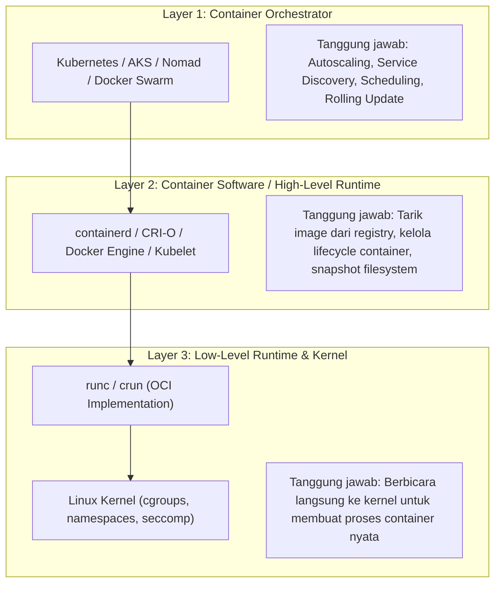
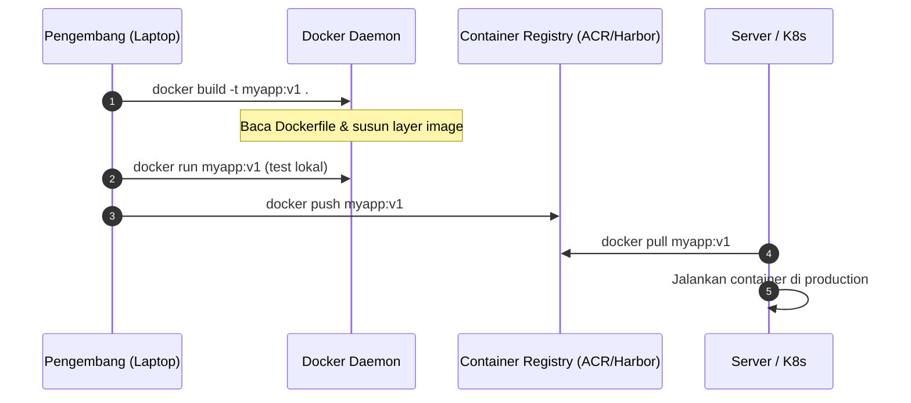
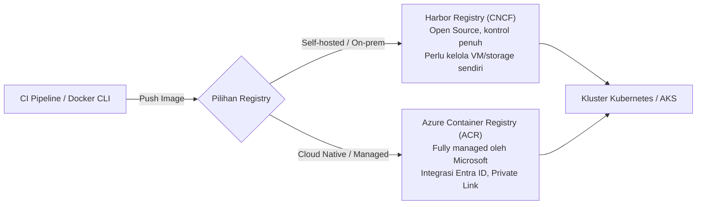

# Cloud Native Applications | Sesi 3: Containerizing Your Application – Part 2

> **Mata Kuliah:** COSC6105001 - Cloud Native Applications | **Sesi:** 3 | **Status:** Materi UTS
> **Sumber:** Slide dosen (COSC6105001), adaptasi Singh & Kehoe, *Cloud Native Infrastructure with Azure* (O'Reilly Media, 2022).

---

## 🔑 Cues

- Tiga lapisan abstraksi container: Orchestrator, Software, Runtime
- Perbedaan High-Level Runtime (containerd, CRI-O) vs Low-Level Runtime (runc)
- Spesifikasi Open Container Initiative (OCI): Image Spec & Runtime Spec
- Peran Docker dalam ekosistem: desktop-to-production pipeline
- Anatomi Dockerfile: FROM, WORKDIR, COPY, RUN, ENTRYPOINT, CMD
- Multistage build: strategi memperkecil ukuran image produksi
- Praktik terbaik Twelve-Factor App & prinsip stateless container
- Fungsi file `.dockerignore` dalam konteks build
- Alternatif runtime berisolasi ketat: Kata Containers (MicroVM)
- Kebutuhan Container Registry: replikasi, RBAC, vulnerability scan
- Harbor Registry (Open Source CNCF) vs Azure Container Registry (Managed)
- Tingkatan SKU Azure Container Registry (Basic, Standard, Premium)
- Azure Container Instances (ACI): serverless container tanpa kelola server

---

## 📖 Materi Utama

### 1. Tiga Lapisan Abstraksi Arsitektur Container

Ekosistem container modern tidak monolitik, melainkan terbagi rapi ke dalam tiga lapisan tanggung jawab teknis:



1. **Layer 1: Container Orchestrator (Tingkat Paling Atas)**
   - Bertugas mengelola ribuan container lintas banyak node/server fisik.
   - Mengatur autoscaling, *self-healing* (mengganti pod yang mati), penyeimbangan beban (*load balancing*), dan penemuan layanan (*service discovery*).
   - **Contoh:** Kubernetes, Azure Kubernetes Service (AKS), HashiCorp Nomad, Docker Swarm.

2. **Layer 2: Container Software / High-Level Runtime (Pengelola Siklus Hidup)**
   - Berada di bawah orkestrator; merespons perintah API untuk mengunduh (*pull*) image dari registry, membongkar layer filesystem, dan mengelola runtime plugin (jaringan CNI, storage CSI).
   - **Contoh:** `containerd` (dipakai oleh Docker & Kubernetes modern) dan `CRI-O` (runtime minimalis khusus Kubernetes).

3. **Layer 3: Low-Level Container Runtime (Eksekutor Nyata)**
   - Lapisan terbawah yang bertugas mengonfigurasi cgroups, namespaces, dan capabilities di kernel Linux, lalu menjalankan proses aplikasi.
   - **Contoh:** `runc` (implementasi standar OCI) dan `Kata Containers` (menggunakan microVM hypervisor untuk isolasi ekstra kuat).

### 2. Standar Open Container Initiative (OCI)

Sebelum 2015, ekosistem container terfragmentasi dan berisiko terkunci pada format Docker proprietary. OCI didirikan pada tahun 2015 oleh para pemimpin industri di bawah naungan Linux Foundation untuk menetapkan dua spesifikasi terbuka:

1. **OCI Image Specification (`image-spec`):**
   - Mendefinisikan format paket gambar container: susunan layer tarball, manifest sha256, arsitektur CPU (x86_64, arm64), variabel lingkungan, user, port yang diekspos, serta perintah default (`Entrypoint` & `Cmd`).
   - Image yang sesuai standar OCI dijamin dapat disimpan di registri mana pun dan dieksekusi di runtime OCI mana pun.
2. **OCI Runtime Specification (`runtime-spec`):**
   - Mendefinisikan format file konfigurasi runtime (`config.json`) yang mengatur isolasi proses: daftar namespace yang harus dibuat, batas cgroups, titik mount filesystem, dan aturan seccomp.

### 3. Docker: Platform Pengembang & Anatomi Dockerfile

Docker mempopulerkan filosofi *"Build, Ship, and Run"*. Docker mengemas aplikasi dan seluruh dependensinya di laptop pengembang sehingga berjalan identik di staging maupun production tanpa masalah *"it works on my machine"*.



#### **Anatomi Instruksi Dockerfile:**
- `FROM`: Menentukan base image sistem operasi atau runtime dasar (misal `node:22-alpine` atau `golang:1.24`).
- `WORKDIR`: Menetapkan direktori kerja aktif untuk instruksi berikutnya.
- `COPY`: Menyalin file atau folder dari konteks build lokal ke dalam filesystem container.
- `RUN`: Mengeksekusi perintah di dalam container saat proses pembuatan image (misal kompilasi atau instalasi paket `apt`/`npm`).
- `ENTRYPOINT`: Perintah biner tetap yang dieksekusi saat container pertama kali dinyalakan.
- `CMD`: Argumen default yang diteruskan ke `ENTRYPOINT` (bisa ditimpa saat `docker run`).
- `EXPOSE`: Dokumentasi port jaringan yang didengarkan oleh aplikasi.

#### **Multistage Build: Trik Efisiensi Gambar Produksi**
Multistage build memungkinkan pemisahan lingkungan kompilasi (*heavyweight*) dengan lingkungan eksekusi (*minimalist*):

```dockerfile
# Tahap 1: Builder (Memuat compiler Go, SDK, dan source code)
FROM golang:1.24-alpine AS builder
WORKDIR /app
COPY go.mod go.sum ./
RUN go mod download
COPY . .
RUN CGO_ENABLED=0 go build -ldflags="-s -w" -o server .

# Tahap 2: Runner (Image minimal tanpa compiler)
FROM alpine:3.20 AS runner
WORKDIR /root/
COPY --from=builder /app/server .
EXPOSE 8080
ENTRYPOINT ["./server"]
```
*Hasil:* Ukuran image berkurang drastis dari ~800MB (SDK Go) menjadi hanya ~15MB (Alpine + biner terkompilasi statis).

#### **Praktik Terbaik Docker:**
1. **Gunakan file `.dockerignore`:** Jangan masukkan folder `node_modules`, `.git`, file rahasia `.env`, atau log lokal ke dalam build context.
2. **Prinsip Twelve-Factor App (Stateless):** Container harus bersifat *ephemeral* (mudah dibuat, dimatikan, dan diganti). Jangan menyimpan data permanen di dalam disk lokal container; gunakan persistent volume atau cloud managed storage.

### 4. Container Registry: Harbor vs Azure Container Registry (ACR)

Setelah image dibangun, image harus disimpan di lokasi yang terpusat dan memiliki ketersediaan tinggi (*container registry*):



- **Fitur Wajib Registry Modern:**
  - *Vulnerability Scanning:* Memindai kerentanan CVE pada library/OS image secara otomatis.
  - *Image Signing (Notary/Cosign):* Memastikan image tidak dimanipulasi di tengah jalan.
  - *Role-Based Access Control (RBAC):* Pengaturan hak tarik (*pull*) dan unggah (*push*).
  - *Replication:* Replikasi image otomatis antar-region geografis.

| Parameter | Harbor Registry | Azure Container Registry (ACR) |
|---|---|---|
| **Tipe Layanan** | *Self-hosted* (Proyek Graduated CNCF) | *Managed Cloud Service* (PaaS) |
| **Beban Operasional** | Tim harus merawat VM, OS, backup, dan disk storage | Nol perawatan infrastruktur (dikelola Azure) |
| **Integrasi Cloud** | Bebas vendor, cocok untuk hybrid/on-premises | Terintegrasi erat dengan AKS, Entra ID, dan Managed Identity |
| **Model Biaya** | Gratis lisensi, bayar biaya server sendiri | Berlangganan bulanan berdasarkan SKU (Basic, Standard, Premium) |

### 5. Azure Container Instances (ACI): Serverless Container

ACI memungkinkan pengembang menjalankan container secara langsung di Azure tanpa perlu mengonfigurasi virtual machine atau memasang cluster Kubernetes:
- **Karakteristik ACI:**
  - Waktu startup super cepat (dalam hitungan detik).
  - Bayar per detik sesuai jumlah vCPU dan memori yang dialokasikan.
  - Cocok untuk pekerjaan berdurasi singkat (*batch jobs*, task cron bulanan, data processing, atau pengujian sementara).
  - **Batasan:** Maksimal 4 vCPU dan 16GB RAM per instance; bukan orkestrator penuh (tidak ada fitur auto-healing atau rolling update bawaan seperti Kubernetes).

---

## 🛠️ Use Case / Implementasi Nyata

- **Skenario:** Aplikasi gateway API Go yang memerlukan kompilasi native dan harus dideploy ke cloud dengan ukuran seminimal mungkin dan kepatuhan keamanan tinggi.
- **Solusi Arsitektur:**
  1. Pengembang menulis Dockerfile dengan pola *multistage build* (stage Go builder → stage distroless runner) menghasilkan image berukuran 22MB.
  2. Image di-push ke Azure Container Registry (ACR) tier Premium yang dilindungi Azure Private Link.
  3. ACR otomatis menjalankan pemindaian kerentanan CVE sebelum image diizinkan ditarik oleh kluster produksi.
  4. Workload batch pengujian tengah malam dieksekusi menggunakan Azure Container Instances (ACI) yang menyala selama 10 menit lalu mati otomatis, menghemat 95% biaya operasional VM yang menyala 24/7.

---

## 🗂️ Konsep Kunci

| Istilah | Definisi | Contoh / Catatan |
|---|---|---|
| OCI | Open Container Initiative; konsorsium penyusun standar format image dan runtime | Standar image-spec & runtime-spec |
| containerd | High-level container runtime yang mengelola lifecycle container dan transfer image | Runtime bawaan Docker dan Kubernetes |
| runc | Low-level CLI runtime resmi OCI untuk spawning dan running container sesuai spec | Pemanggil langsung kernel Linux |
| Multistage Build | Teknik Dockerfile yang menggunakan beberapa tahap `FROM` untuk membuang dependensi build | Builder stage Go → scratch/alpine runner |
| .dockerignore | File konfigurasi pengecualian file/folder dari konteks build Docker | Mengecualikan `.git` dan `node_modules` |
| Container Registry | Layanan penyimpanan dan distribusi container image | Harbor, Docker Hub, ACR |
| ACI | Azure Container Instances; layanan serverless container milik Microsoft Azure | Deploy container tanpa kelola node VM |
| Kata Containers | Runtime container yang mengisolasi setiap workload dalam lightweight VM (microVM) | Isolasi keamanan tingkat hardware |

---

## 📊 Tabel Ringkasan

**Perbandingan Runtime Container**

| Runtime | Kategori | Fitur Unggulan | Digunakan Oleh |
|---|---|---|---|
| **containerd** | High-Level | Sangat stabil, efisien, mendukung snapshot filesystem | Docker Engine, AKS, EKS |
| **CRI-O** | High-Level | Sangat ramping, dirancang murni khusus Kubernetes CRI | Red Hat OpenShift, Kubernetes vanilla |
| **runc** | Low-Level | Implementasi referensi resmi OCI, berbicara langsung ke kernel | containerd, CRI-O, Docker |
| **Kata Containers** | Low-Level / MicroVM | Kernel tamu khusus per container, keamanan setara VM | Workload untrusted / multi-tenant ketat |

**Perbandingan SKU Azure Container Registry (ACR)**

| Fitur | Basic SKU | Standard SKU | Premium SKU |
|---|---|---|---|
| **Kapasitas Penyimpanan** | 10 GB | 100 GB | 500 GB |
| **Throughput Jaringan** | Standar (cukup untuk dev/test) | Tinggi | Sangat Tinggi |
| **Geo-Replication** | Tidak didukung | Tidak didukung | Didukung (multi-region otomatis) |
| **Private Link & VNet** | Tidak didukung | Tidak didukung | Didukung (akses privat tanpa internet) |
| **Customer-Managed Key** | Tidak didukung | Tidak didukung | Didukung (enkripsi kunci mandiri) |

---

## ⚠️ Catatan Penting

> **Docker ≠ containerd.** Sejak rilis Kubernetes 1.20 dan penghentian penuh di 1.24 (Docker deprecation / dockershim removal), Kubernetes tidak lagi berkomunikasi langsung dengan Docker daemon, melainkan berbicara langsung ke `containerd` atau `CRI-O` melalui protokol Container Runtime Interface (CRI).
>
> **Urutan layer Dockerfile menentukan cache build.** Docker mengeksekusi instruksi dari atas ke bawah dan meng-cache setiap layer. Letakkan instruksi yang jarang berubah (seperti `COPY package.json` dan instalasi dependensi) di baris atas, dan letakkan instruksi yang sering berubah (`COPY . .` untuk source code) di baris bawah agar build berikutnya jauh lebih cepat.
>
> **ACI bukan pengganti Kubernetes.** ACI sangat ideal untuk container tunggal yang berdiri sendiri (*standalone task*). Jika aplikasi Anda memiliki puluhan service yang saling berkomunikasi, membutuhkan service discovery DNS internal, ingress routing, dan complex rolling update, gunakan AKS (Kubernetes), bukan ACI.

---

## 📝 Materi Tambahan (Visual Insights)

- **Pembagian Tugas 3 Lapisan saat `docker run`:**
  1. Pengembang mengetik `docker run` → Docker CLI mengirim perintah ke `containerd` (High-Level).
  2. `containerd` mengunduh image dari registry jika belum ada, lalu menyiapkan bundle direktori rootfs.
  3. `containerd` memanggil `runc` (Low-Level) untuk berinteraksi dengan kernel Linux (membuat namespace, mengunci cgroup, dan menjalankan proses aplikasi).
  4. Setelah proses aplikasi berjalan, `runc` langsung keluar (*exit*), meninggalkan proses container diawasi oleh `containerd-shim`.
- **Referensi Buku:** Singh, N., & Kehoe, M. (2022). *Cloud Native Infrastructure with Azure*. O’Reilly Media.
