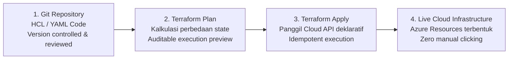
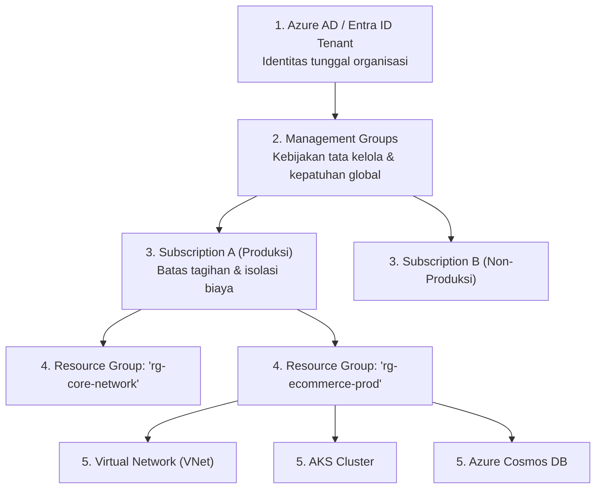
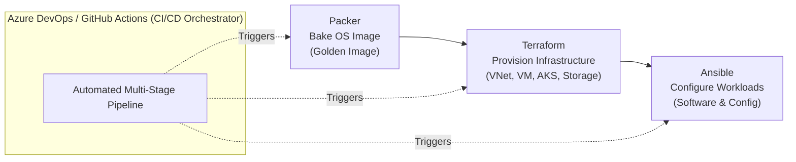

# Cloud Native Applications | Sesi 4: Infrastructure as Code

> **Mata Kuliah:** COSC6105001 - Cloud Native Applications | **Sesi:** 4 | **Status:** Materi UTS
> **Sumber:** Slide dosen (COSC6105001), adaptasi Singh & Kehoe, *Cloud Native Infrastructure with Azure* (O'Reilly Media, 2022).

---

## 🔑 Cues

- Masalah provisioning manual: "Clicking doesn't scale" & configuration drift
- Definisi Infrastructure as Code (IaC) dan prinsip software engineering
- Karakteristik penting IaC: Idempotensi dan deklaratif vs imperatif
- Filosofi infrastruktur cloud native: berumur pendek (*disposable / cattle*)
- Mutable vs Immutable Infrastructure
- Hierarki tata kelola Microsoft Azure: Tenant, Subscription, Resource Group, Resource
- Peran Region dan Availability Zones dalam resiliensi data center
- Azure Resource Manager (ARM) Templates vs Terraform
- HashiCorp Configuration Language (HCL) & sifat cloud-agnostic Terraform
- Konsep inti Terraform: Provider, Plan, Apply, State, Module, Backend
- Alur kerja standar Terraform: init, plan, apply, destroy
- Urgensi State File dan penyimpanan Remote Backend (Azure Blob Storage)
- Packer: pembuatan image mesin virtual prebaked (*immutable machine image*)
- Ansible: manajemen konfigurasi server tanpa agen (*agentless via SSH & Python*)
- Integrasi rantai alat (*toolchain*): Terraform + Packer + Ansible + Azure DevOps

---

## 📖 Materi Utama

### 1. The Problem: "Clicking Doesn't Scale"

Di era cloud, organisasi dapat mengakses ratusan layanan komputasi dengan mudah. Namun, mengonfigurasi infrastruktur dengan mengklik antarmuka web konsol (*GUI Portal*) membawa bahaya besar:
- **Tidak dapat direproduksi (*unrepeatable*):** Sangat sulit membuat ulang dua lingkungan (misal *staging* dan *production*) yang 100% identik hanya dengan ingatan manusia.
- **Rentan kesalahan manusia (*error-prone*):** Satu salah centang pada konfigurasi firewall atau subnet dapat menyebabkan celah keamanan fatal atau *downtime*.
- **Ketergantungan orang (*single point of failure*):** Sering kali hanya ada "satu orang teknisi senior" yang tahu cara memasang sistem.
- **Lambat dan memakan biaya:** Waktu pemulihan saat bencana (*MTTR - Mean Time to Recover*) menjadi sangat panjang.

**Solusinya:** *Infrastructure as Code (IaC)* — filosofi memperlakukan definisi infrastruktur selayaknya kode sumber aplikasi: disimpan dalam version control (Git), dapat diuji, dapat ditinjau ulang (*peer review*), dan dieksekusi secara otomatis.

### 2. Prinsip Inti IaC & Filosofi Cloud Native

1. **Idempotensi (*Idempotence*):**
   - Menjalankan template IaC yang sama berulang kali akan selalu menghasilkan kondisi akhir (*desired state*) yang persis sama tanpa merusak infrastruktur yang sudah sesuai.
2. **Infrastruktur Antifragile:**
   - Sistem tidak hanya bertahan dari gangguan, tetapi mampu kembali pulih dan beradaptasi saat menerima stres lonjakan beban kerja.
3. **Infrastruktur Sekali Pakai (*Short-Lived / Cattle, Not Pets*):**
   - Dalam arsitektur cloud native, infrastruktur tidak boleh dirawat seperti "hewan peliharaan kesayangan" (*pets*) yang terus diperbaiki saat sakit.
   - Jika satu server bermasalah, matikan dan buat baru secara instan (*cattle*) menggunakan template kode yang telah teruji.

### 3. Mutable vs. Immutable Infrastructure

```mermaid
graph TD
    subgraph Mutable ["Mutable Infrastructure (Tradisional)"]
        M1["Provision VM mentah"] --> M2["Deploy kode aplikasi"]
        M2 --> M3["Patch & update OS langsung di server hidup"]
        M3 --> M4["Akibat: Configuration Drift<br/>(Server perlahan menyimpang dari standar)"]
    end

    subgraph Immutable ["Immutable Infrastructure (Cloud Native)"]
        I1["Bake Machine Image dengan Packer"] --> I2["Deploy VM dari Image utuh via Terraform"]
        I2 --> I3["Ada update baru?"]
        I3 --> I4["Hancurkan VM lama & buat VM baru dari image terupdate"]
        I4 --> I5["Hasil: Sistem selalu dapat diprediksi & nol drift"]
    end
```

- **Mutable:** Konfigurasi diubah langsung pada server yang sedang aktif. Seiring berjalannya waktu, konfigurasi antar-server menyimpang (*configuration drift*).
- **Immutable:** Server yang sudah dideploy **tidak pernah disentuh atau dimodifikasi**. Pembaruan dilakukan dengan membuat image mesin baru, mendeploy instance baru, lalu mematikan instance lama secara atomik.

### 4. Fondasi Arsitektur Lingkungan Microsoft Azure

Sebelum mengotomasi infrastruktur Azure dengan IaC, wajib memahami hierarki kepemilikan dan batas tata kelola:

- **Tenant:** Identitas unik organisasi di Azure Active Directory (Entra ID).
- **Subscription:** Kontainer batas penagihan (*billing container*) dan kuota resource.
- **Management Group:** Mengelompokkan beberapa subscription untuk menerapkan *policy* kepatuhan organisasi secara terpusat.
- **Resource Group:** Kontainer logis yang mengelompokkan resource terkait dalam satu siklus hidup proyek/aplikasi.
- **Region & Availability Zones:** Region adalah area geografis yang memuat minimal 2 atau lebih *Availability Zones* (data center independen yang terpisah secara fisik dengan pasokan daya, pendingin, dan jaringan tersendiri).

### 5. Terraform: IaC Deklaratif Cloud-Agnostic

Terraform dari HashiCorp adalah alat IaC terpopuler di dunia yang ditulis dalam bahasa Go. Bersifat **deklaratif** (pengguna menyatakan *apa yang diinginkan*, bukan langkah-langkah *bagaimana membuatnya*) dan menggunakan sintaks HCL (*HashiCorp Configuration Language*).

#### **Konsep Inti Terraform:**
- **Provider:** Plugin yang menghubungkan Terraform dengan API penyedia cloud (contoh: `provider "azurerm"`).
- **State (`terraform.tfstate`):** File basis data lokal/remote yang mencatat pemetaan antara kode HCL dan resource nyata yang ada di cloud.
- **Backend:** Lokasi penyimpanan file state. Di lingkungan tim produksi, file state **wajib disimpan di remote storage** (seperti Azure Blob Storage) dengan fitur penguncian state (*state locking*) agar tidak terjadi konflik perubahan secara paralel.
- **Module:** Kumpulan resource yang dibungkus agar dapat digunakan kembali (*reusable*), menerapkan prinsip DRY (*Don't Repeat Yourself*).

#### **Alur Kerja Standar Terraform:**
1. `terraform init` — Menginisialisasi direktori kerja, mengunduh plugin provider, dan mengonfigurasi backend.
2. `terraform plan` — Melakukan simulasi *dry-run*; menampilkan preview akurat resource apa yang akan dibuat (+), diubah (~), atau dihancurkan (-).
3. `terraform apply` — Mengeksekusi perubahan ke API cloud nyata setelah konfirmasi eksplisit (`yes`).
4. `terraform destroy` — Menghapus seluruh resource yang terdaftar di dalam state file (pembersihan lingkungan).

### 6. Rantai Alat Lengkap: Terraform + Packer + Ansible + Azure DevOps

Keempat alat ini tidak saling bersaing, melainkan saling melengkapi dalam pipeline orkestrasi otomatis:

1. **Packer:** Membangun *machine image* (VHD/AMI) yang sudah memuat paket software dasar sehingga siap pakai (*prebaked*).
2. **Terraform:** Membangun infrastruktur jaringan dan komputasi yang menampung image tersebut.
3. **Ansible:** Alat manajemen konfigurasi *agentless* (hanya butuh SSH dan Python) untuk melakukan *tuning* akhir aplikasi jika diperlukan.
4. **Azure DevOps / GitHub Actions:** Mengorkestrasi seluruh tahapan ini ke dalam pipeline integrasi dan pengiriman berkelanjutan (CI/CD).

---

## 🛠️ Use Case / Implementasi Nyata

- **Skenario:** Tim engineering perlu menyiapkan lingkungan uji beban (*load testing*) yang terdiri dari 1 virtual network, 3 subnet, 1 kluster Kubernetes privat, dan 1 instance database di Microsoft Azure region Southeast Asia. Lingkungan ini hanya digunakan selama 6 jam setiap hari Jumat.
- **Masalah yang Diatasi:** Jika dibuat manual via Azure Portal, teknisi membutuhkan waktu 4 jam untuk mengonfigurasi ratusan parameter jaringan, dan sering lupa mematikan resource sehingga biaya tagihan cloud membengkak saat akhir pekan.
- **Keuntungan Pendekatan IaC:**
  - Seluruh konfigurasi ditulis dalam satu modul Terraform (`main.tf`).
  - Eksekusi `terraform apply -auto-approve` via pipeline Azure DevOps menyiapkan seluruh lingkungan dalam waktu 12 menit secara otomatis pada Jumat pagi.
  - Pada Jumat sore, pipeline otomatis menjalankan `terraform destroy` untuk membersihkan seluruh resource hingga nol tagihan saat akhir pekan.

---

## 🗂️ Konsep Kunci

| Istilah | Definisi | Contoh / Catatan |
|---|---|---|
| IaC | Praktik mengelola dan memprovisi infrastruktur komputasi melalui kode deklaratif | File `.tf` atau template ARM |
| Idempotence | Sifat operasi yang memberikan hasil akhir yang sama meskipun dieksekusi berulang kali | Menjalankan `terraform apply` 10 kali tanpa perubahan |
| Configuration Drift | Perbedaan yang terjadi antara kondisi infrastruktur nyata dengan kode yang dideklarasikan | Modifikasi manual port firewall di portal |
| Immutable Infra | Paradigma di mana server tidak pernah diubah setelah dideploy; hanya diganti utuh | Pola deploy AMI / VHD baru |
| Terraform State | File catatan mapping antara resource di kode HCL dan resource nyata di cloud | `terraform.tfstate` |
| Remote Backend | Penyimpanan state file terpusat yang mendukung penguncian (*locking*) dan kolaborasi | Azure Blob Storage container |
| Packer | Alat pembuat machine image identik untuk berbagai platform komputasi | HashiCorp Packer JSON/HCL |
| Ansible | Alat otomasi dan manajemen konfigurasi server tanpa agen | Playbook berbasis file YAML |

---

## 📊 Tabel Ringkasan

**Perbandingan Alat dalam Rantai Ekosistem IaC**

| Alat | Pengembang | Kategori Utama | Mekanisme Kerja | Bahasa Definisi |
|---|---|---|---|---|
| **Terraform** | HashiCorp | *Infrastructure Provisioning* | Deklaratif (State-driven) | HCL / JSON |
| **ARM / Bicep** | Microsoft | *Azure Native Provisioning* | Deklaratif (Azure-only) | JSON (ARM) / Bicep |
| **Packer** | HashiCorp | *Machine Image Builder* | Otomasi build image VM | HCL / JSON |
| **Ansible** | Red Hat | *Configuration Management* | Prosedural / Idempoten (Agentless via SSH) | YAML |
| **Azure Pipelines**| Microsoft | *CI/CD Orchestration* | Task-driven pipeline automation | YAML |

---

## ⚠️ Catatan Penting

> **JANGAN PERNAH commit file `terraform.tfstate` ke Git!** File state sering kali memuat rahasia (*secrets*) dalam teks polos (*plaintext*), seperti password database, sertifikat TLS, dan *connection strings*. Simpan state selalu di backend privat terenkripsi.
>
> **Deklaratif vs Imperatif:** Pendekatan imperatif (seperti Bash script atau CLI) memberi tahu sistem *langkah demi langkah bagaimana cara membuat sesuatu*, sedangkan pendekatan deklaratif (Terraform/ARM) memberi tahu sistem *kondisi akhir apa yang diinginkan*. Pendekatan deklaratif jauh lebih aman terhadap kegagalan parsial di tengah jalan.
>
> **Resource Group bukan batas keamanan jaringan.** Resource yang berada dalam satu resource group tidak otomatis dapat saling berkomunikasi jika tidak berada di dalam Virtual Network (VNet) atau subnet yang sama dengan konfigurasi Network Security Group (NSG) yang mengizinkannya.

---

## 📝 Materi Tambahan (Visual Insights)

- **Hierarki Pewarisan Azure Policy:** Kebijakan kepatuhan (*governance policies*) dan kontrol akses (*RBAC roles*) yang ditetapkan pada level Root Management Group otomatis diwariskan ke bawah ke seluruh Subscription, Resource Group, dan Resources individual di bawahnya.
- **Pentingnya State Locking:** Ketika dua anggota tim mengeksekusi `terraform apply` secara bersamaan tanpa mekanisme *state locking* di backend remote, file state dapat mengalami *race condition* dan korupsi permanen.
- **Referensi Buku:** Singh, N., & Kehoe, M. (2022). *Cloud Native Infrastructure with Azure*. O’Reilly Media.
