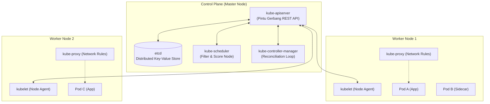
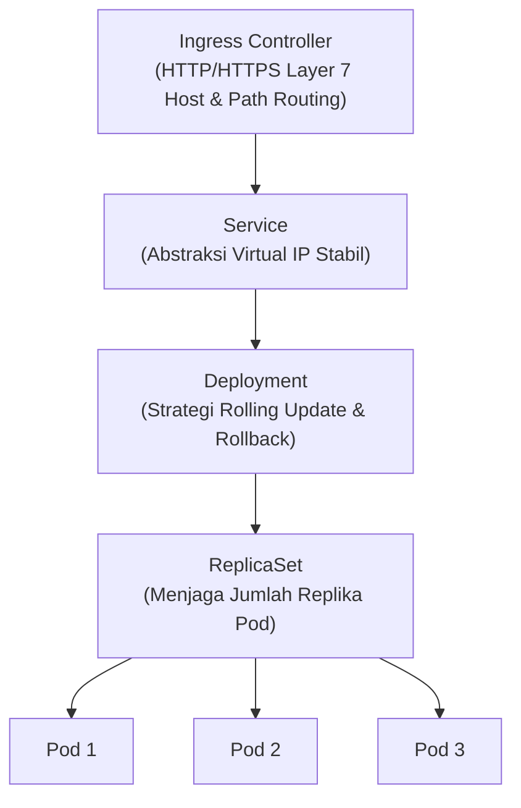

# Cloud Native Applications | Sesi 5: Kubernetes: The Grand Orchestrator

> **Mata Kuliah:** COSC6105001 - Cloud Native Applications | **Sesi:** 5 | **Status:** Materi UTS
> **Sumber:** Slide dosen (COSC6105001), adaptasi Singh & Kehoe, *Cloud Native Infrastructure with Azure* (O'Reilly Media, 2022).

---

## 🔑 Cues

- Mengapa container butuh orkestrator: kompleksitas microservices berskala besar
- Sejarah Kubernetes: Google Borg (2014) dan donasi ke CNCF (2015)
- Fitur bawaan K8s: self-healing, service discovery, load balancing, bin packing
- Arsitektur Control Plane ("Otak") vs Worker Node ("Otot")
- Peran kube-apiserver sebagai pintu gerbang REST API tunggal
- kube-scheduler: proses filtering dan scoring penempatan pod
- kube-controller-manager dan konsep *reconciliation loop*
- etcd: distributed key-value store berbasis konsensus Raft
- Komponen Worker Node: kubelet, kube-proxy, container runtime
- Objek Pod: unit komputasi terkecil dan pola sidecar container
- Tiga jenis pemeriksaan kesehatan Pod: liveness, readiness, startup probe
- Peran ReplicaSet vs Deployment dalam pembaruan bertahap (*rolling update*)
- Jenis Kubernetes Service: ClusterIP, NodePort, LoadBalancer, ExternalName
- Ingress Controller: perutean Layer 7 (HTTP/HTTPS) dan terminasi SSL/TLS
- Objek K8s lainnya: DaemonSet, StatefulSet, Job, CronJob, HPA

---

## 📖 Materi Utama

### 1. Mengapa Kita Membutuhkan Orkestrator?

Peralihan dari monolitik ke microservices menyelesaikan masalah independensi pengembangan modul, namun melahirkan tantangan baru yang rumit:
- Siapa yang memutuskan container berjalan di server mana?
- Apa yang terjadi jika server fisik mati mendadak saat jam sibuk?
- Bagaimana ratusan container saling menemukan alamat IP rekannya saat IP berubah-ubah (*ephemeral*)?
- Bagaimana cara merilis pembaruan versi baru tanpa menghentikan layanan sama sekali (*zero-downtime*)?

Container biasa (seperti Docker standalone) tidak mampu menjawab pertanyaan tersebut. Di sinilah **orkestrator container** berperan: sistem terdistribusi yang mengelola siklus hidup penuh container mulai dari penjadwalan, penyeimbangan beban, skalabilitas otomatis, hingga pemantauan kesehatan.

Kubernetes (K8s) dirilis oleh Google pada tahun 2014 berdasarkan pengalaman 10 tahun menjalankan sistem kluster internal mereka, **Borg**. Pada tahun 2015, Google mendonasikan Kubernetes ke CNCF sebagai proyek lulusan (*graduated project*) pertama.

### 2. Arsitektur Kluster Kubernetes

Kluster Kubernetes terbagi secara tegas menjadi dua bagian: **Control Plane** (pengambil keputusan) dan **Worker Nodes** (pengeksekusi beban kerja).

#### **A. Komponen Control Plane**
1. **`kube-apiserver` (API Server):**
   - Komponen terdepan dan satu-satunya yang berkomunikasi langsung dengan `etcd`.
   - Mengekspos antarmuka HTTP REST API untuk seluruh klien (`kubectl`, pipeline CI/CD, kontroler, hingga kubelet).
2. **`kube-scheduler` (Penjadwal):**
   - Mengamati pod baru yang belum memiliki node penugasan.
   - Melakukan dua tahap pemilihan:
     - *Filtering:* Mengeliminasi node yang tidak memenuhi syarat (misal memori kurang atau port bentrok).
     - *Scoring:* Memberi skor pada node yang tersisa berdasarkan efisiensi resource. Node dengan skor tertinggi dipilih (*binding*).
3. **`kube-controller-manager` (Manajer Kontroler):**
   - Menjalankan loop rekonsiliasi (*reconciliation loop*) terus-menerus: membandingkan kondisi riil (*actual state*) dengan kondisi yang dideklarasikan (*desired state*).
   - Membundel Node Controller, ReplicaSet Controller, Endpoint Controller, dan Service Account Controller.
4. **`etcd` (Database Kluster):**
   - Basis data *key-value* terdistribusi yang sangat konsisten, menggunakan algoritma konsensus Raft.
   - Menyimpan seluruh status konfigurasi dan objek kluster. Selalu dideploy dalam jumlah ganjil (3 atau 5 node) untuk mencegah *split-brain*.

#### **B. Komponen Worker Node**
1. **`kubelet`:** Agen yang berjalan di setiap worker node. Bertugas memastikan container yang didefinisikan dalam PodSpec benar-benar berjalan dan sehat, serta mengeksekusi pemeriksaan kesehatan (*health probes*).
2. **`kube-proxy`:** Mengelola aturan iptables/IPVS pada jaringan node untuk meneruskan lalu lintas dari virtual IP milik *Service* ke Pod tujuan yang tepat.
3. **Container Runtime:** Mesin yang mengeksekusi container (seperti `containerd` atau `CRI-O`).

### 3. Objek-Objek Inti API Kubernetes

#### **1. Pods**
- Unit terkecil dan paling mendasar di Kubernetes.
- Merupakan kelompok dari satu atau lebih container yang berbagi ruang alamat IP jaringan yang sama (*localhost*), ruang penyimpanan (*volumes*), dan namespace IPC.
- Bersifat fana (*ephemeral*): jika sebuah Pod mati, Pod tersebut tidak dibangkitkan ulang dengan identitas yang sama, melainkan digantikan oleh Pod baru dengan IP baru.
- **Pola Sidecar:** Menjalankan container pembantu di samping container utama dalam satu Pod (misal container logging Fluentd yang membaca file log aplikasi utama).

#### **2. Health Checks (Probes Kubelet)**
- **Liveness Probe:** Memeriksa apakah aplikasi masih hidup. Jika gagal, kubelet akan membunuh dan merestart container tersebut.
- **Readiness Probe:** Memeriksa apakah aplikasi sudah siap melayani lalu lintas. Jika gagal, Pod sementara waktu dikeluarkan dari daftar endpoint *Service* agar tidak menerima request pengguna.
- **Startup Probe:** Memberikan waktu tambahan bagi aplikasi lawas yang butuh waktu inisialisasi lambat sebelum liveness probe mulai aktif.

#### **3. ReplicaSet & Deployment**
- **ReplicaSet:** Memastikan sejumlah target replika Pod selalu berjalan pada saat tertentu menggunakan *label selector*.
- **Deployment:** Lapisan abstraksi di atas ReplicaSet yang menambahkan kemampuan **Rolling Update** tanpa downtime.
  - Pengaturan default: `maxUnavailable` 25% dan `maxSurge` 25%. Artinya, minimal 75% kapasitas aplikasi selalu siap melayani pengguna selama proses pembaruan versi berlangsung.

#### **4. Services: Menjaga Stabilitas Jaringan**
Karena IP Pod selalu berubah-ubah, Service hadir memberikan alamat IP virtual (*ClusterIP*) dan nama DNS yang stabil:
- **`ClusterIP` (Default):** Layanan hanya dapat diakses dari dalam kluster internal.
- **`NodePort`:** Membuka port statis pada setiap worker node (rentang 30000–32767).
- **`LoadBalancer`:** Secara otomatis meminta penyedia cloud untuk membuat load balancer eksternal (misal *Azure Load Balancer* publik).
- **`ExternalName`:** Memetakan nama service ke CNAME DNS eksternal (misal database managed di luar kluster).

#### **5. Ingress Controller: Pintu Gerbang Layer 7**
Membuka setiap service dengan `LoadBalancer` di cloud sangat mahal dan sulit dikelola. **Ingress** menyediakan titik masuk tunggal yang melakukan perutean Layer 7 (HTTP/HTTPS) berdasarkan domain (*host-based routing*) atau path URL (*path-based routing*), sekaligus menangani enkripsi sertifikat SSL/TLS di satu tempat terpusat.

---

## 🛠️ Use Case / Implementasi Nyata

- **Skenario:** Aplikasi fintech pembayaran memproses transaksi perbankan. Pada jam gajian (tanggal 25), beban request meningkat 500% dan tim merilis pembaruan patch keamanan mendesak di tengah hari.
- **Solusi Kubernetes:**
  1. *Horizontal Pod Autoscaler (HPA)* otomatis menambah replika Pod dari 5 menjadi 25 berdasarkan metrik utilisasi CPU dan memori.
  2. Saat patch keamanan dideploy, objek *Deployment* melakukan *rolling update*. Versi baru diuji oleh *readiness probe* sebelum menerima transaksi nyata.
  3. *Ingress Controller* merutekan request pengguna secara mulus tanpa ada koneksi yang terputus (*zero-downtime*).
  4. Jika salah satu node fisik meledak di data center, *Node Controller* mendeteksinya dalam beberapa detik dan *kube-scheduler* otomatis memindahkan Pod yang terdampak ke node lain yang sehat (*self-healing*).

---

## 🗂️ Konsep Kunci

| Istilah | Definisi | Contoh / Catatan |
|---|---|---|
| Control Plane | Kumpulan komponen master yang mengatur status global kluster | API server, scheduler, controller, etcd |
| kubelet | Agen utama per node yang memastikan container berjalan sesuai PodSpec | Memeriksa liveness/readiness probe |
| kube-proxy | Komponen jaringan node yang memelihara aturan routing virtual IP | Manajemen iptables / IPVS rules |
| Pod | Unit komputasi terkecil yang memuat 1 atau lebih container terikat erat | Container app + logging sidecar |
| Ingress | Objek API yang mengelola akses eksternal Layer 7 ke service di kluster | Routing `api.domain.com` vs `web.domain.com` |
| Reconciliation Loop | Proses terus-menerus yang menyamakan kondisi nyata dengan kondisi harapan | Siklus kerja controller-manager |
| Sidecar Pattern | Pola menambahkan container pendukung ke dalam Pod yang sama | Proxy mTLS Envoy di service mesh |
| Headless Service | Service tanpa ClusterIP (`clusterIP: None`) untuk identitas direct DNS Pod | Digunakan pada StatefulSet database |

---

## 📊 Tabel Ringkasan

**Perbandingan Peran Komponen Control Plane vs Worker Node**

| Parameter | Control Plane (Master) | Worker Node |
|---|---|---|
| **Peran Utama** | Pengambil keputusan (*Brain*) | Pengeksekusi aplikasi (*Muscle*) |
| **Komponen Inti** | `kube-apiserver`, `scheduler`, `controller`, `etcd` | `kubelet`, `kube-proxy`, `container runtime` |
| **Menjalankan Kode Pengguna?**| Tidak pernah | Ya, di dalam Pod |
| **Dampak Kegagalan** | Penjadwalan & self-healing tertunda sementara; workload yang sedang berjalan tetap hidup | Pod di node tersebut mati; dijadwalkan ulang ke node lain |
| **Tanggung Jawab di Managed AKS**| 100% dikelola dan dijamin SLA oleh Microsoft Azure | Dikelola pengguna (pemilihan ukuran VM node pool) |

**Tipe Pemeriksaan Kesehatan Pod (Probes)**

| Jenis Probe | Kapan Diperiksa? | Apa yang Terjadi Jika Gagal? | Penggunaan Khas |
|---|---|---|---|
| **Startup Probe** | Saat inisialisasi awal | Container dimatikan & direstart | Aplikasi Java/Spring yang boot lambat |
| **Liveness Probe** | Sepanjang siklus hidup | Container dibunuh & dibuat ulang | Mendeteksi deadlock atau freeze |
| **Readiness Probe** | Sepanjang siklus hidup | Pod dicabut dari load balancer Service | Menunggu cache warming atau koneksi DB |

---

## ⚠️ Catatan Penting

> **Pod bersifat fana (*ephemeral*).** Jangan pernah menyimpan data persisten di dalam direktori internal Pod tanpa me-mount Persistent Volume (PV). Setiap kali Pod mati atau dijadwalkan ulang, perubahan disk lokal Pod akan hilang permanen.
>
> **Liveness Probe yang salah setting dapat memicu *restart loop* mematikan.** Jika endpoint liveness probe memeriksa koneksi database eksternal dan database tersebut sedang lambat, kubelet akan merestart semua Pod aplikasi secara serentak, memperparah pemadaman (*cascading failure*). Liveness probe sebaiknya hanya memeriksa kesehatan internal proses aplikasi itu sendiri.
>
> **Deployment mengelola ReplicaSet, bukan Pod langsung.** Jangan pernah mengedit atau mengubah konfigurasi ReplicaSet secara manual jika Pod dibuat oleh objek Deployment; ubahlah selalu manifest Deployment agar rekonsiliasi berjalan sesuai alur.

---

## 📝 Materi Tambahan (Visual Insights)

- **Objek Khusus Lainnya di Kubernetes:**
  - *DaemonSet:* Memastikan tepat satu Pod berjalan di setiap node kluster (standar untuk agent pemantauan seperti Prometheus node-exporter atau Fluentd).
  - *StatefulSet:* Digunakan untuk aplikasi stateful (seperti PostgreSQL, Kafka, Cassandra) yang membutuhkan identitas jaringan persisten (`pod-0`, `pod-1`) dan volume penyimpanan unik yang tidak boleh tertukar.
  - *Job & CronJob:* Menjalankan beban kerja komputasi batch yang berhenti saat selesai (*run-to-completion*), bukan service yang menyala terus-menerus.
- **Referensi Buku:** Singh, N., & Kehoe, M. (2022). *Cloud Native Infrastructure with Azure*. O’Reilly Media.
