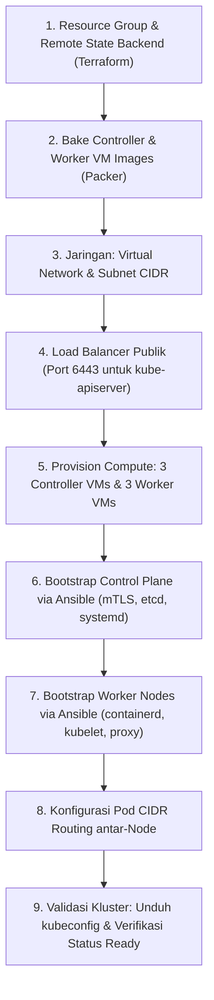
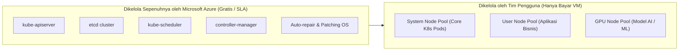
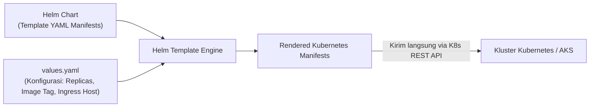

# Cloud Native Applications | Sesi 6: Creating a Kubernetes Cluster in the Cloud

> **Mata Kuliah:** COSC6105001 - Cloud Native Applications | **Sesi:** 6 | **Status:** Materi UTS
> **Sumber:** Slide dosen (COSC6105001), adaptasi Singh & Kehoe, *Cloud Native Infrastructure with Azure* (O'Reilly Media, 2022).

---

## 🔑 Cues

- Alasan membangun kluster manual ("The Hard Way"): pemahaman internal & kepatuhan regulasi
- Lanskap alat otomasi: kubeadm, kops, Kubespray, Rancher
- Pipeline 9 langkah pembuatan kluster Kubernetes manual dari nol
- Peran Packer dalam pembuatan *controller-image* dan *worker-image*
- Perbedaan VNet CIDR (Node IP) dan Pod CIDR (Container IP)
- Mutual TLS (mTLS) antar-komponen K8s dan enkripsi rahasia di etcd (*encryption-at-rest*)
- Keterbatasan kluster manual: rotasi sertifikat, upgrade cluster, dan *operational toil*
- Konsep Azure Kubernetes Service (AKS): *Managed Control Plane*
- Keuntungan operasional AKS: integrasi Entra ID, Azure Monitor, dan storage native
- Pemisahan Node Pools: System Pool vs User Pool vs GPU Pool
- Perbedaan Cluster Autoscaler (skala Node VM) vs Horizontal Pod Autoscaler (skala Pod)
- Masalah ledakan konfigurasi YAML (*configuration sprawl*) dan solusi Helm
- Komponen inti Helm: Chart, Repository, Values, dan Release
- Evolusi arsitektur Helm v2 ke v3: Penghapusan Tiller demi prinsip *Least Privilege*

---

## 📖 Materi Utama

### 1. Mengapa Membangun Kluster "The Hard Way"?

Di era cloud, layanan terkelola (*managed Kubernetes*) seperti AKS, EKS, dan GKE sudah tersedia dengan satu klik. Namun, ada tiga alasan penting mengapa engineer perlu memahami pembuatan kluster manual dari nol:
1. **Pemahaman Internal yang Mendalam:** Saat kluster produksi mengalami kerusakan fatal (misal *etcd split-brain*, kegagalan sertifikat TLS, atau masalah routing CNI), engineer yang memahami arsitektur internal tahu persis komponen apa yang rusak di balik abstraksi.
2. **Lingkungan Khusus & Regulasi Ketat:** Lingkungan *air-gapped* (jaringan militer/perbankan tanpa akses internet publik) atau data center on-premises sering kali tidak memiliki akses ke layanan managed cloud.
3. **Independensi Vendor:** Menghindari ketergantungan mutlak pada ekosistem proprietary satu penyedia cloud.

### 2. Alur 9 Langkah Membangun Kluster Manual (The Full Pipeline)



#### **Rincian Teknis Tiap Langkah:**
1. **Foundation (Terraform):** Membuat Resource Group Azure dan Azure Storage Account sebagai *remote state backend* yang mendukung *state locking*.
2. **Immutable Machine Images (Packer):** Membangun dua image terpisah:
   - *controller-image:* OS Ubuntu dasar + paket etcd dan biner control plane.
   - *worker-image:* OS dasar + container runtime (`containerd`) dan dependensi kernel.
3. **Jaringan VNet:** Menetapkan blok IP jaringan untuk node fisik/VM (misal `10.240.0.0/24`).
4. **Load Balancer Kontrol:** Menyediakan satu IP publik stabil yang mendengarkan port `6443` dan mendistribusikan lalu lintas ke ketiga controller VM.
5. **Provisioning VM:** Terraform meluncurkan VM dengan melampirkan image hasil build Packer ke subnet yang sudah dibuat.
6. **Bootstrap Control Plane (Ansible):**
   - Membuat sertifikat PKI mTLS menggunakan `cfssl` agar semua komponen saling memverifikasi identitas.
   - Menginisialisasi kluster `etcd` 3 node.
   - Menjalankan `kube-apiserver`, `kube-scheduler`, dan `kube-controller-manager` sebagai *systemd service*.
   - Mengonfigurasi *encryption-at-rest* pada etcd agar Kubernetes Secrets tersimpan terenkripsi.
7. **Bootstrap Worker Nodes (Ansible):** Memasang `containerd`, mendaftarkan sertifikat `kubelet`, dan mengaktifkan `kube-proxy`.
8. **Pod Networking & Routing:** Menetapkan Pod CIDR terpisah (misal `10.200.0.0/16`) dan menambahkan tabel routing manual agar paket data antar-Pod di worker berbeda dapat saling terhubung.
9. **Validasi:** Mengunduh file `kubeconfig` dan menjalankan `kubectl get nodes` hingga seluruh worker berstatus `Ready`.

#### **Keterbatasan Kluster Manual:**
Kluster manual ini **belum siap untuk produksi enterprise** karena tidak memiliki rotasi sertifikat otomatis (kluster akan mati saat sertifikat kedaluwarsa), proses upgrade versi K8s sangat berisiko, dan beban kerja pemeliharaan (*operational toil*) sepenuhnya ditanggung tim internal.

### 3. Azure Kubernetes Service (AKS): Solusi Terkelola Modern

AKS diciptakan Microsoft untuk menghapus seluruh beban pemeliharaan kluster manual tersebut:
- **Tanggung Jawab Bersama (*Shared Responsibility*):** Azure mengelola, memantau, dan memperbaiki Control Plane secara gratis (dilindungi jaminan SLA ketersediaan tinggi). Pengguna hanya membayar dan mengonfigurasi *Worker Nodes* (disebut *agent node pools*).



#### **Keunggulan Operasional AKS:**
- **Integrasi Identitas (Entra ID):** Menggunakan akun login korporat untuk otorisasi `kubectl` via Kubernetes RBAC, tanpa perlu membuat sertifikat manual per orang.
- **Observabilitas Terpusat:** Log kluster dan metrik langsung dialirkan ke *Azure Monitor* dan *Container Insights*.
- **Penyimpanan Native:** Pod dapat langsung mengklaim *Azure Disk* (akses performa tinggi single-pod) atau *Azure Files* (shared file storage multi-pod) tanpa driver manual.
- **Pemisahan Node Pool:** Mendukung pembagian kluster ke beberapa kelompok node (misal *System Pool* untuk pod CoreDNS/Ingress, *User Pool* untuk aplikasi, dan *GPU Pool* untuk training machine learning).

#### **Dua Lapisan Autoscaling:**
1. **Horizontal Pod Autoscaler (HPA):** Menambah atau mengurangi jumlah replika Pod saat beban transaksi aplikasi meningkat (menjawab: *"aplikasi butuh kapasitas lebih"*).
2. **Cluster Autoscaler:** Menambah atau menghapus jumlah Virtual Machine (Node) secara otomatis saat ada Pod yang berstatus `Pending` karena kehabisan kapasitas compute kluster (menjawab: *"kluster kehabisan server fisik"*).

### 4. Helm: Package Manager untuk Kubernetes

Mendeploy satu aplikasi lengkap ke Kubernetes membutuhkan banyak file manifest YAML: `deployment.yaml`, `service.yaml`, `configmap.yaml`, `secret.yaml`, dan `ingress.yaml`. Menulis ulang file-file ini untuk setiap lingkungan (dev, staging, prod) menciptakan fenomena **YAML Configuration Sprawl**.

**Helm** hadir sebagai manajer paket standar (lulusan CNCF) yang membungkus seluruh manifest tersebut ke dalam satu paket parameter terpadu bernama **Chart**.



#### **Empat Konsep Utama Helm:**
1. **Chart:** Bundel file manifest template YAML yang mendeskripsikan sekumpulan resource Kubernetes terkait.
2. **Values (`values.yaml`):** Data konfigurasi yang diinjeksikan ke dalam template saat instalasi (misal jumlah replika, tag image container, batas memori).
3. **Repository:** Tempat penyimpanan dan publikasi chart (dapat berupa server HTTP atau registry OCI seperti ACR).
4. **Release:** Instance spesifik dari chart yang telah berhasil terpasang di dalam kluster.

#### **Evolusi Keamanan: Helm v2 vs. Helm v3**
- **Helm v2:** Membutuhkan komponen server di dalam kluster bernama **Tiller**. Tiller memiliki izin administratif sangat tinggi (`cluster-admin`), menjadikannya celah keamanan berbahaya (*security attack vector*).
- **Helm v3:** Menghapus Tiller secara total! Helm v3 menjadi alat berbasis *client-only*. Helm berkomunikasi langsung dengan `kube-apiserver` menggunakan izin RBAC pengguna lokal yang menjalankan perintah, menegakkan prinsip hak akses terendah (*Least Privilege*).

#### **Perintah Inti Pengelolaan Rilis Helm:**
```bash
# Menginstal chart dengan release name 'my-app'
helm install my-app bitnami/nginx -f values-prod.yaml

# Memeriksa status rilis aktif
helm status my-app

# Mengupgrade konfigurasi atau versi chart
helm upgrade my-app bitnami/nginx -f new-values.yaml

# Melakukan rollback instan ke revisi sebelumnya jika terjadi bug
helm rollback my-app 1

# Menghapus seluruh resource aplikasi secara bersih
helm uninstall my-app
```

---

## 🛠️ Use Case / Implementasi Nyata

- **Skenario:** Perusahaan logistik internasional ingin menginstal sistem monitoring Prometheus dan Grafana pada 10 kluster AKS di berbagai region dunia.
- **Masalah yang Diatasi:** Jika menggunakan file YAML mentah, teknisi harus mengelola lebih dari 40 file konfigurasi terpisah per kluster dan rentan salah ketik konfigurasi storage.
- **Keuntungan Menggunakan Helm & AKS:**
  - Tim menggunakan official chart `kube-prometheus-stack`.
  - Cukup menyiapkan satu file `values.yaml` yang menentukan konfigurasi retensi storage Azure Disk dan integrasi alert ke Slack.
  - Perintah `helm upgrade --install monitoring prometheus-community/kube-prometheus-stack -f values.yaml` menyiapkan seluruh stack monitoring dalam 3 menit di seluruh region dengan standar yang konsisten.
  - Jika versi baru bermasalah, tim mengeksekusi `helm rollback monitoring` untuk kembali ke kondisi stabil dalam 5 detik.

---

## 🗂️ Konsep Kunci

| Istilah | Definisi | Contoh / Catatan |
|---|---|---|
| AKS | Azure Kubernetes Service; layanan kluster Kubernetes terkelola dari Microsoft | Free control plane dengan enterprise SLA |
| Node Pool | Kelompok mesin virtual pekerja dalam AKS dengan konfigurasi dan ukuran seragam | System pool, User pool, GPU pool |
| Cluster Autoscaler | Komponen yang menambah/mengurangi jumlah node VM saat ada pod pending | Skala dari 3 node ke 10 node |
| HPA | Horizontal Pod Autoscaler; penskalaan jumlah pod berdasarkan metrik CPU/RAM | Skala dari 2 pod ke 20 pod |
| Helm Chart | Paket aplikasi Kubernetes berisi template manifes deklaratif | `bitnami/wordpress`, `ingress-nginx` |
| Helm Release | Satu instalasi nyata dari sebuah Helm Chart di dalam kluster tertentu | `helm install prod-redis bitnami/redis` |
| Tiller | Komponen server-side di Helm v2 yang dihapus di Helm v3 demi keamanan | Celah keamanan over-privileged |
| Pod CIDR | Rentang subnet IP internal khusus yang dialokasikan untuk container/pod | `10.244.0.0/16` terpisah dari VNet node |

---

## 📊 Tabel Ringkasan

**Matriks Keputusan: Kapan Memilih Kluster Manual vs Managed AKS**

| Kriteria Kebutuhan | Bangun Manual (*From Scratch / Bare-metal*) | Gunakan Managed AKS |
|---|---|---|
| **Lingkungan Jaringan** | *Air-gapped*, data center on-premise, regulasi data fisik | Public cloud Azure / Hybrid Connected |
| **Kustomisasi Komponen** | Membutuhkan modifikasi kode `etcd` atau flag custom API server | Konfigurasi Kubernetes standar industri |
| **Alokasi Tim Engineer** | Memiliki tim platform SRE dedicated untuk merawat OS & master | Tim fokus pada kode bisnis dan aplikasi |
| **Biaya Operasional (Toil)**| Sangat tinggi (patching, backup, certs manual) | Sangat rendah (ditangani penuh oleh cloud provider) |
| **Rekomendasi Beban Kerja** | Riset internal, lab edukasi, sistem militer khusus | **Workload produksi perusahaan (Default)** |

---

## ⚠️ Catatan Penting

> **HPA dan Cluster Autoscaler bekerja pada lapisan berbeda.** HPA menambah replika Pod di memori kluster, sedangkan Cluster Autoscaler menambah jumlah VM fisik saat Pod tidak lagi muat di node yang ada. Keduanya harus dikonfigurasi secara harmonis agar tidak terjadi perebutan resource.
>
> **Jangan gunakan parameter `--set` untuk produksi Helm.** Menggunakan flag `--set key=value` di terminal menyulitkan pelacakan audit di Git. Selalu gunakan file nilai terpisah (`-f values-prod.yaml`) yang disimpan di dalam repositori Git agar seluruh perubahan tercatat dalam riwayat GitOps.
>
> **Keberadaan CNI Plugin:** Dalam kluster manual, komunikasi antar-Pod lintas node membutuhkan konfigurasi rute jaringan khusus. Dalam kluster modern seperti AKS, *Container Network Interface (CNI)* seperti Azure CNI atau Kubenet menangani alokasi IP dan perutean secara transparan.

---

## 📝 Materi Tambahan (Visual Insights)

- **Helm dalam Paradigma GitOps:** Di perusahaan modern, pengembang tidak menjalankan `helm install` dari terminal laptop. Sebaliknya, file `values.yaml` di-commit ke Git, lalu operator GitOps (seperti **ArgoCD** atau **Flux**) otomatis mendeteksi perubahan dan menyinkronkan rilis Helm ke kluster AKS secara deklaratif.
- **Dukungan OCI Registry pada Helm v3:** Sejak Helm v3.8, chart dapat disimpan langsung sebagai artifak OCI di dalam Azure Container Registry (ACR), menyatukan penyimpanan container image dan chart konfigurasi dalam satu repositori yang aman.
- **Referensi Buku:** Singh, N., & Kehoe, M. (2022). *Cloud Native Infrastructure with Azure*. O’Reilly Media.
