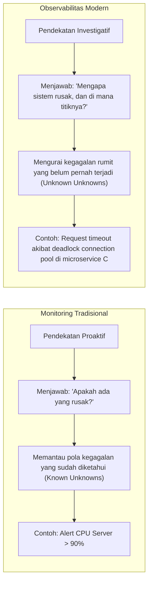
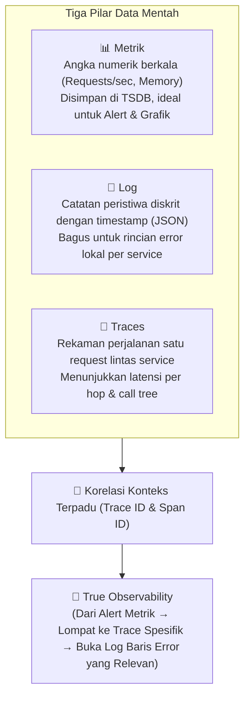
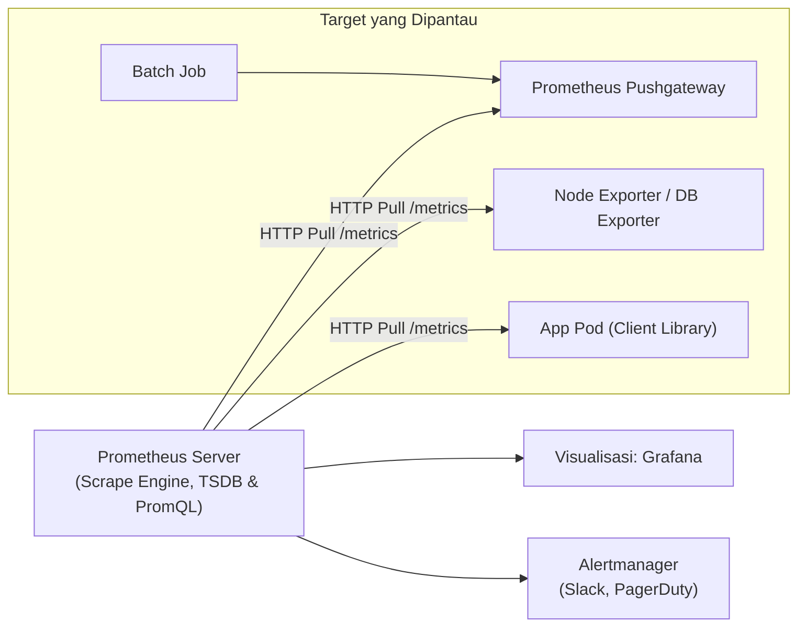
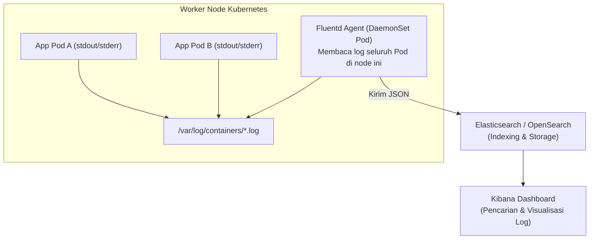
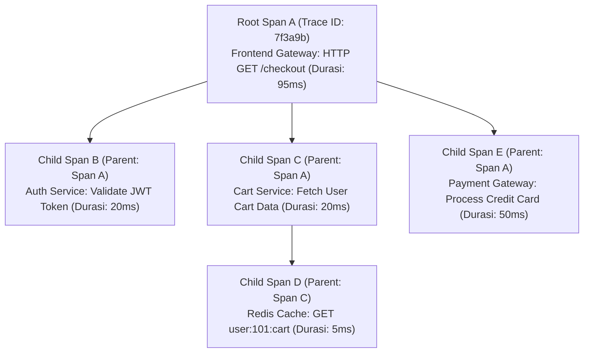

# Cloud Native Applications | Sesi 7: Observability: Following the Breadcrumbs

> **Mata Kuliah:** COSC6105001 - Cloud Native Applications | **Sesi:** 7 | **Status:** Materi UTS
> **Sumber:** Slide dosen (COSC6105001), adaptasi Singh & Kehoe, *Cloud Native Infrastructure with Azure* (O'Reilly Media, 2022).

---

## 🔑 Cues

- Mengapa sistem cloud native menuntut observabilitas: arsitektur terdistribusi & *ephemeral*
- Definisi observabilitas dari teori kontrol matematika (*control theory*)
- Perbedaan mendasar: Monitoring (*Known Unknowns*) vs Observabilitas (*Unknown Unknowns*)
- Tiga Pilar Observabilitas: Metrik, Log, dan Jejak (*Traces*)
- Keterbatasan pilar terisolasi dan pentingnya korelasi konteks (*Trace ID*)
- Arsitektur Prometheus: Model *Pull-based* dan basis data deret waktu (*TSDB*)
- Lima komponen Prometheus: Server, Client Libs, Pushgateway, Exporters, Alertmanager
- PromQL dan empat tipe metrik: Counter, Gauge, Summary, dan Histogram
- Analisis *Tail Latency*: Mengapa p95 dan p99 lebih krusial dibanding rata-rata
- Logging terpusat dengan Fluentd: Arsitektur *tag, time, record* (JSON)
- Strategi logging Kubernetes: Pola Sidecar vs Node-level Agent (*DaemonSet*)
- Distributed Tracing: Konsep Span, Root Span, Child Span, dan propagasi konteks
- Standar universal OpenTelemetry (OTel) dan backend tracing Jaeger
- Azure Monitor: *Transaction Diagnostics* (waterfall) vs *Application Map* (topologi)

---

## 📖 Materi Utama

### 1. Dari Monitoring Tradisional Menuju Observabilitas

Dalam arsitektur monolitik lama, aplikasi berjalan pada server fisik yang statis. Namun dalam sistem *cloud native*, ratusan microservices berjalan di atas container yang fana (*ephemeral*), berpindah node, dan saling memanggil secara asinkron. Menemukan akar penyebab masalah menjadi sangat sulit tanpa instrumentasi yang tepat.

- **Definisi Teori Kontrol:** Observabilitas adalah kemampuan untuk menyimpulkan kondisi internal suatu sistem secara akurat hanya berdasarkan analisis output eksternal yang dipancarkannya.
- **Pergeseran Pola Pikir:** Kita tidak lagi sekadar memasang alarm untuk sistem yang jatuh, melainkan membangun sistem yang mampu **menerangkan dirinya sendiri** (*explain itself*) saat terjadi kegagalan.

### 2. Tiga Pilar Observabilitas & Bahaya Silo Data

- **Bahaya Pilar Terisolasi:** Memiliki metrik, log, dan trace secara terpisah belum menjamin sistem Anda observable. Jika ketiga data tersebut berada di tiga sistem terpisah tanpa benang merah penghubung, teknisi tetap harus menebak korelasi data saat insiden.
- **Kunci Sukses:** Menyematkan **Trace ID unik** ke setiap panggilan transaksi yang otomatis dicatat pada baris log, metrik performa, dan span tracing (*Context Propagation*).

### 3. Pemantauan Metrik Menggunakan Prometheus

Prometheus adalah proyek *graduated* kedua di CNCF (setelah Kubernetes) yang diciptakan di SoundCloud:
- **Arsitektur Pull-Based:** Alih-alih container mendorong (*push*) data ke server pusat yang rentan membanjiri jaringan saat beban tinggi, Prometheus Server secara berkala menarik (*scrape*) metrik dari endpoint HTTP `/metrics` milik target.

#### **Empat Tipe Metrik Prometheus:**
1. **Counter:** Nilai numerik kumulatif yang **hanya bisa naik** (atau kembali ke 0 saat aplikasi restart). Contoh: `http_requests_total`.
   - *Aturan Penting:* Jangan membaca angka mentahnya. Selalu gunakan fungsi `rate()` atau `irate()` untuk membaca laju per detik.
2. **Gauge:** Nilai yang bisa naik dan turun secara bebas. Contoh: jumlah memori yang terpakai saat ini, jumlah koneksi database aktif, atau antrean job.
3. **Summary:** Menghitung jumlah observasi (`_count`) dan total nilai (`_sum`). Bagus untuk menghitung rata-rata latensi dalam rentang waktu tertentu.
4. **Histogram:** Mengelompokkan observasi ke dalam ember-ember batas (*configurable buckets*). Sangat krusial untuk menghitung **Tail Latency** (persentil p90, p95, p99) karena rata-rata aritmatika sering kali menyembunyikan latensi ekstrem yang dialami pengguna kritis.

### 4. Logging Terpusat dengan Fluentd

Pada Kubernetes, container bersifat fana. Jika sebuah Pod mengalami crash, file log lokal yang berada di dalam container ikut lenyap. Perintah `kubectl logs` tidak dapat menolong pasca-insiden.

**Fluentd** adalah *unified logging layer* (lulusan CNCF) yang mengumpulkan, memfilter, dan mengirim log ke storage permanen.
- Setiap event di Fluentd memuat tiga elemen utama (*triplet*): **Tag** (rute pengiriman), **Time** (waktu kejadian), dan **Record** (objek data JSON terstruktur).

- **Strategi DaemonSet vs Sidecar:**
  - *Node-level Agent (DaemonSet):* Standar industri terbaik. Cukup 1 pod Fluentd per node fisik yang membaca direktori log node, menghemat memori kluster.
  - *Sidecar:* Memasang container logging di setiap Pod aplikasi. Fleksibel untuk parsing custom, tetapi sangat boros CPU dan disk I/O.

### 5. Distributed Tracing: Melacak Jejak Transaksi

Distributed tracing bertugas membedah jalur yang dilalui oleh satu request pengguna saat melintasi puluhan microservices independen:

- **Span:** Unit kerja logis terkecil (misal panggilan HTTP dari Frontend ke Auth Service, atau query SQL ke database). Memuat *Start Time*, *Duration*, *Tags* (seperti HTTP Status Code), dan *Logs*.
- **Trace:** Struktur pohon (*directed acyclic graph*) yang tersusun dari kumpulan span yang memiliki **Trace ID** identik.
- **Evolusi OpenTelemetry (OTel):**
  - Dulu industri terbelah antara *OpenTracing* (CNCF) dan *OpenCensus* (Google/Microsoft).
  - Pada tahun 2019, CNCF menggabungkan keduanya menjadi **OpenTelemetry**, menjadikannya standar tunggal universal untuk API dan SDK instrumentasi metrik, log, dan trace.
- **Sampling:** Mengumpulkan 100% data trace pada aplikasi berskala jutaan request/detik akan memboroskan jaringan dan penyimpanan.
  - *Head-based Sampling:* Keputusan merekam trace diambil di awal (misal simpan 5% request secara acak).
  - *Tail-based Sampling:* Keputusan diambil setelah transaksi selesai (misal rekam 100% request yang berstatus HTTP 500 atau yang latensinya > 2 detik).

### 6. Observabilitas Cloud Terkelola: Azure Monitor

Microsoft Azure menyediakan solusi observabilitas terkelola (*managed platform*) yang menyatukan fungsionalitas Prometheus, Fluentd, dan Jaeger ke dalam satu layanan terpadu:
- **Transaction Diagnostics:** Tampilan diagram *waterfall* mendalam yang menunjukkan perjalanan satu transaksi individual dari awal hingga akhir, memudahkan identifikasi baris kode yang memicu error.
- **Application Map:** Diagram topologi otomatis yang memetakan ketergantungan antar-microservices, database, dan layanan eksternal, lengkap dengan indikator kesehatan dan rata-rata durasi komunikasi antar-layanan.

---

## 🛠️ Use Case / Implementasi Nyata

- **Skenario:** Pengguna mengeluhkan tombol "Beli Sekarang" pada aplikasi e-commerce terkadang *loading* hingga 8 detik, namun rata-rata latensi CPU server dilaporkan hanya 15%.
- **Investigasi Menggunakan Observabilitas:**
  1. *Metrik Prometheus (Histogram):* Metrik p50 menunjukkan latensi 200ms (normal), namun metrik p99 menunjukkan lonjakan tajam hingga 7.800ms. Rata-rata terbukti menyamarkan masalah.
  2. *Distributed Tracing (Jaeger / Azure Monitor Transaction Diagnostics):* Teknisi membuka salah satu trace pada persentil p99. Ditemukan bahwa 7.500ms dihabiskan pada *Child Span* ke layanan verifikasi kupon diskon pihak ketiga.
  3. *Logging Fluentd Terkorelasi:* Menggunakan Trace ID yang sama, teknisi membuka log pod verifikasi kupon dan menemukan pesan error `Connection pool exhausted; waiting for free slot`.
  4. *Solusi Tepat Sasaran:* Tim menambahkan timeout 1 detik dengan fallback diskon lokal, menyelesaikan masalah tanpa perlu menebak-nebak atau menambah server secara membabi buta.

---

## 🗂️ Konsep Kunci

| Istilah | Definisi | Contoh / Catatan |
|---|---|---|
| Observability | Kemampuan mengukur kondisi internal sistem dari data output eksternal | Mengetahui bottleneck tanpa attach debugger |
| Three Pillars | Tiga jenis data telemetri utama: Metrik, Log, dan Trace | Data dasar observabilitas sistem |
| Pull-based Scrape | Mekanisme di mana server pemantau aktif menarik metrik dari target | Cara kerja Prometheus Server |
| PromQL | Bahasa query fungsional untuk menganalisis data time-series Prometheus | `rate(http_requests_total[5m])` |
| Tail Latency | Latensi ekstrem yang dialami oleh sebagian kecil pengguna di persentil atas | Nilai p95, p99, p99.9 |
| DaemonSet Logging | Pola logging K8s dengan satu agent per node yang membaca log seluruh pod | Fluentd atau Fluent Bit DaemonSet |
| Span | Satu unit kerja terukur dengan waktu mulai dan durasi dalam sebuah trace | Span query SQL `SELECT * FROM users` |
| Trace | Pohon hierarki kumpulan span yang merekam perjalanan penuh satu transaksi | Alur dari browser ke gateway, auth, dan DB |
| OpenTelemetry | Standar universal vendor-neutral untuk pengumpulan metrik, log, dan trace | Standar gabungan OpenTracing & OpenCensus |
| Application Map | Fitur Azure Monitor yang memvisualisasikan topologi ketergantungan layanan | Peta interaktif service-to-service |

---

## 📊 Tabel Ringkasan

**Perbandingan Karakteristik Tiga Pilar Observabilitas**

| Pilar | Tipe Data | Keunggulan Utama | Keterbatasan Utama | Alat Populer |
|---|---|---|---|---|
| **Metrik** | Numerik (Deret Waktu) | Ringan, komputasi murah, ideal untuk visualisasi tren & alert instan | Tidak memiliki rincian kontekstual mendalam per user | Prometheus, Datadog |
| **Log** | Teks Berstruktur (JSON) | Memberikan rincian kejadian dan pesan error secara spesifik | Volume raksasa, mahal untuk di-index dan disimpan | Fluentd, Elasticsearch, Loki |
| **Traces** | Grafik Berarah (Pohon Span) | Memetakan latensi per hop dan dependensi antar-microservice | Membutuhkan instrumentasi kode & sampling storage | Jaeger, Zipkin, OpenTelemetry |

**Build-Your-Own (Open Source) vs Managed Platform (Azure Monitor)**

| Aspek Evaluasi | Stack Open Source (Prometheus + Fluentd + Jaeger) | Managed Cloud (Azure Monitor / Application Insights) |
|---|---|---|
| **Kontrol & Fleksibilitas** | Kontrol penuh atas retensi data, konfigurasi, dan lokasi storage | Dibatasi oleh kebijakan platform provider |
| **Keterikatan Vendor** | **Nol vendor lock-in** (standar terbuka CNCF, multi-cloud) | Terikat pada ekosistem Microsoft Azure |
| **Beban Perawatan (Toil)** | Tim harus merawat, mem-patch, dan men-scale kluster storage | **Zero maintenance** (dikelola penuh oleh Azure) |
| **Paling Cocok Untuk** | Arsitektur multi-cloud, on-premise, tim dengan keahlian SRE tinggi | Tim yang berfokus cepat pada aplikasi di dalam ekosistem Azure |

---

## ⚠️ Catatan Penting

> **Jangan tertipu oleh rata-rata latensi (*Average is a lie*).** Jika 99 pengguna mendapatkan respon dalam 100ms dan 1 pengguna menunggu 10 detik, rata-rata latensi sistem terlihat bagus di angka 199ms. Namun, 1 pengguna tersebut kemungkinan adalah pelanggan dengan transaksi keranjang belanja terbesar yang mengalami timeout. Selalu gunakan **Histogram persentil (p95 / p99)** untuk mengukur performa nyata.
>
> **Counter yang me-reset ke 0 bukan berarti trafik anjlok.** Saat container me-restart, nilai Counter Prometheus otomatis kembali ke nol. Fungsi `rate()` pada PromQL cukup pintar untuk mengenali reset ini dan tidak menganggapnya sebagai penurunan anomali, asalkan tidak dibaca mentah.
>
> **Waspadai biaya penyimpanan log di cloud.** Mengirimkan log dengan level `DEBUG` secara permanen ke Azure Log Analytics atau Elasticsearch pada sistem ber-traffic jutaan request per detik dapat menghasilkan tagihan ribuan dolar dalam semalam. Terapkan log level dinamis dan retensi berjenjang (*hot vs cold storage*).

---

## 📝 Materi Tambahan (Visual Insights)

- **EFK vs PLG Stack:**
  - Stack konvensional adalah **EFK** (Elasticsearch, Fluentd, Kibana) yang mengindeks seluruh isi teks log, sangat bertenaga namun membutuhkan RAM server yang sangat besar.
  - Alternatif modern yang sangat populer di kluster Kubernetes adalah **PLG** (Promtail, Loki, Grafana) dari Grafana Labs. Loki hanya mengindeks label metadata (seperti pod name dan namespace), membiarkan isi log tidak diindeks, sehingga menghemat konsumsi memori dan biaya hingga 80%.
- **W3C Trace Context Standard:** Standar resmi propagasi konteks distributed tracing via HTTP header, menggunakan header `traceparent` (memuat version, trace-id, parent-id, dan trace-flags) yang didukung penuh oleh OpenTelemetry dan Azure Application Insights.
- **Referensi Buku:** Singh, N., & Kehoe, M. (2022). *Cloud Native Infrastructure with Azure*. O’Reilly Media.
