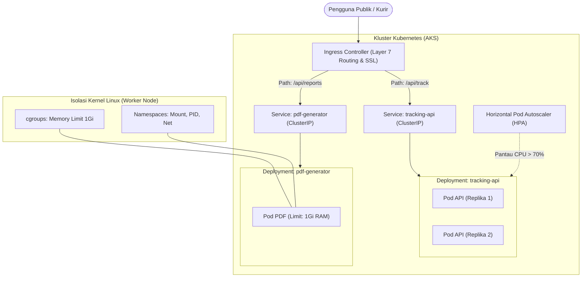

# Cloud Native Applications | Sesi UTS: Latihan Soal UTS Paket 1

> **Mata Kuliah:** COSC6105001 - Cloud Native Applications | **Sesi:** UTS | **Status:** Latihan Soal UTS
> **Fokus Materi:** Dasar & Tantangan Cloud Native, Containerization vs VM, Dockerfile Best Practices, Mutable vs Immutable IaC, Objek Dasar Kubernetes

---

## 🔑 Cues

- Perbedaan cloud-based vs cloud-native
- Tiga tantangan utama adopsi cloud modern
- Arsitektur VM vs Container (Hypervisor vs Shared Kernel)
- Peran cgroups dan namespaces dalam bin packing
- Evaluasi kelemahan Dockerfile konvensional
- Penerapan pattern multistage build
- Fungsi file .dockerignore pada build context
- Mutable vs Immutable Infrastructure dan configuration drift
- Urgensi file terraform.tfstate dan remote backend
- Komponen Control Plane: kube-apiserver, kube-scheduler, etcd
- Perbedaan teknis Liveness Probe vs Readiness Probe
- Studi kasus crash OOM akibat proses export PDF
- Isolasi kuota memori menggunakan cgroups
- Mekanisme rolling update tanpa downtime pada Deployment
- Peran Ingress Controller Layer 7 dan HPA

---

## 📖 Materi Utama

### 1. Pembahasan Teori (Bobot 40%)

#### **A. Konsep Dasar & Tantangan Cloud Native**
- **Cloud-Based vs. Cloud-Native:**
  - *Cloud-based*: Memindahkan aplikasi monolitik ke VM cloud secara *lift-and-shift* tanpa mengubah arsitektur. Sifatnya hanya menyewa komputasi tanpa elastisitas riil.
  - *Cloud-native*: Aplikasi dirancang sejak awal memanfaatkan keunggulan cloud (microservices, container, API deklaratif, elastisitas dinamis, dan self-healing).
- **Tiga Tantangan Utama (CNCF):**
  1. *Too Many Choices*: Tersedianya ratusan layanan cloud yang memerlukan arsitek berpengalaman agar tidak terjadi over-engineering.
  2. *Rapid Growth & Vendor Lock-in*: Laju rilis layanan baru sangat cepat dan ketergantungan pada API proprietary provider membatasi fleksibilitas migrasi.
  3. *Generational Churn*: Mengelola infrastruktur lintas tiga era (VM $\rightarrow$ Container $\rightarrow$ Serverless) meningkatkan kompleksitas pemantauan dan keamanan.

#### **B. Containerization vs. Traditional Approach**
- **VM vs. Container:**
  - VM mengisolasi di level hardware via Hypervisor; tiap instance memerlukan *Guest OS* lengkap (memakan banyak GB RAM dan waktu boot bermenit-menit).
  - Container mengisolasi di level proses OS; semua container berbagi kernel Linux yang sama (*shared host kernel*), menghasilkan waktu startup hitungan milidetik dan efisiensi *bin packing* tinggi.
- **Dua Primitif Inti Kernel Linux:**
  - *Namespaces*: Mengisolasi visibilitas sistem (PID, Network, Mount, IPC, UTS, User) sehingga proses merasa berjalan di OS mandiri.
  - *cgroups (Control Groups)*: Membatasi dan mengukur kuota penggunaan resource komputasi (CPU, RAM, Disk I/O, batas PID) untuk mencegah masalah *noisy neighbor*.

#### **C. Standar Konfigurasi Dockerfile & Multistage Build**
- **Masalah Dockerfile Konvensional:**
  - Menggabungkan SDK/compiler dan source code ke dalam satu layer produksi menghasilkan image berukuran besar (>800MB) dan memperluas celah keamanan (*attack surface*).
  - Eksekusi `COPY . .` sebelum download dependensi merusak cache layer Docker saat kode berubah.
- **Solusi Multistage Build (Go):**
```dockerfile
  # Stage 1: Builder
  FROM golang:1.24-alpine AS builder
  WORKDIR /app
  COPY go.mod go.sum ./
  RUN go mod download
  COPY . .
  RUN CGO_ENABLED=0 GOOS=linux go build -ldflags="-s -w" -o server .

  # Stage 2: Minimal Runner
  FROM alpine:3.20 AS runner
  WORKDIR /app
  COPY --from=builder /app/server .
  USER 10001
  EXPOSE 8080
  ENTRYPOINT ["./server"]
```
- **File Pendukung `.dockerignore`:** Mencegah file rahasia `.env`, folder `.git`, dan file pengujian lokal terunggah ke dalam build context Docker daemon.

#### **D. Konsep Infrastructure as Code (IaC)**
- **Mutable vs. Immutable Infrastructure:**
  - *Mutable*: Server diperbarui dan di-patch langsung saat aktif. Menghasilkan *configuration drift* (perbedaan konfigurasi tak terlacak antar-server).
  - *Immutable*: Server tidak pernah dimodifikasi setelah dideploy. Setiap pembaruan dilakukan dengan meluncurkan image VM baru dan mematikan server lama (*cattle, not pets*).
- **Keamanan `terraform.tfstate`:**
  - Merupakan database pemetaan antara kode HCL dan resource nyata di cloud.
  - Dilarang di-commit ke Git karena memuat data rahasia (*secrets*, password, token) dalam teks polos, serta rawan konflik konkurensi (wajib disimpan di remote backend seperti Azure Blob Storage dengan fitur *state locking*).

#### **E. Komponen Inti Kubernetes & Probes**
- **Control Plane:**
  - `kube-apiserver`: Pintu gerbang utama (REST API) untuk seluruh komunikasi internal dan eksternal kluster.
  - `kube-scheduler`: Memilih worker node yang paling optimal untuk menjalankan Pod melalui tahap *filtering* dan *scoring*.
  - `etcd`: Basis data terdistribusi (key-value store konsensus Raft) penyimpan seluruh state konfigurasi kluster.
- **Liveness Probe vs. Readiness Probe:**
  - *Liveness Probe*: Menilai apakah container masih hidup. Jika gagal, container dimatikan dan direstart oleh kubelet.
  - *Readiness Probe*: Menilai apakah aplikasi siap melayani lalu lintas. Jika gagal, Pod dikeluarkan sementara dari routing Service/Load Balancer tanpa direstart.

---

### 2. Pembahasan Studi Kasus: PT Megatama Logistik (Bobot 60%)

#### **Alur Arsitektur Solusi Cloud Native:**



#### **A. Analisis Permasalahan & Kebutuhan**
1. **Akar Masalah:**
   - *Noisy Neighbor & Lack of Boundary*: Proses kompilasi laporan PDF menyedot 100% RAM pada VM yang sama, mematikan API pelacakan utama.
   - *Manual Provisioning*: Penambahan server manual memakan waktu 4 jam (*clicking doesn't scale*).
   - *Monolithic Coupling & Downtime*: Rilis fitur baru menuntut downtime penuh 30 menit.
   - *Environment Drift*: Versi dependensi di laptop developer berbeda dengan server produksi.
2. **Kebutuhan Sistem Baru:**
   - Pemisahan microservice independen dengan batas kuota memori terisolasi.
   - Packaging image OCI yang konsisten di seluruh lingkungan.
   - Orkestrasi auto-scaling dinamis dan rilis pembaruan tanpa downtime (*zero-downtime rolling update*).

#### **B. Penerapan Konsep Containerization**
- **Strategi Pemisahan:**
  - Aplikasi dipecah menjadi dua image terpisah: `tracking-api` dan `pdf-generator`.
- **Mekanisme Kernel:**
  - **cgroups**: Menetapkan kuota memori maksimal 1 GiB untuk container PDF. Jika proses laporan bocor, hanya container PDF yang terkena OOM Killer tanpa mengganggu proses API utama.
  - **Namespaces**: Mengisolasi proses, jaringan, dan filesystem sehingga crash pada container laporan tidak berdampak ke container lain.

#### **C. Konfigurasi Dockerfile Produksi (Node.js API)**
```dockerfile
FROM node:22-alpine AS builder
WORKDIR /app
COPY package*.json ./
RUN npm ci --only=production
COPY . .
RUN npm run build

FROM node:22-alpine AS runner
WORKDIR /app
ENV NODE_ENV=production
COPY --from=builder /app/package*.json ./
COPY --from=builder /app/node_modules ./node_modules
COPY --from=builder /app/dist ./dist
USER node
EXPOSE 3000
CMD ["node", "dist/index.js"]
```
*Tiga Praktik Terbaik:*
1. Multistage build untuk memangkas compiler dari image akhir.
2. Menjalankan aplikasi sebagai non-root (`USER node`) untuk mempersempit *blast radius*.
3. Mengoptimalkan layer caching dengan menyalin `package*.json` sebelum menyalin seluruh kode sumber.

#### **D. Arsitektur Orkestrasi Kubernetes**
1. **Zero-Downtime Deployment:** Objek `Deployment` menjalankan strategi `RollingUpdate` dengan parameter `maxUnavailable: 25%` dan `maxSurge: 25%`. Pod baru divalidasi oleh `readiness probe` sebelum pod lama dimatikan bertahap.
2. **Horizontal Pod Autoscaler (HPA):** Memantau metrik utilisasi CPU/RAM via Metrics Server. Saat utilisasi melampaui 70% saat promo 11.11, HPA otomatis menambah replika Pod dari 2 menjadi 12 pod dalam hitungan detik.
3. **Pintu Masuk Terpadu:** Memasang **Ingress Controller** Layer 7 di depan `ClusterIP` Services untuk merutekan path `/api/track` dan `/api/reports` dengan 1 IP publik serta terminasi SSL/TLS terpusat.

---

## 🛠️ Use Case / Implementasi Nyata

- **Skenario:** Menangani lonjakan transaksi kilat (*flash sale*) e-commerce dan ekspor laporan rekapitulasi data massal secara bersamaan.
- **Masalah yang Diatasi:** Lonjakan beban komputasi berat pada modul analitik tidak boleh menurunkan SLA ketersediaan modul checkout dan pembayaran.
- **Keuntungan Arsitektur:** Penerapan cgroups membatasi konsumsi memori modul laporan, HPA menaikkan kapasitas pod checkout secara elastis, dan Ingress menyatukan seluruh routing endpoint ke dalam satu domain yang rapi.

---

## 🗂️ Konsep Kunci

| Istilah | Definisi | Contoh / Catatan |
|---|---|---|
| Cloud Native | Pendekatan membangun aplikasi yang memanfaatkan penuh elastisitas cloud | Microservices, container, declarative API |
| Bin Packing | Algoritma penempatan beban kerja agar node komputasi terisi seefisien mungkin | Memadatkan 20 pod pada 1 VM |
| cgroups | Primitif kernel Linux untuk membatasi kuota CPU, RAM, dan I/O proses | `resources.limits.memory: 1Gi` |
| Namespaces | Primitif kernel Linux untuk mengisolasi pandangan proses terhadap sistem | PID, Mount, Network, IPC |
| Multistage Build | Teknik Dockerfile yang menggunakan beberapa tahap `FROM` untuk membuang compiler | Builder stage Go $\rightarrow$ Alpine runner |
| Immutable Infra | Paradigma di mana server tidak pernah diubah; setiap update mengganti server utuh | Mengganti VM dari image Packer baru |
| HPA | Horizontal Pod Autoscaler; penskalaan jumlah pod otomatis berbasis metrik beban | Skala dari 2 pod ke 12 pod |

---

## 📊 Tabel Ringkasan

**Perbandingan Karakteristik Arsitektur**

| Parameter | VM Tradisional | Container Cloud Native |
|---|---|---|
| **Abstraksi** | Hardware fisik (Hypervisor) | Sistem operasi (Shared Kernel) |
| **Ukuran Image** | Besar (Gigabyte) | Ramping (Megabyte) |
| **Startup Time** | Menit | Milidetik – Detik |
| **Pembaruan Sistem** | Mutable (Patch in-place) | Immutable (Replace container) |
| **Penanganan Lonjakan** | Manual via GUI Portal (Jam) | HPA Otomatis (Detik) |

---

## ⚠️ Catatan Penting

> **Liveness Probe bukan untuk cek koneksi eksternal.** Liveness probe hanya boleh menilai kesehatan internal proses container. Jika liveness probe mengecek database yang sedang lambat, seluruh Pod akan direstart serentak dan memicu pemadaman massal (*cascading failure*).
>
> **Simpan State Terraform di Remote Backend.** Jangan pernah menyimpan `terraform.tfstate` di Git lokal karena memuat plaintext secrets dan rawan konflik konkurensi antar-engineer.
>
> **Container berbagi kernel yang sama.** Container bukan sandbox hardware penuh; isolasi kernel yang bocor (*kernel privilege escalation*) dapat mengancam host OS jika tidak diamankan dengan seccomp dan non-root user.

---

## 📝 Materi Tambahan (Visual Insights)

- **Mekanisme OOM Killer:** Saat container melampaui batas kuota RAM yang ditetapkan oleh cgroup subsystem `memory`, kernel Linux otomatis mengirim sinyal `SIGKILL` (Exit Code 137) ke proses container tersebut tanpa mempengaruhi proses host lainnya.
- **Strategi Rolling Update:** Pengaturan `maxSurge: 25%` memastikan kluster membuat pod baru terlebih dahulu sebelum membunuh pod lama, menjamin kapasitas layanan tidak pernah turun di bawah 100% dari target awal.
- **Referensi Buku:** Singh, N., & Kehoe, M. (2022). *Cloud Native Infrastructure with Azure*. O’Reilly Media.
