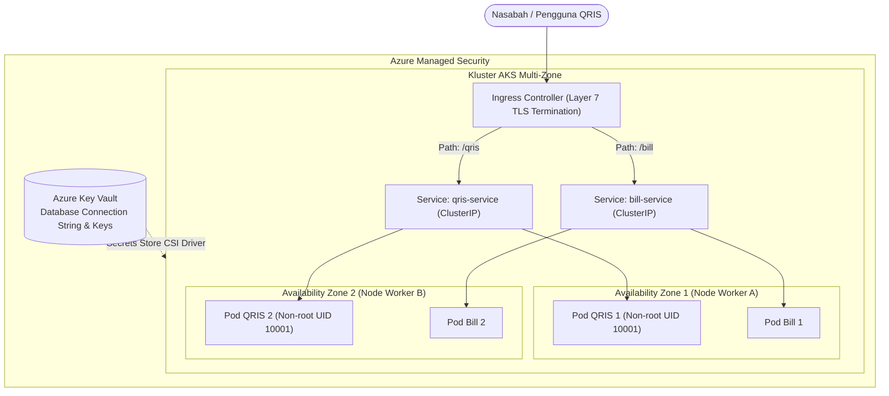

# Cloud Native Applications | Sesi UTS: Latihan Soal UTS Paket 2

> **Mata Kuliah:** COSC6105001 - Cloud Native Applications | **Sesi:** UTS | **Status:** Latihan Soal UTS
> **Fokus Materi:** Keamanan Container (Capabilities & Seccomp), Alur Kerja Terraform & Remote State, Arsitektur Jaringan Kubernetes & Ingress

---

## 🔑 Cues

- The Cloud Is Not a Silver Bullet pada pola lift-and-shift
- Karakteristik CNCF: loosely coupled, resilient, observable
- Model keamanan biner Unix vs Linux Capabilities
- Pembatasan port 80 dengan CAP_NET_BIND_SERVICE
- Peran Seccomp-BPF dalam membatasi blast radius
- Perbedaan fungsional ENTRYPOINT vs CMD di Dockerfile
- Prinsip stateless dan ephemeral pada Twelve-Factor App
- Empat perintah alur kerja Terraform: init, plan, apply, destroy
- Peran state locking pada remote backend Azure Blob Storage
- Tanggung jawab kubelet, kube-proxy, dan containerd di worker node
- Perbandingan Service ClusterIP, NodePort, dan LoadBalancer
- Analisis celah eksekusi root pada sistem perbankan
- Mitigasi container escape dengan User Namespace dan non-root user
- Desain Dockerfile multistage Java Spring Boot (Eclipse Temurin)
- Strategi Ingress Layer 7 dan Pod Topology Spread Constraints

---

## 📖 Materi Utama

### 1. Pembahasan Teori (Bobot 40%)

#### **A. Karakteristik Cloud Native & Kritik Lift-and-Shift**
- **The Cloud Is Not a Silver Bullet:**
  - Memindahkan aplikasi monolitik secara langsung (*lift-and-shift*) ke cloud hanya memindahkan beban kerja tanpa memetik manfaat elastisitas. Aplikasi tetap kaku, rentan titik kegagalan tunggal (*single point of failure*), dan biaya sewa VM statis sering kali membengkak tanpa utilisasi yang efisien.
- **Tiga Karakteristik Inti CNCF:**
  - *Loosely Coupled*: Komponen microservices saling berkomunikasi melalui kontrak API jaringan yang terstandarisasi; kegagalan satu service tidak merembet ke service lain.
  - *Resilient*: Sistem dirancang mampu bertahan dari gangguan infrastruktur dan pulih mandiri (*self-healing*) secara otomatis.
  - *Observable*: Kondisi kesehatan internal sistem dapat dianalisis secara akurat hanya melalui output telemetri (metrik, log, dan trace).

#### **B. Keamanan Container Tingkat Rendah (Capabilities & Seccomp)**
- **Linux Capabilities (Granularitas Hak Akses):**
  - Mengubah model biner Unix tradisional (*root serba bisa vs non-root tidak berdaya*) menjadi izin spesifik yang terpecah-pecah.
  - Web server hanya membutuhkan kapabilitas `CAP_NET_BIND_SERVICE` untuk membuka port di bawah 1024 (seperti port 80/443) tanpa perlu hak administratif root penuh.
- **Seccomp-BPF (Secure Computing Berkeley Packet Filter):**
  - Berfungsi menyaring panggilan sistem (*system call*) ke kernel Linux. Pemanggilan fungsi berbahaya (seperti `reboot`, `sys_ptrace`, atau `kexec_load`) langsung diblokir di level kernel, memperkecil radius kerusakan (*blast radius*) jika aplikasi diretas.

#### **C. Anatomi Dockerfile & Prinsip Twelve-Factor App**
- **ENTRYPOINT vs. CMD:**
  - `ENTRYPOINT`: Perintah biner tetap yang pasti dijalankan saat container pertama kali menyala.
  - `CMD`: Argumen default yang diteruskan ke `ENTRYPOINT`, yang dapat ditimpa (*override*) saat menjalankan `docker run`.
  - *Kombinasi harmonis:*
    ```dockerfile
    ENTRYPOINT ["python3", "app.py"]
    CMD ["--port", "8080"]
    ```
- **Prinsip Stateless & Ephemeral (Twelve-Factor App):**
  - Container harus dapat dimatikan, dipindahkan, dan diskalakan secara instan tanpa risiko kehilangan data pelanggan. Seluruh data persisten wajib disimpan di luar container (seperti Managed Database atau Cloud Object Storage).

#### **D. Alur Kerja Terraform & Manajemen State**
- **Empat Perintah Utama:**
  1. `terraform init`: Menginisialisasi direktori kerja, mengunduh plugin provider, dan menghubungkan backend remote.
  2. `terraform plan`: Menghitung selisih antara kondisi riil cloud dan kode HCL (*dry-run execution preview*).
  3. `terraform apply`: Mengeksekusi perubahan deklaratif ke API cloud hingga desired state tercapai.
  4. `terraform destroy`: Membersihkan dan menghapus seluruh resource yang terdaftar pada state file.
- **Urgensi Remote Backend & State Locking:**
  - Remote backend (seperti Azure Blob Storage) menjamin seluruh tim bekerja pada satu sumber kebenaran (*single source of truth*) yang sama.
  - Fitur *state locking* mencegah kerusakan file state akibat eksekusi apply ganda secara bersamaan oleh dua engineer berbeda.

#### **E. Komponen Worker Node & Tipe Service Kubernetes**
- **Komponen Worker Node:**
  - `kubelet`: Agen di setiap node yang mengawasi eksekusi container sesuai kontrak PodSpec dan melaporkan status kesehatan node ke API server.
  - `kube-proxy`: Mengelola aturan iptables/IPVS lokal untuk meneruskan lalu lintas virtual IP Service ke Pod tujuan yang tepat.
  - `container runtime`: Mesin pelaksana tingkat rendah (misal `containerd`) yang bertugas menarik image dan mengeksekusi container.
- **Tiga Tipe Kubernetes Service:**
  - `ClusterIP`: Alamat IP virtual internal yang hanya dapat diakses dari dalam kluster (default).
  - `NodePort`: Membuka port khusus (rentang 30000–32767) pada setiap IP node worker untuk akses luar.
  - `LoadBalancer`: Mengintegrasikan kluster dengan load balancer eksternal cloud provider untuk menyediakan IP publik stabil bagi pengguna internet.

---

### 2. Pembahasan Studi Kasus: Bank Digital "Nusantara Pay" (Bobot 60%)

#### **Alur Arsitektur Solusi Perbankan Cloud Native:**



#### **A. Analisis Permasalahan & Kebutuhan**
1. **Akar Masalah:**
   - *Severe Security Vulnerability*: Menjalankan aplikasi langsung sebagai akun `root` di bare metal memungkinkan penyerang mengeksploitasi RCE untuk mengakses file sistem `/etc/shadow` dan bergerak lateral ke database.
   - *Configuration Drift*: Konfigurasi manual via SSH/RDP antar-server menyebabkan versi driver dan patch menyimpang tanpa pelacakan audit.
   - *Monolithic Scalability Failure & Port Clutter*: Ketiadaan autoscaling saat jam sibuk QRIS melumpuhkan sistem, ditambah pemborosan biaya pemesanan IP publik terpisah untuk setiap modul baru.
2. **Kebutuhan Sistem Baru:**
   - Eksekusi container tanpa hak root (*rootless containerization*).
   - Infrastruktur deklaratif berbasis IaC (Terraform) untuk menghapus *configuration drift*.
   - Autoscaling otomatis (HPA) dan reverse proxy Layer 7 (Ingress) dengan 1 IP publik terpusat.

#### **B. Penerapan Konsep Containerization & Keamanan**
- **Prinsip Least Privilege & Isolasi:**
  - Aplikasi dibungkus dalam container yang dijalankan menggunakan akun non-root (`UID 10001`).
  - Hak akses Linux Capabilities dibatasi secara ketat; seluruh kapabilitas dicabut (`--cap-drop=ALL`) dan hanya ditambahkan izin yang benar-benar esensial.
  - *User Namespace* memetakan UID container ke pengguna non-privilese di host OS, sehingga jika terjadi *container escape*, penyerang tidak memiliki kewenangan administratif apa pun di mesin host.

#### **C. Konfigurasi Dockerfile Produksi (Java Spring Boot)**
```dockerfile
# Stage 1: Build JAR dengan Maven & JDK
FROM eclipse-temurin:21-jdk-alpine AS builder
WORKDIR /build
COPY .mvn/ .mvn/
COPY mvnw pom.xml ./
RUN ./mvnw dependency:go-offline
COPY src ./src
RUN ./mvnw clean package -DskipTests

# Stage 2: Minimal Runtime JRE
FROM eclipse-temurin:21-jre-alpine AS runner
WORKDIR /app
RUN addgroup -S appgroup && adduser -S appuser -G appgroup
COPY --from=builder /build/target/*.jar app.jar
USER appuser
EXPOSE 8080
ENTRYPOINT ["java", "-jar", "app.jar"]
```
*Tiga Praktik Terbaik:*
1. Multistage build memisahkan JDK builder dari JRE runner untuk meminimalkan ukuran image dan membuang tools kompilasi yang berbahaya jika disusupi.
2. Menggunakan `USER appuser` (non-root) untuk mencegah eskalasi hak akses sistem operasi.
3. Kredensial database tidak disimpan di dalam image atau Dockerfile, melainkan disuntikkan secara dinamis saat runtime melalui Kubernetes Secret.

#### **D. Arsitektur Orkestrasi Kubernetes Perbankan**
1. **Ingress Controller (Layer 7 Routing):** Menggunakan Ingress Controller tunggal untuk membagi trafik berdasarkan path URL (`/qris` ke Service QRIS dan `/bill` ke Service Pembayaran) serta mengelola sertifikat TLS/HTTPS terpusat via `cert-manager`.
2. **Resiliensi Penempatan Pod:** Menerapkan `PodTopologySpreadConstraints` atau `PodAntiAffinity` pada manifest Deployment agar Pod replika QRIS otomatis disebar merata melintasi node fisik dan *Availability Zones* yang berbeda.
3. **Penyimpanan Kredensial Aman:** Menggunakan objek `Kubernetes Secret` yang diintegrasikan dengan **Azure Key Vault** melalui *Secrets Store CSI Driver*, memastikan rahasia perbankan tersimpan terenkripsi di memori dan tidak pernah bocor ke disk atau repositori Git.

---

## 🛠️ Use Case / Implementasi Nyata

- **Skenario:** Platform perbankan digital melayani jutaan transaksi transfer dana dan pembayaran QRIS saat jam makan siang.
- **Masalah yang Diatasi:** Perlindungan data sensitif nasabah dari serangan siber RCE sekaligus menjamin kelancaran transaksi tanpa bottleneck koneksi.
- **Keuntungan Arsitektur:** Penerapan User Namespace dan non-root user mengisolasi container secara ketat, Pod Anti-Affinity mencegah matinya seluruh instance saat 1 data center mengalami gangguan daya, dan integrasi Azure Key Vault menjamin keamanan rahasia perbankan sesuai standar PCI-DSS.

---

## 🗂️ Konsep Kunci

| Istilah | Definisi | Contoh / Catatan |
|---|---|---|
| Least Privilege | Prinsip keamanan memberikan hak akses seminimal mungkin yang diperlukan | Menjalankan app via `USER appuser` |
| Seccomp-BPF | Penyaringan system call kernel Linux berbasis Berkeley Packet Filter | Memblokir panggilan `kexec_load` |
| Blast Radius | Area cakupan kerusakan sistem saat terjadi insiden keamanan | Pembatasan kerusakan hanya pada 1 pod |
| Remote Backend | Lokasi penyimpanan file state Terraform terpusat yang aman | Azure Blob Storage dengan state locking |
| kubelet | Agen node yang memastikan container berjalan sesuai PodSpec | Memantau siklus hidup pod |
| Ingress | Objek perutean Layer 7 HTTP/HTTPS berbasis host dan path URL | `api.bank.com/qris` |
| Pod Anti-Affinity | Aturan penjadwalan pod agar tidak diletakkan pada node/zone yang sama | Menjamin ketersediaan tinggi multi-zone |

---

## 📊 Tabel Ringkasan

**Perbandingan Model Keamanan Konvensional vs Cloud Native**

| Aspek Keamanan | Lingkungan Bare Metal Tradisional | Lingkungan Container Cloud Native |
|---|---|---|
| **Akun Eksekusi** | Sering kali `root` penuh pada OS host | User non-root (`UID 10001`) dalam User Namespace |
| **Izin Akses Kernel** | Biner (Semua atau Tidak Sama Sekali) | Terbagi granular via Linux Capabilities |
| **System Call Filtering**| Tidak dibatasi (Aplikasi bebas panggil syscall) | Dibatasi secara ketat oleh Seccomp-BPF |
| **Manajemen Secret** | Hardcoded di file `.properties` server | Azure Key Vault via Secrets Store CSI Driver |
| **Batas Kerusakan** | Mengancam seluruh jaringan data center | Terisolasi di dalam sandbox container (*minimal blast radius*) |

---

## ⚠️ Catatan Penting

> **User non-root wajib dideklarasikan di Dockerfile dan Pod Security Standards.** Menjalankan container sebagai root di cluster production melanggar prinsip keamanan CNCF; gunakan selalu instruksi `USER <non-root-uid>` dan terapkan aturan `runAsNonRoot: true` pada SecurityContext Kubernetes.
>
> **State Locking melindungi dari korupsi data.** Jangan pernah menonaktifkan flag penguncian state pada Terraform backend remote, karena eksekusi apply paralel oleh dua proses CI/CD dapat merusak state infrastruktur secara permanen.
>
> **Ingress membutuhkan Service ClusterIP di belakangnya.** Objek Ingress tidak merutekan lalu lintas langsung ke alamat IP Pod, melainkan ke Service Kubernetes bertipe ClusterIP yang bertindak sebagai endpoint abstraction stabil.

---

## 📝 Materi Tambahan (Visual Insights)

- **Hierarki Capabilities Linux:** Seluruh kapabilitas diawali dengan prefiks `CAP_`. Contoh penting: `CAP_NET_BIND_SERVICE` (mengikat port istimewa), `CAP_CHOWN` (mengubah pemilik file), dan `CAP_SYS_ADMIN` (kapabilitas super yang wajib dihindari karena setara dengan hak root penuh).
- **Secrets Store CSI Driver:** Memungkinkan kluster Kubernetes me-mount rahasia dari Azure Key Vault secara langsung sebagai file sistem virtual ke dalam Pod tanpa menyimpan rahasia tersebut sebagai teks statis di dalam database `etcd`.
- **Referensi Buku:** Singh, N., & Kehoe, M. (2022). *Cloud Native Infrastructure with Azure*. O’Reilly Media.
