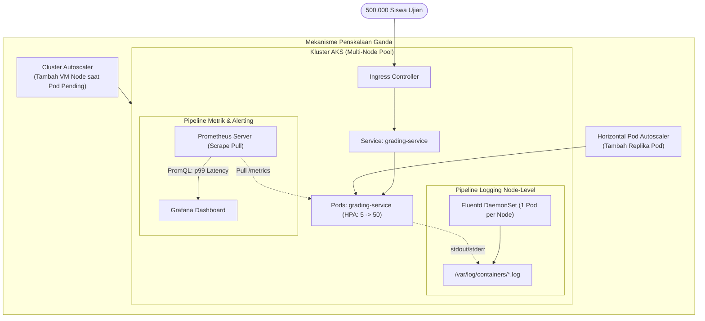

# Cloud Native Applications | Sesi UTS: Latihan Soal UTS Paket 3

> **Mata Kuliah:** COSC6105001 - Cloud Native Applications | **Sesi:** UTS | **Status:** Latihan Soal UTS
> **Fokus Materi:** Runtime (containerd/runc), Rantai Alat IaC (Packer + Terraform + Ansible), Helm Package Manager, dan Observabilitas (Prometheus/Fluentd/Tail Latency)

---

## 🔑 Cues

- Peran CNCF dalam standardisasi dan vendor neutrality
- Kategori status proyek CNCF: Sandbox, Incubating, Graduated
- Peran Kubernetes dan Prometheus sebagai pionir proyek Graduated
- Perbedaan High-Level Runtime vs Low-Level Runtime OCI
- Alasan teknis penghapusan dockershim sejak Kubernetes v1.24
- Mekanisme Layer Caching dan Copy-on-Write (CoW) pada Dockerfile
- Perbandingan komprehensif Harbor Registry vs Azure Container Registry (ACR)
- Sinergi rantai alat: Packer, Terraform, Ansible
- Masalah YAML configuration sprawl dan solusi Helm Charts
- Arsitektur Helm v2 ke v3 dan penghapusan daemon server Tiller
- Kelemahan metrik rata-rata aritmatika vs Histogram persentil Tail Latency
- Solusi kehilangan log pod crash dengan DaemonSet Fluentd
- Perbandingan arsitektural DaemonSet logging vs Sidecar logging
- Sinergi penskalaan ganda: Horizontal Pod Autoscaler (HPA) dan Cluster Autoscaler

---

## 📖 Materi Utama

### 1. Pembahasan Teori (Bobot 40%)

#### **A. Peran CNCF & Siklus Hidup Proyek**
- **Peran CNCF (*Vendor Neutrality*):**
  - Mendorong ekosistem proyek *open-source* yang netral dari vendor agar teknologi modern tidak dimonopoli oleh segelintir raksasa teknologi.
  - Mempertahankan standar terbuka (seperti Kubernetes, Prometheus, OCI, dan CNI) sehingga organisasi terhindar dari *vendor lock-in*.
- **Tiga Status Kematangan Proyek CNCF:**
  - *Sandbox*: Proyek tahap awal/eksperimental yang sedang dievaluasi kelayakannya.
  - *Incubating*: Proyek yang mulai diadopsi luas dan memenuhi kriteria keamanan dasar.
  - *Graduated*: Proyek matang dengan adopsi enterprise luas, tata kelola komunitas yang solid, dan lolos audit keamanan independen.
  - *Dua Contoh Proyek Graduated:*
    1. **Kubernetes:** Orkestrator container terdistribusi untuk otomasi deployment, scaling, dan manajemen aplikasi.
    2. **Prometheus:** Sistem pemantauan deret waktu (*time-series*) berbasis pull dan mesin alerting berbasis PromQL.

#### **B. Arsitektur Runtime Container & Penghapusan Dockershim**
- **High-Level vs. Low-Level Runtime:**
  - *High-Level Runtime (`containerd`, `CRI-O`)*: Bertanggung jawab menarik (*pull*) image dari registry, mengelola layer filesystem, memantau siklus hidup container, dan meneruskan perintah via API CRI.
  - *Low-Level Runtime (`runc`)*: Biner ringan yang berbicara langsung ke kernel Linux untuk membuat cgroups, namespaces, dan mengeksekusi proses container sesuai standar OCI.
- **Penghapusan Dockershim di Kubernetes v1.24:**
  - Docker daemon awalnya dibuat sebagai platform lengkap untuk developer, bukan murni runtime container. Dahulu K8s membutuhkan jembatan penerjemah (*dockershim*) yang menimbulkan overhead memori dan kompleksitas maintenance.
  - Sejak K8s v1.24, dockershim dihapus total. Kubernetes berkomunikasi langsung ke runtime yang mengimplementasikan standar terbuka *Container Runtime Interface* (CRI) seperti `containerd` atau `CRI-O`.

#### **C. Layer Caching Docker & Komparasi Container Registry**
- **Layer Caching & Copy-on-Write:**
  - Setiap instruksi di Dockerfile membentuk layer read-only. Docker meng-cache layer ini dari atas ke bawah.
  - *Aturan Urutan Instruksi:* Taruh instruksi yang jarang berubah (seperti file definisi dependensi `package.json` atau `pom.xml`) di atas, dan taruh source code yang sering diedit di bawah agar proses kompilasi ulang memanfaatkan cache layer secara optimal.
- **Harbor vs. Azure Container Registry (ACR):**
  - *Harbor*: Open-source murni (CNCF Graduated), bebas lisensi, kontrol data fisik penuh untuk on-premise, namun membutuhkan pemeliharaan infrastruktur VM dan storage sendiri.
  - *ACR*: Layanan managed PaaS dari Azure, zero maintenance, mendukung fitur enterprise (geo-replikasi otomatis multi-region, enkripsi private link, dan integrasi native dengan AKS/Entra ID).

#### **D. Sinergi Rantai Alat IaC (Toolchain)**
- **Packer:** Membangun *machine image* (Golden Image) sistem operasi dasar yang sudah memuat dependensi kernel dan container runtime secara statis (*prebaked*).
- **Terraform:** Memprovisi infrastruktur jaringan dan komputasi (Virtual Network, Subnet, AKS Cluster, Storage Account) yang menggunakan image tersebut secara deklaratif.
- **Ansible:** Menangani konfigurasi dinamis tingkat lanjut dan integrasi akhir pada server/node tanpa perlu memasang agent tambahan (*agentless via SSH*).

#### **E. Helm Package Manager & Evolusi Arsitektur**
- **Mengatasi Configuration Sprawl:**
  - Mengelola puluhan file manifest YAML mentah di berbagai lingkungan (dev, staging, prod) rentan kesalahan duplikasi.
  - Helm membungkus seluruh manifest menjadi satu paket terparameterisasi (**Chart**), di mana perbedaan konfigurasi antar-lingkungan cukup didefinisikan dalam satu file nilai (`values.yaml`).
- **Penghapusan Tiller (Helm v2 ke v3):**
  - Di Helm v2, komponen server **Tiller** berjalan di dalam kluster dengan hak akses sangat tinggi (`cluster-admin`), menjadikannya celah keamanan berbahaya jika dieksploitasi.
  - Di Helm v3, Tiller dihapus total. Helm menjadi alat *client-only* yang berbicara langsung ke Kubernetes API server menggunakan kredensial RBAC pengguna lokal yang menjalankan perintah, menegakkan prinsip *Least Privilege*.

---

### 2. Pembahasan Studi Kasus: Platform Ujian Daring "EduCerdas" (Bobot 60%)

#### **Alur Arsitektur Observabilitas & Penskalaan Kluster:**



#### **A. Analisis Permasalahan & Kebutuhan**
1. **Akar Masalah:**
   - *Flawed Metrics & Hidden Tail Latency*: Metrik rata-rata aritmatika menyamarkan 1% siswa yang mengalami timeout ekstrem 15 detik.
   - *Ephemeral Log Loss*: Ketiadaan logging terpusat menyebabkan bukti rekaman crash pod penilaian lenyap saat container diganti.
   - *YAML Sprawl*: Ketiadaan standarisasi rilis menyebabkan kesalahan konfigurasi database staging terbawa ke production.
   - *Decoupled Scaling Failure*: HPA memperbanyak Pod, namun node fisik kehabisan alokasi CPU sehingga 30 Pod baru terjebak dalam status `Pending`.
2. **Kebutuhan Sistem Baru:**
   - Observabilitas berbasis persentil (Histogram p95/p99) dan distributed tracing.
   - Logging terpusat berbasis DaemonSet Fluentd.
   - Standarisasi packaging deklaratif berbasis Helm Charts dan penskalaan ganda (HPA + Cluster Autoscaler).

#### **B. Penerapan Logging Terpusat (DaemonSet vs. Sidecar)**
- **Solusi Log Hilang:**
  - Seluruh log aplikasi dialirkan ke `stdout`/`stderr`. Kubelet secara otomatis menyimpannya ke direktori host `/var/log/containers/`.
  - Menerapkan **DaemonSet Fluentd / Fluent Bit** (1 pod per worker node). Agent ini membaca file log node dan meneruskannya ke penyimpanan terpusat (Azure Log Analytics / Elasticsearch). Log tetap aman meskipun Pod aplikasi mati.
- **Mengapa DaemonSet > Sidecar:**
  - *DaemonSet* hanya membutuhkan 1 agent per node fisik, menghemat alokasi memori dan CPU kluster.
  - *Sidecar* menuntut penambahan container logging di setiap Pod aplikasi, memboroskan resource komputasi dan membebani disk I/O kluster secara masif.

#### **C. Spesifikasi Paket Helm Chart Terparameterisasi**
- **Struktur Chart `grading-service`:**
  ```text
  grading-service/
  ├── Chart.yaml          # Metadata nama dan versi chart
  ├── values.yaml         # Nilai default konfigurasi
  ├── values-dev.yaml     # Konfigurasi khusus Development
  ├── values-prod.yaml    # Konfigurasi khusus Production
  └── templates/          # Template manifes yang diparameterisasi
      ├── deployment.yaml
      ├── service.yaml
      ├── hpa.yaml
      └── ingress.yaml
  ```
- **Penerapan Multi-Lingkungan:**
  - Template manifest dibuat generik menggunakan variabel, misal: `replicas: {{ .Values.replicaCount }}` dan `db_host: {{ .Values.database.host }}`.
  - *Deploy ke Dev:* `helm upgrade --install grading-dev ./grading-service -f values-dev.yaml` (alokasi memori 256Mi, 1 replika, database dev).
  - *Deploy ke Prod:* `helm upgrade --install grading-prod ./grading-service -f values-prod.yaml` (alokasi memori 2Gi, 10 replika, database prod terisolasi).

#### **D. Analisis Orkestrasi & Observabilitas (Prometheus & AKS)**
1. **Kegagalan Rata-Rata Latensi & Solusi Histogram:**
   - Rata-rata aritmatika (*mean*) sangat bias terhadap mayoritas request cepat. Jika 99% request selesai dalam 50 ms dan 1% request tertahan 15 detik, nilai rata-rata tetap terlihat sangat baik (~199 ms).
   - Teknisi wajib menggunakan tipe metrik **Histogram** di Prometheus dan mengevaluasi persentil **p99** menggunakan fungsi PromQL:
     ```promql
     histogram_quantile(0.99, sum(rate(http_request_duration_seconds_bucket[5m])) by (le))
     ```
     Metrik ini secara akurat menunjukkan batas waktu respon terburuk yang dialami oleh 1% pengguna paling lambat.
2. **Mengatasi Pod Pending (Sinergi HPA + Cluster Autoscaler):**
   - *Penyebab:* HPA berhasil memperbanyak replika Pod, namun worker node fisik telah mencapai batas kapasitas CPU/RAM, sehingga Pod baru berstatus `Pending`.
   - *Solusi:* Mengaktifkan **Cluster Autoscaler** pada AKS Node Pool. Saat mendeteksi ada Pod yang berstatus `Pending` akibat kehabisan resource node, Cluster Autoscaler secara otomatis memprovisi Virtual Machine baru ke dalam node pool dalam 2–3 menit, sehingga seluruh Pod ujian dapat segera dijadwalkan dan melayani siswa.

---

## 🛠️ Use Case / Implementasi Nyata

- **Skenario:** Platform ujian daring nasional melayani ratusan ribu siswa secara serentak pada satu jam ujian yang sama.
- **Masalah yang Diatasi:** Lonjakan trafik masif yang melampaui kapasitas server fisik serta penanganan latensi tersembunyi yang merugikan siswa.
- **Keuntungan Arsitektur:** Pemantauan Histogram persentil mendeteksi lonjakan tail latency secara instan, DaemonSet Fluentd mengamankan riwayat log jawaban siswa dari crash pod, dan sinergi HPA + Cluster Autoscaler melipatgandakan kapasitas kluster secara elastis.

---

## 🗂️ Konsep Kunci

| Istilah | Definisi | Contoh / Catatan |
|---|---|---|
| CRI | Container Runtime Interface; API standar K8s untuk berkomunikasi dengan runtime | `containerd`, `CRI-O` |
| Helm Chart | Paket aplikasi terpadu yang memuat template deklaratif Kubernetes | Chart `grading-service` |
| Tiller | Komponen server Helm v2 yang dihapus di Helm v3 demi keamanan | Celah keamanan cluster-admin |
| Tail Latency | Latensi ekstrem yang dialami sebagian kecil pengguna di persentil atas | Nilai persentil p95 dan p99 |
| PromQL | Bahasa query fungsional untuk menganalisis metrik time-series Prometheus | `histogram_quantile()` |
| Cluster Autoscaler | Komponen yang menambah/menghapus VM worker node saat ada pod pending | Penskalaan kapasitas infrastruktur |
| DaemonSet | Objek K8s yang menjamin tepat 1 Pod berjalan di setiap node pekerja | Logging agent Fluentd |

---

## 📊 Tabel Ringkasan

**Perbandingan Pendekatan Logging & Penskalaan di Kubernetes**

| Parameter | Pendekatan Konvensional | Pendekatan Cloud Native Terpadu |
|---|---|---|
| **Pola Logging** | Pod Sidecar Logging / File Lokal | Node-Level DaemonSet (Fluentd) ke Log Terpusat |
| **Metrik Latensi**| Rata-rata Aritmatika (*Mean*) | Histogram Persentil (*p90, p95, p99 Tail Latency*) |
| **Manajemen YAML** | File statis per environment (*Sprawl*) | Helm Chart Terparameterisasi (`values.yaml`) |
| **Penskalaan** | Skala Pod saja (HPA mandiri) | Penskalaan Ganda (*Sinergi HPA + Cluster Autoscaler*) |

---

## ⚠️ Catatan Penting

> **Rata-rata adalah kebohongan (*Average is a lie*).** Selalu gunakan persentil p95 atau p99 untuk mengukur SLA kepuasan pengguna. Rata-rata 250ms bisa saja menyembunyikan 5.000 siswa yang mengalami timeout 15 detik.
>
> **HPA tidak bisa bekerja sendirian tanpa Cluster Autoscaler.** Menyetel replika maksimal HPA hingga 100 Pod akan sia-sia jika cluster tidak dilengkapi Cluster Autoscaler; Pod baru hanya akan menumpuk dalam antrean berstatus `Pending`.
>
> **Gunakan `values-*.yaml` terpisah untuk membedakan konfigurasi.** Jangan pernah mengedit template manifest utama di dalam folder `templates/` hanya untuk mengubah alamat database; delegasikan seluruh variabel ke file nilai spesifik lingkungan.

---

## 📝 Materi Tambahan (Visual Insights)

- **Komparasi Loki vs Elasticsearch:** Pada arsitektur logging modern, Grafana Loki sering kali dipilih menggantikan Elasticsearch karena Loki hanya mengindeks metadata label, menghemat biaya storage hingga 80% saat menangani log bervolume masif.
- **Mekanisme PromQL `histogram_quantile`:** Menghitung estimasi persentil linier di dalam bucket observasi waktu respons, memungkinkan engineer menetapkan Service Level Objective (SLO) yang realistis.
- **Referensi Buku:** Singh, N., & Kehoe, M. (2022). *Cloud Native Infrastructure with Azure*. O’Reilly Media.
