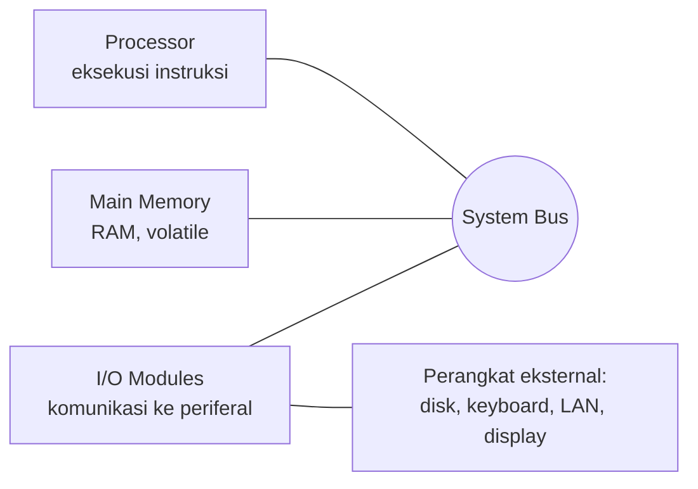
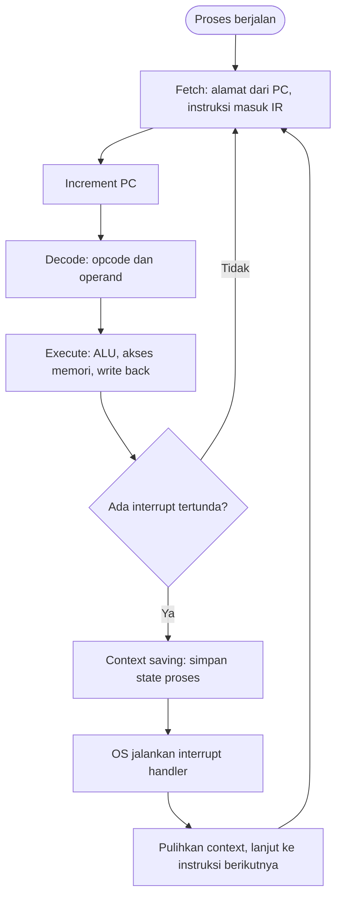

# Operating System | Sesi 1: Introduction to Operating Systems

> **Mata Kuliah:** COMP6697001 - Operating Systems | **Sesi:** 1 | **Status:** Materi UTS
> **Sumber:** Slide dosen (M. Ihsan Arief), adaptasi Stallings *Operating Systems: Internals and Design Principles* 9th, Chapter 1–2.

---

## 🔑 Cues

- Operating System sebagai perantara user, aplikasi, dan hardware
- Fungsi OS: resource manager + penyedia layanan
- User mode vs kernel mode
- Empat komponen struktural: processor, main memory, I/O modules, system bus
- Volatile vs non-volatile memory
- Principle of Locality (temporal, spatial)
- Instruction cycle: fetch, decode, execute
- Program counter (PC) dan Instruction Register (IR)
- Interrupt sebagai mekanisme pemanggilan CPU
- Kelas interrupt: exception/program, timer, I/O, hardware failure
- Page fault
- Time slicing dan scheduling
- Evolusi OS: manual, batch, multiprogramming, time-sharing
- Kondisi komputer bisa berjalan tanpa OS
- Alasan OS terus berevolusi

---

## 📖 Materi Utama

### 1. Apa itu Operating System

OS adalah perangkat lunak utama yang **mengelola hardware** dan **menyediakan layanan bagi software aplikasi**. Dua definisi yang setara: (a) manajer resource, (b) perantara antara user dan hardware yang menjamin seluruh komponen bekerja dan aplikasi berjalan lancar.

Analogi yang saya pakai: OS itu seperti **manajer gedung kantor**. Penyewa (aplikasi) tidak perlu tahu letak kabel, lift, atau panel listrik; manajer yang mengatur siapa memakai ruang rapat (CPU), gudang (memori), dan pintu masuk (I/O), sekaligus menetapkan aturan keamanan (hak akses).

**Tujuan OS** — enam hal yang harus dijawab kalau ditanya "OS ngapain saja":

| Tujuan | Objek yang diatur |
|---|---|
| Manajemen Sumber Daya | CPU, memori, penyimpanan, perangkat I/O |
| Manajemen Proses | pembuatan, penjadwalan, penghentian proses |
| Manajemen Memori | alokasi dan proteksi ruang memori |
| Manajemen Berkas (File) | struktur direktori, penyimpanan, akses |
| Manajemen Perangkat I/O | driver dan koordinasi transfer data |
| Keamanan dan Akses | autentikasi serta pembatasan hak |

### 2. Fungsi OS sebagai Resource Manager

Tugas konkretnya: memanfaatkan hardware dari satu atau lebih prosesor, menyediakan kumpulan layanan ke user, serta mengelola secondary memory dan perangkat I/O. Kata kuncinya **alokasi**: siapa dapat CPU berapa lama, siapa dapat blok memori di mana, perangkat mana dipakai proses mana — semuanya demi kinerja optimal dan pemakaian resource yang efisien.

### 3. User Mode dan Kernel Mode

Struktur OS dipisah jadi dua wilayah eksekusi:

- **User mode** — tempat aplikasi berjalan. Tidak boleh menyentuh hardware langsung.
- **Kernel mode** — tempat inti OS (kernel) bekerja, punya akses penuh ke hardware.

Pemisahan ini yang membuat OS bisa menjadi "antarmuka yang lebih mudah **dan terkontrol**". Aplikasi yang butuh hardware harus lewat kernel; itulah sumber kata *controlled interface*.

### 4. Komponen Struktural Komputer

Empat elemen utama, dan hubungan antar mereka:

- **Processor** — mengeksekusi instruksi.
- **Main Memory** — menyimpan data dan instruksi yang sedang diproses CPU secara langsung; umumnya RAM. Bersifat **volatile**: isinya hilang saat listrik mati. Cepat, tetapi kapasitas terbatas.
- **I/O Modules** — menyediakan komunikasi antara prosesor, memori utama, dan modul I/O.
- **System bus** — jalur komunikasi utama yang menghubungkan prosesor, memori, dan perangkat I/O, mentransfer **data, alamat, dan sinyal kontrol**.

**Secondary memory** adalah lawannya: non-volatile, menyimpan data secara permanen atau semi-permanen. Contoh: HDD, SSD, CD, DVD, flash drive.

Dua gaya koneksi periferal di motherboard:

| Tipe | Contoh port | Peran |
|---|---|---|
| Direct connection | SATA port, RAM slot, PCIe slot | jalur langsung ke komponen inti |
| Indirect connection | VGA, USB, LAN, 1394 (FireWire), audio (mic, line-in, line-out, SPDIF) | lewat controller/chipset sebelum sampai CPU |

### 5. Principle of Locality

Program tidak mengakses memori secara acak. **Principle of Locality**: program cenderung mengakses lokasi memori yang sama atau berdekatan dalam rentang waktu berdekatan.

- **Temporal locality** — lokasi yang baru diakses berpeluang besar diakses lagi segera. Contoh: variabel counter di dalam loop.
- **Spatial locality** — lokasi di sekitar lokasi yang baru diakses juga akan diakses. Contoh: penelusuran array berurutan, karena elemennya tersimpan berdekatan.

Ini alasan cache dan paging masuk akal: menebak isi memori berikutnya hampir selalu benar.

### 6. Instruction Execution dan Instruction Cycle

Sebuah program adalah kumpulan instruksi yang disimpan di memori. Eksekusinya dua langkah besar: **prosesor mengambil (fetch) instruksi dari memori**, lalu **menjalankannya (execute)**.

Rinciannya:

**Fetch stage**
1. Ambil alamat instruksi berikutnya dari **program counter (PC)**.
2. Ambil instruksi pada alamat tersebut dari memori, salin ke **instruction register (IR)**.
3. **Increment PC** agar menunjuk instruksi berikutnya.

**Execute stage**
1. **Decoding**: baca opcode dan operand dari IR untuk menentukan operasi.
2. **Operasi**: aritmatika, logika, pemindahan data, atau pengendalian alur — dieksekusi ALU atau unit lain.
3. **Akses memori**: bila instruksi perlu baca/tulis data.
4. **Write back**: hasil ditulis ke register atau memori.

#### Visualisasi: satu putaran instruction cycle dengan interrupt

Poin ujian: interrupt **tidak** memotong di tengah instruksi. CPU menyelesaikan instruksi yang sedang berjalan, memeriksa interrupt, baru berpindah.

### 7. Interrupts

**Interrupt** = mekanisme hardware atau software untuk mengganggu eksekusi program yang sedang berlangsung agar CPU memberi perhatian pada hal yang lebih mendesak. Istilah mentahnya: cara komponen komputer "memanggil" CPU.

Empat manfaat yang harus dihafal:

1. **Efisiensi sumber daya** — CPU tidak perlu terus-menerus memeriksa status perangkat (polling), jadi siklus CPU hemat.
2. **Peningkatan multitasking** — timer interrupt memungkinkan OS membagi waktu CPU antar proses/thread.
3. **Pengelolaan I/O lebih baik** — perangkat memberi tahu saat data siap, bukan CPU menebak-nebak. Latensi turun.
4. **Respons cepat terhadap peristiwa** — kegagalan hardware atau peringatan kritis ditangani segera; penting untuk sistem real-time.

**Kelas interrupt**

| Kelas | Penyebab | Contoh |
|---|---|---|
| Exception / Program | masalah atau kondisi khusus saat program berjalan | arithmetic exception (perhitungan tidak valid), page fault |
| Timer | sinyal periodik dari pengatur waktu internal | time slicing, scheduling |
| I/O | perangkat input/output butuh perhatian CPU | keyboard ditekan, mouse digerakkan, printer selesai mencetak |
| Hardware failure | kerusakan/permasalahan perangkat keras | listrik bermasalah, suhu prosesor terlalu tinggi, kesalahan memori |

**Time slicing** = OS membagi waktu CPU bergantian ke beberapa program. **Scheduling** = OS menentukan program mana yang jalan berikutnya. Efek yang terlihat user: Word sebentar, browser, lalu pemutar musik — bergantian sangat cepat sehingga terasa bersamaan.

Ketika beberapa interrupt datang berurutan, muncul persoalan **multiple interrupts**: menangani satu per satu (interrupt dinonaktifkan sementara) atau memberi prioritas sehingga interrupt lebih mendesak didahulukan.

### 8. Evolusi Operating System

Alasan OS terus berkembang:

- **New services** — layanan baru mengikuti kebutuhan: koneksi internet, cloud, virtualisasi, keamanan biometrik.
- **Fixes** — perbaikan bug, penutupan celah keamanan, peningkatan stabilitas, menjaga kompatibilitas.
- **Hardware upgrades** — optimalisasi untuk prosesor lebih cepat, RAM lebih besar, penyimpanan berkecepatan tinggi.
- **New types of hardware** — dukungan perangkat baru lewat driver: GPU, SSD, layar sentuh, perangkat IoT.

Tahapan evolusinya bergerak satu arah: dari satu pekerjaan manual, ke sekumpulan pekerjaan otomatis (**batch**), ke beberapa program dalam satu waktu (**multiprogramming**), lalu ke banyak user berinteraksi bersamaan (**time-sharing**).

### 9. Bisakah Komputer Berjalan Tanpa OS?

Bisa, tetapi sangat terbatas dan program harus berinteraksi langsung dengan hardware. Setelah dinyalakan, komputer dapat menjalankan firmware atau satu program khusus secara langsung. Contoh: mikrokontroler lampu lalu lintas, mesin cuci digital, kalkulator.

Untuk laptop, PC, dan smartphone, OS wajib — supaya perangkat mudah dipakai, aman, efisien, dan mampu menjalankan banyak aplikasi sekaligus.

---

## 🛠️ Use Case / Implementasi Nyata

**Skenario:** seorang mahasiswa menjalankan ekspor video 4K sambil membuka puluhan tab browser dan memutar musik. Di tengah render, sistem kehabisan frame memori karena data tekstur belum ada di RAM.

- **Masalah yang Diatasi:** CPU tidak bisa melanjutkan instruksi yang membutuhkan data tersebut. Tanpa mekanisme interrupt, CPU hanya bisa menunggu atau membaca disk sendiri — mahal dan memblokir semuanya.
- **Peran OS:** memicu **page fault**, menyimpan context proses (context saving), memuat halaman yang hilang dari secondary storage ke RAM, memperbarui tabel memori, lalu mengembalikan kontrol ke CPU. Render lanjut dari titik yang sama, browser dan musik tetap responsif.
- **Keuntungan:** CPU terpakai untuk proses lain selama I/O berlangsung (tidak sibuk menunggu), waktu tunggu tersembunyi, dan user melihat sistem seolah mengerjakan banyak hal bersamaan.

Versi satu kalimat untuk ujian: *page fault adalah interrupt jenis exception; OS berperan sebagai manajer memori sekaligus pengendali interrupt agar eksekusi berlanjut tanpa kehilangan data.*

---

## 🗂️ Konsep Kunci

| Istilah | Definisi | Contoh / Catatan |
|---|---|---|
| Operating System | Perangkat lunak utama yang mengelola hardware dan menyediakan layanan bagi aplikasi | Perantara user–aplikasi–hardware |
| Kernel | Inti OS yang berjalan di kernel mode dengan akses penuh ke hardware | Lawan dari user mode |
| User mode | Wilayah eksekusi aplikasi, tanpa akses langsung ke hardware | Butuh layanan kernel untuk I/O |
| Resource manager | Peran OS mengatur, mengendalikan, dan mengalokasikan resource | CPU, memori, penyimpanan, I/O |
| Main memory | Penyimpanan kerja CPU, umumnya RAM, volatile dan cepat | Data hilang saat listrik mati |
| Secondary memory | Penyimpanan non-volatile untuk data permanen/semi-permanen | HDD, SSD, CD, DVD, flash drive |
| System bus | Jalur komunikasi utama antar komponen | Transfer data, alamat, sinyal kontrol |
| I/O module | Penghubung prosesor–memori–periferal | Menerjemahkan sinyal bus ke perangkat |
| Principle of Locality | Program cenderung mengakses lokasi memori sama/berdekatan dalam waktu berdekatan | Temporal dan spatial |
| Program counter (PC) | Register penunjuk alamat instruksi berikutnya | Di-increment saat fetch |
| Instruction register (IR) | Register penampung instruksi yang sedang dieksekusi | Sumber decoding |
| Instruction cycle | Siklus fetch → decode → execute | Berulang sepanjang proses hidup |
| Interrupt | Sinyal yang mengganggu eksekusi untuk hal lebih mendesak | Hardware maupun software |
| Page fault | Data yang dibutuhkan belum ada di RAM, harus diambil dari storage | Kelas exception/program |
| Time slicing | OS membagi waktu CPU bergantian antar program | Dijaga timer interrupt |
| Multiprogramming | Menjalankan beberapa program dalam satu waktu | Tahap evolusi sebelum time-sharing |
| Time-sharing | Banyak user berinteraksi dengan sistem bersamaan | Butuh timer interrupt + scheduling |

---

## 📊 Tabel Ringkasan

**Main vs Secondary Memory**

| Aspek | Main Memory | Secondary Memory |
|---|---|---|
| Sifat | Volatile | Non-volatile |
| Isi saat listrik mati | Hilang | Tetap tersimpan |
| Kecepatan | Cepat | Lebih lambat |
| Kapasitas | Terbatas | Besar |
| Contoh | RAM | HDD, SSD, CD, DVD, flash drive |
| Peran | Menampung data/instruksi yang sedang diproses CPU | Penyimpanan permanen/semi-permanen |

**Dua Tahap Instruction Cycle**

| Tahap | Langkah | Register yang terlibat |
|---|---|---|
| Fetch | Ambil alamat dari PC, ambil instruksi ke IR, increment PC | PC, IR |
| Execute | Decode opcode/operand, operasi ALU, akses memori, write back | IR, ALU, register umum |

**Kelas Interrupt dan Efeknya**

| Kelas | Sumber | Efek pada eksekusi |
|---|---|---|
| Exception / Program | kondisi khusus dalam program | proses dialihkan ke handler OS (contoh: page fault) |
| Timer | pengatur waktu internal | proses diganti sesuai time slicing/scheduling |
| I/O | perangkat I/O | CPU melayani transfer data perangkat |
| Hardware failure | kerusakan perangkat keras | OS menangani kondisi kritis sistem |

**Evolusi OS**

| Tahap | Ciri |
|---|---|
| Manual | satu pekerjaan dikerjakan satu per satu |
| Batch | sekumpulan pekerjaan diproses otomatis |
| Multiprogramming | beberapa program berada di memori, CPU bergantian |
| Time-sharing | banyak user berinteraksi bersamaan |

---

## ⚠️ Catatan Penting

> **Interrupt bukan gangguan, tapi mekanisme efisiensi.** Tanpa interrupt, CPU harus polling status perangkat terus-menerus; dengan interrupt, CPU hanya bekerja saat dibutuhkan. Pertanyaan "kenapa interrupt dibutuhkan" hampir selalu muncul di ujian — jawab dengan empat manfaat: efisiensi resource, multitasking, pengelolaan I/O, respons cepat.

> **Posisi pemeriksaan interrupt.** Interrupt dicek **setelah** instruksi selesai dieksekusi, bukan di tengah-tengah. Karena itu urutan yang benar: fetch → execute (termasuk decode) → cek interrupt → (jika ada) context saving → handler → kembali.

> **Volatile itu soal daya, bukan kecepatan.** RAM volatile karena isinya hilang tanpa listrik; SSD non-volatile meski jauh lebih cepat dari HDD. Jangan tertukar.

> **User mode vs kernel mode adalah soal hak akses.** Mode menentukan instruksi mana yang boleh dijalankan dan area memori mana yang boleh disentuh — bukan sekadar soal "level pengguna".

---

## 📝 Materi Tambahan (Visual Insights)

- Slide arsitektur **Windows**, **Traditional Unix**, **Modern Unix**, dan **Android** hanya berisi gambar tanpa teks. Pola umum yang bisa diambil: lapisan hardware di bawah, kernel di tengah, layanan sistem di atasnya, lalu aplikasi di lapisan teratas — dengan batas user mode/kernel mode sebagai garis pemisah utama.
- Slide **Types of operating systems** tidak disertai uraian teks; klasifikasi tipe OS (batch, time-sharing, real-time, distributed, embedded) perlu dilengkapi dari referensi.
- Latihan dari dosen: simulasi cuaca mengalami page fault saat eksekusi. Jawaban lengkap = siklus normal fetch–decode–execute, titik interrupt terjadi setelah instruksi butuh data yang tidak ada di RAM, lalu empat langkah OS: context saving → muat data dari secondary storage ke RAM → perbarui tabel memori → kembalikan kontrol ke CPU.
- **Referensi lanjutan:** Stallings (2018) *Operating Systems: Internals and Design Principles* 9th; Silberschatz, Galvin, Gagne (2018) *Operating System Concepts* 10th; Tanenbaum & Bos (2015) *Modern Operating Systems* 4th.
