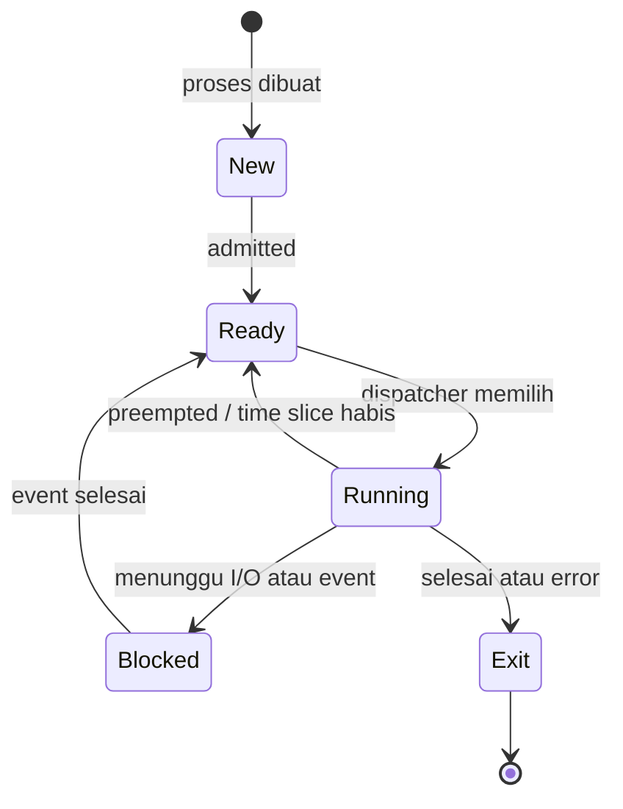
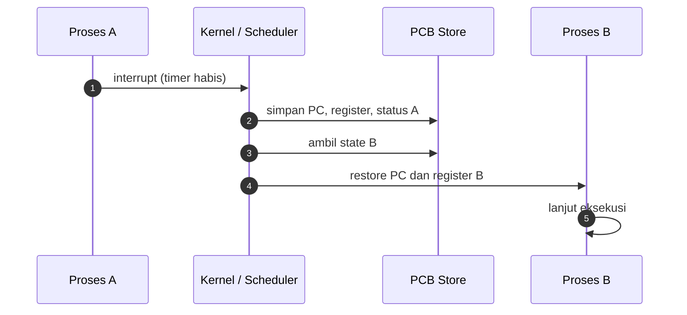

# Operating System | Sesi 2: Processes

> **Mata Kuliah:** Operating Systems (COMP6697001) | **Sesi:** 2 | **Status:** Materi UTS
> **Sumber:** Stallings, *Operating Systems: Internals and Design Principles* 9th, Chapter 3.

---

## 🔑 Cues

- Process = program yang sedang dijalankan
- PID dan PPID
- Spawning: `fork()` lalu `exec()`
- PCB (Process Control Block)
- Lima state: New, Ready, Running, Blocked, Exit
- Swapping in / swapping out
- Suspended process dan alasan suspensi
- One suspend state vs two suspend states
- Terminasi normal, error, user
- Zombie dan orphan process
- Process table sebagai registry
- Context switch = simpan/restore state
- Interrupt sebagai pemicu perpindahan eksekusi
- `fork()` mengembalikan 0 di child, PID child di parent, -1 jika gagal
- `execl()` mengganti image proses

---

## 📖 Materi Utama

### 1. Proses: Bukan File, Tapi Aktivitas

Sebuah **process** adalah program yang sedang berjalan. Program di disk hanyalah kumpulan instruksi pasif; begitu dimuat ke memori dan diberi CPU, ia menjadi entitas aktif yang dapat dijadwalkan dan dieksekusi oleh prosesor.

Analogi: resep adalah program, juru masak yang sedang mengikuti resep itu adalah proses. Satu resep bisa dipakai dua juru masak sekaligus — dua proses terpisah dari satu program.

Konsekuensi penting: satu program bisa melahirkan banyak proses (buka Chrome dua kali → dua PID berbeda), dan proses adalah unit yang dipakai OS untuk alokasi CPU, memori, dan I/O.

### 2. Silsilah Proses: Parent, Child, Spawning

| Peran | Penjelasan | Penanda |
|-------|------------|---------|
| Parent | Proses yang menciptakan proses lain | Bisa menunggu, menghentikan, membaca exit status child |
| Child | Proses hasil spawning | Punya PID unik + PPID yang menunjuk parent |
| Spawning | Aksi melahirkan proses baru | `fork()` di Unix/Linux, `CreateProcess()` di Windows |

Child mewarisi sebagian properti parent, misalnya environment variables. Hubungan ini membentuk pohon proses dengan satu akar (di Unix, `init`).

Pola spawning klasik di Unix terdiri dari dua langkah:

1. **Forking** — `fork()` membuat salinan proses induk. Ruang alamat child terpisah, tetapi isinya awalnya identik dengan parent.
2. **Exec** — `exec()` menimpa isi ruang alamat child dengan program baru. Setelah `exec`, child menjalankan program yang berbeda dari parent.

Pemisahan dua langkah ini yang membuat Unix fleksibel: shell bisa `fork` dulu, lalu menyiapkan redirection file descriptor di child, baru `exec` program target. Windows menyatukan keduanya dalam satu panggilan `CreateProcess()`.

### 3. State Proses: dari Dua ke Lima

Model paling sederhana hanya punya dua state: **Running** dan **Not Running**. Model ini terlalu kasar untuk sistem nyata.

Model lima state:

- **New** — proses baru dibuat, belum siap masuk antrean.
- **Ready** — siap dieksekusi, menunggu giliran CPU.
- **Running** — instruksinya sedang dieksekusi prosesor.
- **Blocked / Waiting** — berhenti sementara menunggu event atau I/O (misalnya pembacaan disk selesai); tidak bisa lanjut walau CPU kosong.
- **Exit / Terminated** — selesai atau dihentikan.

Beda kunci **Ready vs Blocked**: Ready hanya menunggu CPU, Blocked menunggu kejadian eksternal. Proses Blocked tidak akan menjadi Running meski CPU menganggur — ini yang membuat model lima state jauh lebih realistis daripada dua state.



### 4. Context Switch dan Interrupt

CPU hanya mengeksekusi satu proses pada satu waktu (per core). Perpindahan dari proses A ke proses B disebut **context switch**: OS menyimpan state A ke PCB-nya, lalu me-restore state B dari PCB-nya.

Pemicu perpindahan eksekusi adalah **interrupt** — timer, selesai I/O, system call, atau trap. Tanpa interrupt, proses yang sedang Running akan memonopoli CPU selamanya.

Biaya context switch murni overhead: tidak ada instruksi user yang dikerjakan selama proses simpan/restore. Karena itu time slice terlalu kecil = banyak overhead, terlalu besar = responsivitas buruk.



### 5. Swapping dan Suspended Process

**Swapping** memindahkan proses dari memori utama ke disk (backing store / secondary storage) agar ruang RAM bisa dipakai proses lain.

- **Swapping out** — proses dipindah dari RAM ke disk saat memori penuh.
- **Swapping in** — proses dikembalikan ke RAM saat gilirannya tiba.

Manfaat: lebih banyak proses bisa "ada" daripada kapasitas RAM. Kekurangan: akses disk jauh lebih lambat dari RAM, sehingga sistem terasa melambat.

**Suspended process** adalah proses yang dihentikan sementara (paused) oleh OS atau user. Ciri utamanya: proses tidak bisa dijalankan meski CPU dan memori tersedia — harus di-resume dulu. Proses suspended bisa tetap di RAM (**suspended in memory**) atau dipindah ke disk (**suspended swapped out**).

Alasan suspensi:

| Alasan | Penjelasan |
|--------|-----------|
| Swapping | Paling sering; OS melepas RAM untuk memberi ruang proses lain |
| Other OS reason | OS menyuspend proses background/utility tak prioritas, atau proses bermasalah (crash, memory leak) |
| Interactive user request | User meminta, misalnya debugger di breakpoint atau Ctrl+Z di Linux |
| Timing | Proses periodik (akuntansi harian, monitoring) disuspend sambil menunggu jadwal berikutnya |
| Parent process request | Parent menyuspend child untuk inspeksi, modifikasi, atau sinkronisasi antar-child |

Dua varian diagram state dengan suspend:

| Aspek | One Suspend State | Two Suspend States |
|-------|-------------------|--------------------|
| Jumlah state suspend | 1 | 2 (Ready-Suspend dan Blocked-Suspend) |
| Tingkat detail | Sederhana | Lebih rinci |
| Kemudahan implementasi | Mudah | Lebih rumit |
| Efisiensi scheduling | Rendah, semua dianggap sama | Tinggi, bisa dibedakan mana yang siap vs menunggu I/O |
| Cocok untuk | OS sederhana, konsep dasar | OS modern dengan multiprogramming kompleks |

### 6. Terminasi Proses

Proses berhenti dan seluruh sumber dayanya (memori, entri di process table) dibebaskan oleh OS. Tiga jalur terminasi:

- **Normal termination** — tugas selesai dengan sukses.
- **Error termination** — kesalahan tak teratasi, misalnya pembagian dengan nol atau kesalahan memori.
- **User termination** — user menghentikan proses secara manual.

Dua anomali yang wajib dibedakan:

- **Zombie** — child sudah selesai, tetapi parent belum mengambil exit code-nya. Proses mati, entrinya masih ada di process table.
- **Orphan** — parent berhenti lebih dulu daripada child. OS mengadopsi child ke proses khusus seperti `init` (contoh nyata: server dimatikan mendadak saat masih banyak proses berjalan).

### 7. Process Table dan PCB

**Process table** adalah registry milik OS yang mencatat semua proses aktif. Fungsinya: tracking proses, mendukung context switching, alokasi resource, dan bahan bagi scheduler.

Setiap baris process table adalah sebuah **Process Control Block (PCB)**, berisi:

| Field PCB | Isi |
|-----------|-----|
| Identitas | PID unik |
| Status | Running, blocked, selesai, dst. |
| Program counter | Alamat instruksi berikutnya |
| Register | Nilai register CPU untuk melanjutkan eksekusi |
| Memori | Informasi ruang memori yang dialokasikan |
| Prioritas | Tingkat prioritas untuk penjadwalan |
| I/O status | Perangkat I/O yang sedang dipakai |

Manfaat PCB: efisiensi eksekusi (context switch cepat), manajemen resource, keamanan dan isolasi antar proses, pemulihan setelah error/interupsi, serta bahan analisis kinerja.

### 8. System Call Manajemen Proses

`fork()` — membuat salinan proses. Nilai balik menentukan sisi mana yang berjalan:

- `0` → kode ini dieksekusi oleh **child**.
- `> 0` → kode ini dieksekusi oleh **parent**, nilainya adalah PID child.
- `-1` → fork gagal, child tidak terbentuk.

Karena kedua proses melanjutkan eksekusi dari titik yang sama setelah `fork()`, hasilnya dua aliran eksekusi independen dengan ruang alamat terpisah.

`execl()` — bagian dari `<unistd.h>`:

```c
int execl(const char *path, const char *arg0, ..., const char *argn, char * /*NULL*/);
```

`path` menunjuk file perintah, `arg0` biasanya sama dengan nama program, `arg1..argn` argumen, dan `NULL` menandai akhir daftar argumen. Setelah `execl()` berhasil, image proses lama diganti total — baris kode setelahnya tidak akan dijalankan.

---

## 🛠️ Use Case / Implementasi Nyata

- **Skenario — tab browser baru:** user klik "Open New Tab", browser utama (parent) melakukan spawning. Tab baru mendapat PID sendiri dan PPID yang menunjuk browser induk. Tab di background bisa di-suspend OS agar tidak memakan resource.
- **Masalah yang Diatasi:** tanpa isolasi proses, satu tab yang crash akan menjatuhkan seluruh browser; tanpa PCB dan state, OS tidak bisa menyisihkan tab idle tanpa kehilangan progresnya.
- **Keuntungan:** isolasi kegagalan, penggunaan CPU lebih adil lewat time slice, dan memori bisa dipakai bergantian via swapping.
- **Skenario — smartphone RAM 3 GB:** user membuka WhatsApp, Instagram, YouTube, Maps sekaligus. OS menyimpan aplikasi yang lama idle ke storage (swap/virtual memory); saat dibuka lagi, terasa "reload" karena swap in dari storage ke RAM.
- **Skenario — shell menjalankan perintah:** shell `fork()`, child menyiapkan file descriptor output, lalu `exec("/bin/ls", ...)`. Shell menunggu exit status child; jika shell mati lebih dulu, `ls` menjadi orphan dan diadopsi `init`.
- **Skenario — batch vs real-time:** payroll bulanan diproses batch (efisien, terjadwal, konsisten formulanya, tapi tidak instan dan koreksi baru terlihat setelah batch jalan). Otorisasi kartu kredit butuh real-time: cek limit, validasi kartu, approval dalam hitungan detik — jika lambat, risiko fraud naik dan pengalaman kasir memburuk.

---

## 🗂️ Konsep Kunci

| Istilah | Definisi | Contoh / Catatan |
|---------|----------|-----------------|
| Process | Program yang sedang dijalankan | Entitas yang dapat ditetapkan dan dieksekusi prosesor |
| PID | Process ID unik | Setiap proses punya, termasuk child |
| PPID | Parent Process ID | Menunjuk parent; membentuk pohon proses |
| Spawning | Aksi menciptakan child process | `fork()` di Unix, `CreateProcess()` di Windows |
| `fork()` | Menyalin proses induk | Return 0 di child, PID child di parent, -1 jika gagal |
| `exec()` | Mengganti image proses | Setelah berhasil, kode lama tidak dilanjutkan |
| PCB | Blok data per proses di process table | PID, status, PC, register, memori, prioritas, I/O |
| Context switch | Simpan state lama, restore state baru | Overhead murni, dipicu interrupt |
| Ready | Siap jalan, menunggu CPU | Beda dengan Blocked yang menunggu event |
| Blocked | Menunggu I/O atau event | Tidak jalan walau CPU idle |
| Swapping | Pindah proses RAM ke disk dan sebaliknya | Swap out saat RAM penuh, swap in saat dibutuhkan |
| Suspended | Proses dipause, harus di-resume | Ctrl+Z di Linux, download manager di-pause |
| Zombie | Child selesai, exit code belum diambil parent | Entri masih ada di process table |
| Orphan | Parent mati sebelum child | Diadopsi `init` |

---

## 📊 Tabel Ringkasan

**Lima state proses dan pemicunya**

| State | Arti | Masuk dari | Keluar ke |
|-------|------|-----------|-----------|
| New | Baru dibuat | — | Ready (admitted) |
| Ready | Siap, menunggu CPU | New, Running (preempted), Blocked (event selesai) | Running |
| Running | Sedang dieksekusi | Ready (dispatch) | Ready, Blocked, Exit |
| Blocked | Menunggu I/O atau event | Running | Ready |
| Exit | Selesai atau dihentikan | Running | — |

**Model state: kapan dipakai**

| Model | State | Kelebihan | Kekurangan |
|-------|-------|-----------|------------|
| Two-state | Running, Not Running | Sangat sederhana | Tidak membedakan siap vs menunggu I/O |
| Five-state | New, Ready, Running, Blocked, Exit | Realistis, mencakup waiting dan new | Belum menangani suspensi |
| Five-state + 1 suspend | Tambah satu state suspend | Cukup untuk OS sederhana | Semua proses suspend dianggap sama |
| Five-state + 2 suspend | Ready-Suspend, Blocked-Suspend | Scheduling lebih presisi | Implementasi lebih rumit |

**Batch vs Real-Time Processing**

| Aspek | Batch Processing | Real-Time Processing |
|-------|------------------|----------------------|
| Waktu respons | Tinggi latency, tidak instan | Segera, terjamin konsisten |
| Kekuatan | Olah data besar sekaligus, hemat resource | Keputusan cepat, umpan balik instan |
| Kelemahan | Interaksi terbatas, koreksi telat terdeteksi | Kompleks, konsumsi resource tinggi |
| Contoh | Payroll akhir bulan, laporan bulanan, Hadoop | Otorisasi kartu kredit, navigasi lalu lintas, health monitoring |

**Terminasi dan anomali**

| Kondisi | Status proses | Status entri di process table | Penanganan |
|---------|---------------|------------------------------|------------|
| Normal / error / user termination | Mati | Dihapus OS beserta sumber dayanya | — |
| Zombie | Mati | Masih ada | Parent harus memanggil wait |
| Orphan | Hidup | Ada | Diadopsi proses khusus seperti `init` |

---

## ⚠️ Catatan Penting

> **Ready ≠ Blocked.** Ini jebakan soal paling umum. Proses Ready bisa langsung jalan begitu CPU bebas; proses Blocked tidak akan jalan sampai event/I/O-nya selesai, walau CPU menganggur total.

> **`fork()` menggandakan, `exec()` mengganti.** `fork()` tanpa `exec()` menghasilkan dua proses yang menjalankan kode yang sama; `exec()` tanpa `fork()` akan menimpa proses pemanggilnya sendiri. Kombinasi keduanya baru menghasilkan "proses baru yang menjalankan program lain".

> **Zombie vs orphan terbalik dari yang sering dikira.** Zombie: child mati, parent hidup, entri child menggantung. Orphan: parent mati, child hidup, child diadopsi.

> **Suspended bukan Blocked.** Blocked menunggu event dan akan otomatis lanjut; suspended harus di-resume secara eksplisit oleh OS atau user.

> Context switch tidak menghasilkan kerja produktif — ia biaya. Semua angka "efisiensi" pada PCB pada akhirnya berarti memperkecil biaya tersebut.

---

## 📝 Materi Tambahan (Visual Insights)

#### Analogi lima state
Proses makan: **New** = makanan baru datang, **Ready** = makanan di meja siap disantap, **Running** = sedang dimakan, **Blocked** = berhenti sebentar karena kepedasan lalu minum, **Exit** = selesai makan. Analogi ini memetakan setiap state ke satu kejadian konkret, sehingga transisi Ready→Blocked terasa alami.

#### Batch processing di ERP
Pada sistem ERP seperti SAP, scheduler mengatur proses yang kompleks dan terintegrasi. PCB dipakai untuk menyimpan status dan prioritas tiap job, mengatur urutan eksekusi, serta melacak job yang gagal agar bisa dipulihkan. Ini contoh nyata process management yang tidak terlihat user.

#### Pola kombinasi batch + real-time
Banyak sistem produksi memakai keduanya: real-time untuk jalur kritis (otorisasi pembayaran), batch untuk pekerjaan berat yang bisa ditunda (rekonsiliasi harian, update inventaris e-commerce di akhir hari, laporan penumpang bulanan). Pilihan bukan dikotomi, melainkan pembagian jalur berdasarkan toleransi latency.

#### Referensi
Stallings (2018) *Operating Systems: Internals and Design Principles* 9th, Chapter 3; Silberschatz, Galvin, Gagne (2018) *Operating System Concepts* 10th; Tanenbaum & Bos (2015) *Modern Operating System* 4th.
