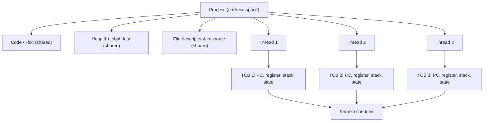
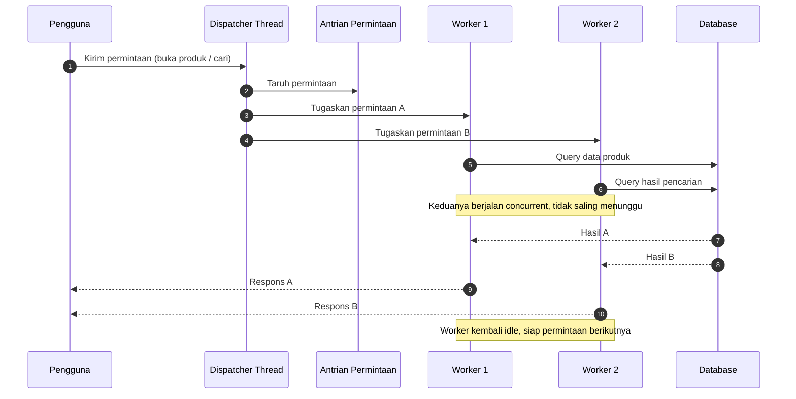
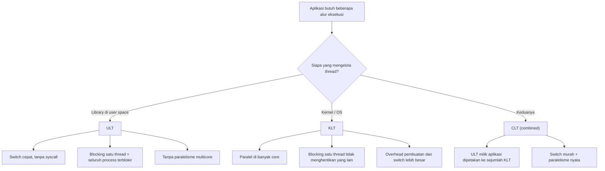

# Operating System | Sesi 3: Threads

> **Mata Kuliah:** Operating Systems (COMP6697001) | **Sesi:** 3 | **Status:** Materi UTS
> Sumber fakta: *Operating Systems: Internals and Design Principles* (Stallings, 2018, Ch. 4) via slide dosen.

---

## 🔑 Cues
- Thread = unit eksekusi terkecil di dalam process
- Process = wadah resource (address space, file, dll)
- Satu process minimal satu thread
- Thread berbagi heap, code, dan file; stack + register privat
- TCB menyimpan state tiap thread
- Context switch thread lebih murah daripada process
- Crash satu thread merusak seluruh process
- Single-threaded: sekuensial, tanpa paralelisme
- Multithreaded: beberapa alur eksekusi dalam satu process
- Dispatcher thread + worker thread
- ULT: dikelola library di user space
- KLT: dijadwalkan kernel, bisa paralel di banyak core
- CLT: gabungan ULT dan KLT
- Blocking call di ULT memblokir seluruh process
- Race condition: hasil bergantung urutan akses data bersama

---

## 📖 Materi Utama

### 1. Mengapa Thread Ada

Bayangkan aplikasi editor foto. Pengguna menekan **Terapkan Filter** pada foto resolusi tinggi; total pemrosesan butuh sekitar **8 detik** (baca piksel, hitung efek, simpan ke memori, tampilkan hasil). Selama 8 detik itu pengguna masih ingin memindahkan jendela, melihat progres, bahkan membatalkan.

Kalau semua dikerjakan satu alur eksekusi, jendela membeku. Solusinya bukan membuat process baru, tapi memecah pekerjaan menjadi beberapa **thread** di dalam process yang sama.

**Thread** adalah unit eksekusi terkecil dalam sebuah process. Thread memungkinkan multitasking *di dalam* satu process, dengan resource yang sama (memori dan data).

Karakteristik:
- **Ringan** — berbagi address space dan resource, jadi pembuatannya jauh lebih murah daripada process.
- **Eksekusi paralel** — beberapa thread dapat berjalan serentak, menaikkan efisiensi dan responsivitas.
- **Berbagi resource** — komunikasi antar-thread mudah karena memori sudah sama (tapi ini juga sumber bug).

Motivasi praktis mempelajari thread:
1. Menerima input sambil mengerjakan aktivitas lain.
2. Memanfaatkan CPU multicore untuk kerja yang memang paralel.
3. Mengelola data bersama dengan aman.
4. Menjaga aplikasi tetap responsif saat menjalankan pekerjaan berat.

### 2. Anatomi Process vs Thread

Process = program yang sedang dijalankan beserta resource-nya (ruang memori, file terbuka). Thread = satu alur eksekusi di dalamnya.

Resource yang **dibagi** antar thread: kode program, data/heap, file descriptor, signal handler.
Resource yang **privat** per thread: register, program counter, stack, status eksekusi.

Status privat itulah yang disimpan dalam **Thread Control Block (TCB)** — analog PCB untuk process, tapi lebih kecil: isinya PC, register, stack pointer, state (running/ready/blocked), prioritas, dan pointer ke PCB induknya.

#### **Visualisasi Konsep — isi satu process**

**Analogi dapur restoran.** Process = dapur: bahan, peralatan, area kerja. Thread = koki di dalamnya. Minimal satu koki; kalau ada beberapa, mereka berbagi bahan dan peralatan tetapi punya urutan kerja masing-masing. Karena berbagi pisau dan kompor, koki wajib berkoordinasi — itulah **sinkronisasi**.

### 3. Konsekuensi Berbagi: Crash dan Race Condition

Dua pertanyaan yang sering muncul:

- **Satu thread crash?** Process-nya ikut jatuh. Address space dipakai bersama, jadi pembagian oleh nol, pointer liar, atau heap rusak di satu thread merusak thread lain. Isolasi hanya ada di level process.
- **Satu process crash?** Process lain tetap aman. Ini keunggulan process: isolasi fault.

Karena memori dibagi, akses bersamaan tanpa pengaturan memunculkan **race condition** — hasil akhir bergantung pada urutan eksekusi yang tidak deterministik. Contoh klasik: dua worker menaikkan counter stok barang yang sama; operasi `baca → tambah → tulis` yang berselang-seling membuat satu kenaikan hilang. Obatnya: **mutex/semaphore** (mutual exclusion) atau struktur data atomik. Konsekuensi lanjutan: **deadlock** bila dua thread saling menunggu lock yang dipegang lawannya.

Aturan praktis: data yang immutable boleh dibagi bebas; data yang di-update wajib dikunci atau didesain agar hanya satu thread yang menulis.

### 4. Single-Threaded vs Multithreaded

**Single-threaded** — semua tugas berurutan, satu per satu, tanpa paralelisme.

Contoh yang justru tepat: program penggajian batch. Baca data karyawan, hitung gaji pokok + tunjangan − potongan, simpan, lanjut karyawan berikutnya, lalu cetak laporan. Tidak ada interaksi pengguna yang perlu dilayani selama perhitungan, jadi menambah thread hanya menambah kompleksitas tanpa manfaat. Sama untuk program hitung nilai akhir mahasiswa (input → validasi → hitung bobot → grade → tampil → mahasiswa berikutnya): alurnya interaktif tapi sekuensial, satu langkah bergantung pada langkah sebelumnya.

**Multithreaded** — beberapa thread berjalan bersamaan, masing-masing punya tugas sendiri.

Contoh yang tepat: web server e-Commerce saat flash sale. Satu **dispatcher thread** menerima permintaan, lalu membagikannya ke **worker thread** yang sedang idle. Pengguna A buka detail produk → Worker 1 ambil data produk; Pengguna B cari sepatu → Worker 2 proses pencarian; Pengguna C buka keranjang → Worker 3 ambil isi keranjang. Saat Worker 1 menunggu database, Worker 2 tetap jalan. Setelah selesai, worker kembali ke pool dan siap menerima permintaan berikutnya.

Pola yang sama muncul di aplikasi desktop (UI thread terpisah dari proses berat), game (grafis, suara, input simultan), dan OS Windows sendiri (input keyboard/mouse, aplikasi latar belakang, proses sistem).

#### **Visualisasi Konsep — dispatcher + worker**

### 5. Level Thread: ULT, KLT, CLT

Pengelolaan thread bisa di dua tempat: **aplikasi** (user space) atau **sistem operasi** (kernel space). Dari situ lahir dua tipe.

**User-Level Threads (ULT)** — dibuat, dijadwalkan, dan dikelola library/runtime di ruang pengguna. Kernel tidak tahu ada berapa thread; yang dijadwalkan kernel hanya satu entitas milik process itu.
- Tujuan: pengelolaan ringan dan fleksibel sesuai kebutuhan aplikasi.
- Plus: switch sangat cepat (tanpa syscall), portabel, aplikasi bebas menentukan kebijakan penjadwalan.
- Minus: **blocking call di satu ULT memblokir seluruh process**, karena kernel hanya melihat satu entitas. Tidak ada paralelisme multicore sesungguhnya.

Contoh: aplikasi pengunduhan dengan library ULT. ULT A menangani interaksi baca, ULT B mengunduh artikel. ULT B memulai permintaan unduhan, data belum tersedia, runtime menangguhkan ULT B dan menjalankan ULT A; setelah data tiba, ULT B dijadwalkan kembali. Semua perpindahan itu diatur library — kernel tidak menjadwalkan masing-masing ULT.

**Kernel-Level Threads (KLT)** — kernel tahu dan menjadwalkan setiap thread.
- Tujuan: pengendalian pemakaian CPU dan penanganan blocking di level OS.
- Plus: kernel bisa menaruh thread berbeda di **core berbeda** → paralel sejati; satu thread kena blocking I/O, thread lain tetap dijadwalkan.
- Minus: pembuatan dan perpindahan melibatkan kernel → overhead lebih besar.

Contoh: aplikasi transportasi online. Main thread menampilkan peta, worker thread memproses lokasi dan komunikasi ke server, lalu menyerahkan hasil ke main thread untuk memperbarui tampilan. Contoh lain: aplikasi pesan instan — main thread menjaga UI, worker thread menangani jaringan; saat worker menunggu server, pengguna tetap bisa mengetik.

⚠️ **Sering salah paham:** KLT berarti *thread-nya* dikelola kernel, bukan berarti kode aplikasi berjalan di kernel space. Kode tetap di user space; yang masuk kernel adalah operasi manajemen thread.

**Combined / CLT** — thread dikelola di dua level sekaligus: aplikasi mengelola banyak thread user, kernel menyediakan sejumlah thread kernel yang menjalankannya. Ini menggabungkan switch murah milik ULT dengan paralelisme milik KLT.

**Model multithreading** yang menghubungkan keduanya:
- **Many-to-One** — banyak ULT → satu thread kernel. Murah, tapi satu blocking menghentikan semuanya dan tanpa multicore.
- **One-to-One** — satu ULT → satu KLT. Paralel penuh, tapi biaya pembuatan thread tinggi dan jumlahnya dibatasi OS.
- **Many-to-Many** — banyak ULT multiplexed ke sejumlah KLT. Fleksibel dan paralel, paling kompleks dikelola.

#### **Visualisasi Konsep — siapa menjadwalkan apa**

---

## 🛠️ Use Case / Implementasi Nyata

- **Skenario:** Editor foto menerapkan filter berat (≈8 detik). Satu thread mengurus UI, satu thread menghitung filter, satu thread menulis progres. Pengguna tetap bisa menggeser jendela, melihat progress bar, dan menekan **Batal** di tengah proses.
- **Masalah yang Diatasi:** aplikasi membeku (tidak responsif) bila semua pekerjaan dijalankan sekuensial pada satu alur eksekusi.
- **Keuntungan:** responsivitas terjaga, CPU multicore terpakai, dan pembatalan bisa dilakukan tanpa menunggu proses selesai.

- **Skenario:** Aplikasi Word dengan tiga thread — input (menerima ketikan), pemformatan (mengatur tata letak teks dan halaman), penyimpanan (menulis ke disk berkala).
- **Masalah yang Diatasi:** mengetik harus tetap mungkin walau aplikasi sedang menata layout dan menyimpan dokumen di background.
- **Keuntungan:** tiga pekerjaan berjalan bersamaan dalam satu process, tanpa biaya dan tanpa isolasi process terpisah.

- **Skenario:** Web server e-Commerce flash sale dengan dispatcher + worker pool.
- **Masalah yang Diatasi:** ribuan permintaan datang bersamaan; satu permintaan lambat tidak boleh menahan yang lain.
- **Keuntungan:** throughput tinggi, worker dipakai ulang (bukan buat-buang thread per request), dan latensi per pengguna tetap wajar.

---

## 🗂️ Konsep Kunci

| Istilah | Definisi | Contoh / Catatan |
|---------|----------|------------------|
| Process | Program yang sedang dieksekusi beserta resource-nya | Punya address space dan file sendiri |
| Thread | Unit eksekusi terkecil di dalam process | Minimal satu per process |
| TCB | Thread Control Block: struktur kernel penyimpan state thread | PC, register, stack pointer, state, prioritas |
| Address space | Ruang memori milik process | Dibagi semua thread di dalamnya |
| Context switch | Pergantian eksekusi antar entitas | Antar thread lebih murah daripada antar process |
| Dispatcher thread | Thread penerima permintaan yang membagikannya ke worker | Front door sebuah server |
| Worker thread | Thread yang mengeksekusi tugas hasil pembagian dispatcher | Kembali idle setelah selesai |
| ULT | Thread yang dikelola library di user space | Kernel tidak menjadwalkan individual |
| KLT | Thread yang dijadwalkan kernel | Bisa berjalan di core berbeda |
| CLT | Model gabungan ULT dan KLT | Thread dikelola dua level sekaligus |
| Many-to-One | Banyak ULT dipetakan ke satu thread kernel | Blocking menghantam semua |
| One-to-One | Satu ULT dipetakan ke satu KLT | Paralel penuh, biaya tinggi |
| Many-to-Many | Banyak ULT dipetakan ke sejumlah KLT | Fleksibel, paling kompleks |
| Race condition | Hasil bergantung urutan akses data bersama | Counter stok yang hilang update |
| Mutual exclusion | Jaminan hanya satu thread masuk critical section | Mutex, semaphore |

---

## 📊 Tabel Ringkasan

**Thread vs Process**

| Aspek | Thread | Process |
|-------|--------|---------|
| Definisi | Unit terkecil eksekusi dalam process | Program yang sedang dieksekusi |
| Sumber daya | Berbagi resource dalam process yang sama (memori, file) | Memiliki ruang memori dan resource sendiri |
| Overhead | Rendah, karena berbagi resource | Tinggi, tiap process punya overhead memori dan resource |
| Komunikasi | Mudah dan cepat, lewat memori bersama | Butuh mekanisme IPC yang lebih kompleks |
| Kecepatan switching | Lebih cepat, konteks thread lebih ringan | Lebih lambat, konteks process lebih berat |
| Stabilitas | Satu thread crash, thread/process lain ikut terpengaruh | Satu process crash, process lain tetap berjalan |
| Contoh | Satu thread per permintaan pengguna di web server | Browser dan aplikasi pengolah kata sebagai process terpisah |

**ULT vs KLT vs CLT**

| Aspek | ULT | KLT | CLT |
|-------|-----|-----|-----|
| Dikelola oleh | Library di user space | Kernel | Library + kernel |
| Diketahui kernel | Tidak, per entitas | Ya, per thread | Sebagian (sejumlah KLT) |
| Biaya switch | Sangat rendah | Lebih tinggi (melibatkan kernel) | Rendah untuk antar ULT |
| Paralel multicore | Tidak | Ya | Ya, sesuai jumlah KLT |
| Efek blocking call | Seluruh process terblokir | Hanya thread tersebut | Tergantung pemetaan |
| Cocok untuk | Banyak thread ringan, UI | Kerja paralel dan I/O nyata | Keduanya sekaligus |

---

## ⚠️ Catatan Penting

> **Thread bukan process mini.** Thread tidak punya address space sendiri. Konsekuensinya dua arah: komunikasi jadi gratis, tapi isolasi fault hilang. Satu thread crash = seluruh process ikut mati, dan data bersama tanpa sinkronisasi = race condition.

> **Blocking adalah pembeda utama ULT vs KLT.** Pada ULT, kernel hanya melihat satu entitas, jadi `read()` yang menunggu data menghentikan *semua* thread user. Pada KLT, thread lain yang siap tetap dijadwalkan.

> **KLT ≠ kode di kernel space.** Hanya manajemen thread yang ditangani kernel; instruksi aplikasi tetap dieksekusi di user space.

> **Jangan pilih thread untuk segalanya.** Pekerjaan batch sekuensial seperti penggajian atau kalkulasi nilai justru lebih sederhana dan benar dengan satu thread. Thread menambah nilai saat ada pekerjaan yang bisa tumpang tindih atau ada UI yang harus tetap hidup.

---

## 📝 Materi Tambahan (Visual Insights)

#### Jembatan ke materi berikutnya

- **Scheduling.** Dengan banyak thread siap jalan dan core terbatas, kernel harus memilih siapa jalan duluan — ini masuk ke penjadwalan CPU.
- **Synchronization.** Race condition menuntut mutex, semaphore, dan monitor; harga yang dibayar adalah risiko deadlock dan priority inversion.
- **Model implementasi.** Many-to-One, One-to-One, Many-to-Many adalah kerangka berpikir untuk membaca perilaku runtime Java, pthread, atau goroutine.
- **Multicore.** Multithreading baru benar-benar menghasilkan paralelisme kalau thread benar-benar dijadwalkan di core berbeda — inilah kaitan KLT dengan mesin multicore.

#### Jebakan umum saat praktikum

- Membuat thread lebih banyak daripada pekerjaan yang tersedia: overhead naik, throughput turun.
- Mengakses variabel global dari beberapa thread tanpa lock, lalu menyalahkan "thread tidak deterministik".
- Memakai ULT untuk operasi I/O blocking, lalu bingung kenapa seluruh aplikasi membeku.
- Lupa `join()`, sehingga program selesai sebelum worker menyelesaikan tugasnya.

#### Referensi

- Stallings, W. (2018). *Operating Systems: Internals and Design Principles*, 9th ed., Chapter 4. ISBN 978-1-292-21429-0.
- Silberschatz, Galvin, Gagne (2018). *Operating System Concepts*, 10th ed. ISBN 978-1-119-32091-3.
- Tanenbaum & Bos (2015). *Modern Operating Systems*, 4th ed. ISBN 978-0-13-359162-0.
