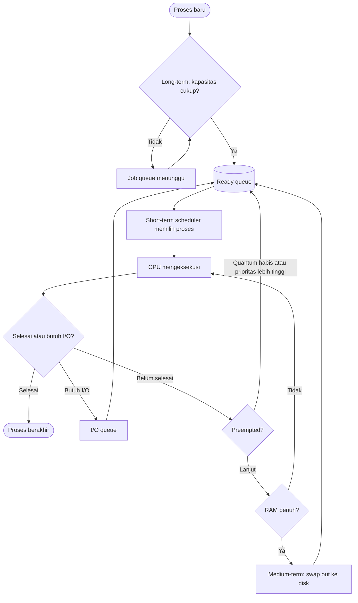

# Operating System | Sesi 4: Process Scheduling

> **Mata Kuliah:** COMP6697001 Operating Systems | **Sesi:** 4 | **Status:** Materi UTS

---

## 🔑 Cues

- **Scheduling** = mengatur siapa, kapan, berapa lama dapat CPU
- Empat lapis: **long-term**, **medium-term**, **short-term**, **I/O**
- **Long-term** = gerbang masuk job, kendali *degree of multiprogramming*
- **Medium-term** = *swap out / swap in* saat RAM sesak
- **Short-term** = pemilih dari **ready queue**, paling sering jalan
- **Preemptive** vs **non-preemptive**
- **FCFS** → **convoy effect**
- **SJF** → rata-rata *waiting time* terkecil, tapi butuh prediksi burst
- **SRT / SRTF** = SJF versi preemptive
- **Round Robin** + **time quantum**
- **Priority scheduling** → **starvation** → **aging**
- Metrik: **turnaround**, **waiting**, **response**, **throughput**
- Biaya tersembunyi: **context switch**
- OS vs developer: siapa mengatur apa

---

## 📖 Materi Utama

### 1. Masalah yang Diselesaikan Scheduling

Satu CPU, banyak proses siap jalan. Konfliknya bukan "CPU lambat", tapi **CPU cuma satu**.

Kasus nyata: kuliah via Zoom sambil browsing, mengetik catatan, mengunduh file, dan antivirus memindai disk. Kalau antivirus dibiarkan menguasai CPU sampai selesai, ketikan tertahan. Kalau tiap proses diberi jatah kecil bergiliran, semua terasa hidup — meski pekerjaan berat selesai sedikit lebih lambat.

Keputusan desainnya: **latenitas interaktif** vs **total waktu penyelesaian kerja berat**. Scheduling adalah tempat trade-off itu diatur.

Tiga aturan dasar yang harus diputuskan OS:
1. Proses mana yang naik CPU berikutnya.
2. Berapa lama boleh menempati CPU.
3. Apa yang terjadi kalau ada proses lebih penting datang di tengah jalan.

### 2. Empat Jenis Scheduling — Satu Rantai, Bukan Empat Pesaing

| Jenis | Objek yang Diatur | Frekuensi | Analogi logistik |
|---|---|---|---|
| Long-term | Job baru yang boleh masuk sistem | Jarang | Memilih kargo yang boleh masuk gudang |
| Medium-term | Proses di RAM vs di disk | Saat memori tertekan | Menata ulang barang di rak gudang |
| Short-term | Proses di ready queue → CPU | Sangat sering (tiap kali CPU bebas) | Menentukan urutan kirim barang |
| I/O | Permintaan baca/tulis perangkat | Per permintaan I/O | Mengatur kendaraan keluar gudang |

Keempatnya berbagi satu siklus, bukan bersaing. Long-term menjaga agar sistem tidak kelebihan beban, medium-term menjaga RAM tidak meledak, short-term memutuskan tiap milidetik, I/O menjaga disk tidak menganggur.

**Long-term** mengendalikan *degree of multiprogramming*. Contoh sistem batch: 20 job menunggu, kapasitas hanya cukup 5, maka 5 diterima dan sisanya mengantre di job queue. Terlalu banyak diterima → *thrashing*; terlalu sedikit → CPU idle.

**Medium-term** memakai *swapping*. Saat RAM sempit, isi memori proses (mis. P2) dipindah ke disk (*swap out*), lalu dikembalikan (*swap in*) ketika ruang tersedia. Prosesnya tidak mati, hanya "diparkir".

**Short-term** adalah yang biasanya dimaksud "algoritma scheduling". Ia memilih dari ready queue, jalan paling sering, dan harus secepat mungkin karena keputusannya menahan seluruh sistem.

**I/O scheduling** berbeda objek: CPU scheduler memilih *proses/thread*, I/O scheduler memilih *permintaan I/O*. Contoh: menyalin video ke SSD sambil membuka PowerPoint dari SSD yang sama — dua aliran permintaan baca/tulis harus diurutkan agar tidak saling menghambat.

#### **Visualisasi Konsep**

Diagram di atas memperlihatkan bahwa **hanya short-term scheduler yang menyentuh CPU secara langsung**; long-term menyaring di pintu masuk, medium-term menyelamatkan RAM, I/O menangani antrean perangkat.

### 3. Preemptive vs Non-Preemptive

- **Non-preemptive** (*cooperative*): proses yang sudah di CPU dibiarkan selesai atau menyerahkan CPU sendiri (karena selesai atau menunggu I/O). Sederhana, hemat context switch, tapi satu proses panjang bisa membekukan seluruh sistem.
- **Preemptive**: OS boleh mencabut CPU di tengah eksekusi, biasanya karena **time quantum habis** atau **proses berprioritas lebih tinggi tiba**. Responsif, tapi menambah biaya *context switch*.

### 4. Algoritma-Algoritma Inti

#### FCFS — First Come, First Served
Melayani sesuai urutan masuk ready queue. **Non-preemptive**: proses berjalan tidak dihentikan hanya untuk memberi giliran.
Aturan: yang paling depan dapat CPU, pendatang baru masuk belakang, CPU pindah setelah proses selesai.
Contoh: antrean cetak dokumen — A masuk dulu, lalu B dan C; printer mencetak A, B, C berurutan.
Kelemahan: **convoy effect** — satu proses panjang di depan menahan semua proses pendek di belakangnya, sehingga rata-rata waiting time membengkak.

#### SJF — Shortest Job First
Memilih proses dengan **perkiraan CPU burst berikutnya paling singkat** di antara proses yang sudah siap. Versi yang dibahas: **non-preemptive**, jadi proses pendek yang datang belakangan tetap menunggu CPU dilepas.
Syarat praktis: butuh **prediksi** durasi burst (riwayat, exponential averaging). Tanpa prediksi yang layak, SJF tidak bisa diterapkan.
Kelemahan: proses panjang berisiko **starvation** kalau proses pendek terus berdatangan.

#### SRT / SRTF — Shortest Remaining Time (First)
Versi **preemptive** dari SJF. Pembandingnya bukan total burst, melainkan **sisa waktu** proses yang sedang berjalan.
Jika proses baru datang dengan kebutuhan lebih singkat daripada sisa proses aktif, proses aktif **dijeda**, dan dilanjutkan lagi saat terpilih kembali (pause/resume).
Konsekuensinya: lebih responsif untuk tugas pendek, tapi context switch lebih sering.

#### Round Robin (RR)
Preemptive bergiliran dengan batas **time quantum**.
Aturan: proses terdepan dapat CPU maksimal satu quantum; kalau quantum habis dan proses masih siap, ia kembali ke **belakang** antrean; kalau selesai atau menunggu I/O sebelum quantum habis, CPU langsung diserahkan ke proses lain.
Efek: tidak ada proses yang menguasai CPU terlalu lama — foto berukuran besar tidak menghabiskan seluruh waktu, pengguna lain tetap kebagian.
Catatan penting: RR **bukan** pemotongan waktu CPU saat dipakai untuk *load balancing*. NGINX membagi request ke Server A, B, C lalu kembali ke A — itu pembagian giliran, tanpa pause/resume pekerjaan.

Ukuran quantum menentukan karakter:
- quantum terlalu **besar** → RR menyerupai FCFS, respons buruk;
- quantum terlalu **kecil** → terlalu banyak context switch, throughput turun karena CPU sibuk berpindah.

#### Priority Scheduling
Tiap proses punya prioritas; CPU diberikan ke prioritas tertinggi. Bisa preemptive maupun non-preemptive. Cocok saat ada proses yang memang harus didahulukan (mis. thread UI, driver perangkat).
Risiko: **starvation** — proses berprioritas rendah bisa tidak pernah jalan selama proses berprioritas tinggi terus datang.
Solusi: **aging** — prioritas proses yang menunggu dinaikkan bertahap seiring waktu tunggu, sehingga akhirnya pasti terpilih.

### 5. Contoh Perhitungan yang Konsisten

Tiga proses tiba bersamaan pada t=0, burst diketahui (angka ini sama dengan contoh layanan laporan pada materi):

| Proses | Pekerjaan | Burst (detik) |
|---|---|---|
| P1 | Rekap tahunan | 20 |
| P2 | Rekap bulanan | 5 |
| P3 | Rekap harian | 2 |

**FCFS (urutan P1 → P2 → P3)**

| Proses | Mulai | Selesai | Turnaround | Waiting |
|---|---|---|---|---|
| P1 | 0 | 20 | 20 | 0 |
| P2 | 20 | 25 | 25 | 20 |
| P3 | 25 | 27 | 27 | 25 |
| **Rata-rata** | | | **24** | **15** |

**SJF non-preemptive (urutan P3 → P2 → P1)**

| Proses | Mulai | Selesai | Turnaround | Waiting |
|---|---|---|---|---|
| P3 | 0 | 2 | 2 | 0 |
| P2 | 2 | 7 | 7 | 2 |
| P1 | 7 | 27 | 27 | 7 |
| **Rata-rata** | | | **12** | **3** |

Cek: 20+25+27 = 72, dibagi 3 = 24. Waiting = turnaround − burst, jadi 0+20+25 = 45, dibagi 3 = 15. SJF: 2+7+27 = 36 → 12; waiting 0+2+7 = 9 → 3. Total waktu penyelesaian keduanya tetap 27 detik — **SJF tidak mempercepat sistem, ia hanya memindahkan waktu tunggu ke proses panjang.**

**Round Robin dengan quantum 2** (proses berbeda: P1=6, P2=4, P3=2, semua tiba t=0)

| Waktu | Proses | Sisa setelahnya |
|---|---|---|
| 0–2 | P1 | 4 |
| 2–4 | P2 | 2 |
| 4–6 | P3 | 0 (selesai, t=6) |
| 6–8 | P1 | 2 |
| 8–10 | P2 | 0 (selesai, t=10) |
| 10–12 | P1 | 0 (selesai, t=12) |

Turnaround: P1=12, P2=10, P3=6 → rata-rata **9,33**. Waiting (turnaround − burst): 6, 6, 4 → rata-rata **5,33**. Bandingkan SJF untuk himpunan yang sama: waiting 0 + 2 + 6 → rata-rata 2,67. RR lebih adil untuk respons, tapi rata-rata waiting lebih tinggi.

### 6. Pembagian Peran: OS vs Developer

| Level | Tanggung jawab | Batas kendali |
|---|---|---|
| Sistem operasi | Memilih thread yang dapat CPU, mengatur giliran dan prioritas, menjeda eksekusi | Penuh atas CPU fisik |
| Developer aplikasi | Memecah pekerjaan jadi task/thread, mengelola konkurensi, menjaga pekerjaan berat tidak memblokir UI | Hanya atas struktur kerja di dalam proses |

Contoh: tombol "Olah Data" memproses jutaan baris. Kalau dijalankan di UI thread, jendela membeku. Developer memindahkannya ke worker thread agar UI tetap menerima klik dan menampilkan progres — tetapi **kapan worker itu benar-benar dapat CPU tetap ditentukan OS**. Developer boleh membuat penjadwalan tingkat aplikasi (urutan unggahan, prioritas job latar), eksekusinya tetap mengikuti penjadwal OS.

---

## 🛠️ Use Case / Implementasi Nyata

- **Skenario:** Layanan pembuatan laporan toko dengan satu worker yang mendukung pause/resume. Manajer meminta laporan tahunan (sisa 10 detik); kasir lalu meminta laporan harian (2 detik).
- **Masalah yang Diatasi:** Tanpa preemption, kasir menunggu 10 detik untuk laporan yang butuh 2 detik. Dengan aturan **SRT**, pekerjaan tahunan dijeda karena sisa waktunya lebih besar daripada kebutuhan laporan harian, laporan harian selesai lebih dulu, lalu tahunan dilanjutkan dari posisi terakhir.
- **Keuntungan:** waktu tunggu permintaan kecil turun drastis, terasa responsif, tanpa kehilangan progres pekerjaan besar.
- **Skenario kedua:** server web dengan tiga backend berbobot sama memakai **Round Robin** — request 1 ke A, 2 ke B, 3 ke C, 4 kembali ke A. Beban tersebar rata. Bedanya dengan RR di CPU: tidak ada pemotongan waktu atau pause/resume, hanya pemilihan tujuan.

---

## 🗂️ Konsep Kunci

| Istilah | Definisi | Contoh / Catatan |
|---|---|---|
| Scheduling | Pengaturan waktu eksekusi proses pada CPU agar sumber daya terpakai efisien, adil, dan tepat waktu | Inti: siapa, kapan, berapa lama |
| Ready queue | Daftar proses siap jalan yang menunggu giliran CPU | Sumber masukan short-term scheduler |
| Dispatcher | Mekanisme yang menyerahkan CPU ke proses terpilih | Menimbulkan biaya context switch |
| Long-term scheduler | Menentukan job mana yang masuk sistem; mengatur degree of multiprogramming | 20 job menunggu, 5 diterima |
| Medium-term scheduler | Menangguhkan/mengaktifkan proses via swap out–swap in | P2 diparkir ke disk saat RAM sempit |
| Short-term scheduler | Memilih proses dari ready queue untuk CPU | Berjalan paling sering |
| I/O scheduler | Mengurutkan permintaan baca/tulis perangkat | Salin video + buka PowerPoint di SSD sama |
| Preemptive | OS boleh mencabut CPU di tengah eksekusi | Quantum habis, prioritas lebih tinggi datang |
| Non-preemptive | Proses berjalan sampai selesai atau menunggu I/O | FCFS, SJF versi non-preemptive |
| FCFS | Melayani sesuai urutan kedatangan | Non-preemptive, rawan convoy effect |
| Convoy effect | Proses pendek tertahan di belakang satu proses panjang | Efek khas FCFS |
| SJF | Pilih burst terpendek berikutnya | Non-preemptive; butuh prediksi burst |
| SRT / SRTF | Pilih sisa waktu terpendek, termasuk preempt proses aktif | Versi preemptive SJF |
| Time quantum | Jatah waktu maksimum satu giliran pada Round Robin | Terlalu besar ≈ FCFS, terlalu kecil ≈ boros switch |
| Priority scheduling | Pilih prioritas tertinggi | Rawan starvation |
| Starvation | Proses berprioritas rendah tidak pernah terpilih | Diperbaiki dengan aging |
| Aging | Menaikkan prioritas proses seiring lama menunggu | Jaminan eventually dilayani |
| Turnaround time | Selesai − waktu tiba | Termasuk waktu menunggu |
| Waiting time | Total waktu di ready queue | Turnaround − burst |
| Response time | Waktu dari permintaan sampai respons pertama | Metrik utama sistem interaktif |
| Throughput | Jumlah proses selesai per satuan waktu | Turun kalau context switch terlalu sering |
| Degree of multiprogramming | Banyaknya proses di memori | Dikendalikan long-term scheduler |

---

## 📊 Tabel Ringkasan

| Algoritma | Preemptive? | Dasar pemilihan | Kekuatan | Kelemahan |
|---|---|---|---|---|
| FCFS | Tidak | Urutan kedatangan | Sederhana, adil secara urutan, minim overhead | Convoy effect, waiting time besar |
| SJF | Tidak | Burst terpendek | Waiting time rata-rata minimum | Butuh prediksi burst, starvation proses panjang |
| SRT / SRTF | Ya | Sisa burst terpendek | Responsif untuk tugas pendek | Context switch sering, prediksi tetap dibutuhkan, starvation |
| Round Robin | Ya | Giliran + quantum | Adil, respons time terbatas, cocok time-sharing | Waiting time lebih tinggi dari SJF, tuning quantum |
| Priority | Bisa keduanya | Nilai prioritas | Proses penting didahulukan | Starvation tanpa aging |

| Metrik | Rumus | Arah yang Diinginkan |
|---|---|---|
| Turnaround time | completion − arrival | Kecil |
| Waiting time | turnaround − burst | Kecil |
| Response time | first run − arrival | Kecil |
| Throughput | jumlah selesai / total waktu | Besar |
| CPU utilization | waktu sibuk / total waktu | Besar (mendekati 100%) |

---

## ⚠️ Catatan Penting

> **Tidak ada algoritma terbaik untuk semua kondisi.** SJF menang di rata-rata waiting time, RR menang di respons, FCFS menang di kesederhanaan. Pilihan algoritma adalah pernyataan tentang tujuan sistem, bukan soal benar–salah.

> **Total waktu penyelesaian tidak berubah** oleh urutan non-preemptive. Pada contoh 20/5/2 detik, FCFS dan SJF sama-sama selesai di t=27. Yang berubah adalah distribusi waktu tunggu: SJF memindahkan beban ke proses panjang.

> **Preemptive ≠ selalu lebih baik.** Setiap preemption adalah context switch: simpan register, ganti page table, kemungkinan cache dingin. Quantum terlalu kecil membuat CPU sibuk berpindah, bukan bekerja.

> **RR di CPU ≠ RR di load balancer.** Di CPU ada quantum dan pause/resume; di NGINX hanya pemilihan server tujuan, tidak ada pemotongan pekerjaan.

> **Prediksi burst adalah titik lemah SJF/SRT.** Tanpa data historis yang layak, keduanya hanya teori; di sistem nyata dipakai estimasi exponential averaging atau algoritma berbasis prioritas/feedback.

---

## 📝 Materi Tambahan (Visual Insights)

- **Melengkapi slide (dokumentasi umum, bukan dari PPT):** PPT menyebut prioritas secara sepintas ("kecuali ada pengaturan prioritas"), sedangkan *aging*, *starvation*, *convoy effect*, dan metrik *turnaround/throughput* adalah istilah baku pada Stallings, Silberschatz, dan Tanenbaum yang menjadi referensi sesi ini.
- **Multilevel Feedback Queue (MFQ):** perluasan praktis dari priority + RR. Proses baru masuk antrean prioritas tertinggi dengan quantum kecil; kalau memakai CPU berulang tanpa selesai, ia turun kelas ke antrean dengan quantum lebih besar. Efeknya: proses interaktif (burst pendek) tetap di atas, proses batch turun ke bawah — SJF didekati tanpa perlu memprediksi burst.
- **Linux CFS:** memakai *virtual runtime* sebagai pengganti prioritas statis; proses dengan waktu jalan paling sedikit dipilih berikutnya, sehingga tidak ada starvation dan tidak perlu quantum eksplisit seperti RR klasik.
- **Hubungan dengan sesi berikutnya:** scheduling hanya bermakna kalau ada lebih dari satu proses siap. Mekanisme yang menciptakan kondisi itu — thread, sinkronisasi, dan konkurensi — adalah lanjutan alami dari sesi ini.

#### Analogi Penutup

Kasir supermarket adalah CPU. Antrean pelanggan adalah ready queue. Kasir 1 melayani sesuai urutan datang (FCFS) — pelanggan dengan satu barang bisa mengantre di belakang troli penuh. Kasir 2 memilih keranjang paling sedikit (SJF) — cepat, tapi pelanggan dengan troli penuh bisa menunggu sangat lama. Kasir 3 memberi tiap pelanggan beberapa item lalu berpindah (RR) — semua terlihat maju, tidak ada yang selesai cepat. Kasir 4 melayani pelanggan VIP dulu (priority) — dan kalau VIP terus datang, pelanggan biasa tidak pernah kebagian (starvation), kecuali kasir menaikkan prioritas mereka sedikit demi sedikit (aging).
