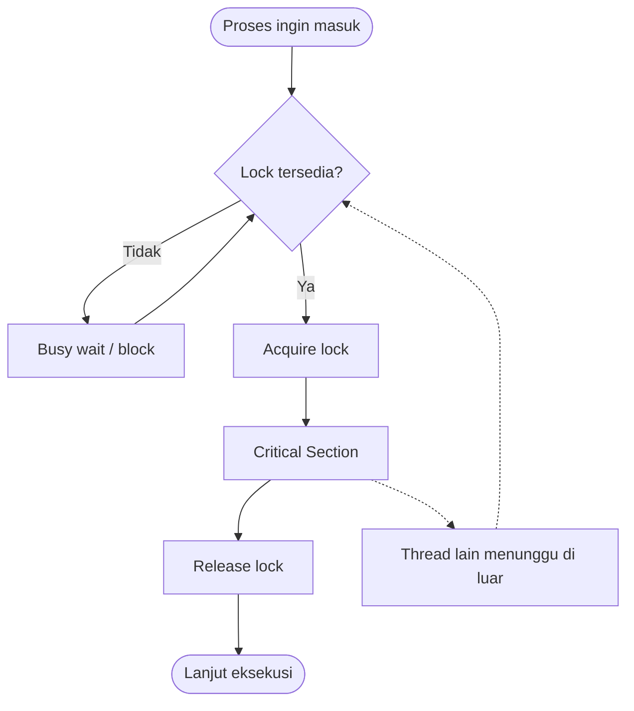

# Operating System | Sesi 5: Synchronization and Inter-process Communication

> **Mata Kuliah:** Operating Systems | **Sesi:** 5 | **Status:** Materi UAS

---

## 🔑 Cues

- Multiprogramming vs Multiprocessing vs Distributed Processing
- Concurrency: simultan belum tentu paralel
- Tiga konteks concurrency: multiple applications, structured applications, OS structure
- Empat penyebab concurrency management
- Deadlock, livelock, race condition, starvation — bedanya
- Atomic operation: all or nothing
- Critical section & mutual exclusion
- Semaphore counting vs binary; condition variable; event flag
- Spinlock: busy waiting
- Software approach: Dekker & Peterson
- Hardware approach: instruksi atomic CPU
- IPC: shared memory vs message passing
- Pipe, mailbox, monitor
- Aging sebagai obat starvation
- Trade-off: lock benar vs throughput

---

## 📖 Materi Utama

### 1. Dari satu CPU ke banyak CPU: peta besar

Sebelum bicara sinkronisasi, pahami dulu panggungnya. Tiga istilah ini sering tertukar, padahal beda level:

- **Multiprogramming** — satu prosesor, banyak proses disimpan di *ready queue*, CPU bergiliran sangat cepat lewat *CPU scheduling*. Hanya satu proses benar-benar dieksekusi pada satu waktu. Contoh: satu PC membuka editor teks, pemutar musik, dan browser sekaligus.
- **Multiprocessing** — lebih dari satu prosesor/core di satu komputer, benar-benar paralel. Butuh koordinasi lewat OS agar tidak berebut sumber daya. Contoh: server 4 CPU menjalankan web server, database server, dan file server bersamaan.
- **Distributed Processing** — banyak komputer (*node*) terhubung jaringan, berbagi beban. Contoh: cluster computing dan cloud computing, termasuk mesin pencari Google.

Analogi: multiprogramming = satu kasir melayani banyak antrean bergantian; multiprocessing = empat kasir di gedung yang sama; distributed = empat cabang toko di kota berbeda yang saling berbagi stok.

### 2. Concurrency: simultan, belum tentu paralel

**Concurrency** adalah kemampuan sistem menangani beberapa tugas secara simultan. Kuncinya: beberapa proses/thread dapat berjalan "bersamaan" tanpa harus benar-benar dieksekusi pada waktu yang persis sama — cukup saling tumpang tindih (overlap) dalam periode yang sama.

Ini penting karena hardware sekarang multi-core. Program satu jalur (sequential) menyia-nyiakan sebagian besar kekuatan CPU. Di sisi lain, sistem enterprise seperti Gojek, Tokopedia, atau Netflix melayani jutaan request per detik; tanpa pengaturan concurrency, server tumbang dan data jadi berantakan.

Concurrency muncul di tiga konteks:
1. **Multiple Applications** — banyak aplikasi aktif, CPU membagi waktu. Mengetik di Word sambil musik berjalan.
2. **Structured Applications** — aplikasi besar dipecah jadi modul/subproses yang jalan bersamaan. Web server seperti Apache memakai thread terpisah per klien.
3. **Operating System Structure** — OS sendiri tersusun dari proses/thread paralel: file management, memory management, device management. Di Windows ada `explorer.exe` (GUI: taskbar, Start Menu, ikon desktop) dan `dwm.exe` (pengelola jendela berbasis efek visual).

### 3. Kenapa concurrency perlu "manajemen"

Empat pemicu masalah:

1. Banyak proses/thread aktif bersamaan (multitasking).
2. Sumber daya dipakai bersama (*shared resources*): variabel global, file, memori, printer.
3. Tuntutan efisiensi CPU dan waktu respons cepat, sehingga proses dijalankan bergantian dalam waktu sangat singkat.
4. Interaksi antar proses (IPC) — saling kirim data/pesan, butuh sinkronisasi agar tidak konflik atau kehilangan data.

Kalau aturan sinkronisasi dilanggar, muncul empat penyakit:

| Penyakit | Inti masalah | Tanda khas |
|---|---|---|
| **Deadlock** | Dua atau lebih proses saling menunggu sumber daya yang dipegang pihak lain | Semua diam, tidak ada progres |
| **Livelock** | Proses terus mengubah status mencoba menyelesaikan konflik | CPU sibuk, pekerjaan nol |
| **Race Condition** | Akses dan modifikasi data sama secara bersamaan; hasil bergantung urutan eksekusi yang tak pasti | Nilai akhir berubah-ubah antar run |
| **Starvation** | Satu proses terus diabaikan scheduler; prioritas tinggi selalu menang | Proses siap, tapi tak pernah dieksekusi |

Analogi: deadlock = dua orang di lorong sempit, sama-sama menunggu yang lain mundur. Livelock = keduanya justru terus maju-mundur bergantian tanpa pernah lewat. Race condition = dua orang menulis di baris yang sama pada papan tulis; yang terakhir menulis menentukan isi akhir. Starvation = antrean loket yang selalu melayani tamu VIP.

### 4. Kosakata wajib sinkronisasi

- **Atomic Operation** — aksi *indivisible*: dieksekusi sepenuhnya atau tidak sama sekali, tidak bisa diinterupsi proses lain. Tujuannya menjaga konsistensi data.
- **Critical Section** — potongan kode yang mengakses *shared resource* (variabel, file, perangkat) dan tidak boleh dijalankan bersamaan oleh lebih dari satu proses/thread.
- **Mutual Exclusion** — prinsip/mekanisme yang memastikan hanya satu proses berada di critical section pada satu waktu.
- **Semaphore** — variabel integer untuk memberi sinyal antar proses melalui `wait` dan `signal`; bentuk *counting* mengatur akses sejumlah slot.
- **Binary Semaphore** — semaphore bernilai hanya 0 atau 1, mirip mutex; satu pengakses per waktu.
- **Condition Variable** — struktur data tempat thread menunggu sampai kondisi tertentu terpenuhi.
- **Event Flags** — variabel memori penanda/pemicu kejadian; thread lain lanjut kerja setelah event terjadi.
- **Mailboxes / Messages** — mekanisme tukar pesan antar proses (IPC) tanpa berbagi memori langsung.
- **Spinlock** — *busy waiting*: thread terus memeriksa ketersediaan lock tanpa tidur; cocok untuk locking cepat di multiprosesor dengan waktu tunggu singkat.

### 5. Dua jalur menuju mutual exclusion

**Pendekatan software** — murni logika program dan variabel bersama, tanpa bantuan hardware khusus.
- *Dekker's Algorithm*: memakai `flag[i]` dan `turn` untuk mengatur giliran dua proses.
- *Peterson's Algorithm*: versi lebih ringkas dan mudah dipahami untuk dua proses.
- Kelemahan: rumit untuk lebih dari 2 proses, butuh busy waiting, tidak efisien di multiprosesor.

**Pendekatan hardware** — instruksi khusus CPU yang membuat operasi memori menjadi atomic, tak bisa diinterupsi.
- Kelemahan: bergantung dukungan arsitektur tertentu.
- Contoh nyata: di kernel Linux/Windows, banyak thread mengakses tabel file sistem; hanya satu yang diizinkan menulis pada satu waktu.

#### **Visualisasi Konsep**

Protokol empat langkah inilah inti semua mekanisme: *entry section* (ambil lock) → *critical section* → *exit section* (lepas lock) → *remainder section*. Semua algoritma, dari Peterson sampai mutex kernel, hanya variasi cara mengisi kotak "Lock tersedia?".

---

## 🛠️ Use Case / Implementasi Nyata

- **Skenario 1 — Bank online.** Dua nasabah bertransaksi pada rekening yang sama di waktu bersamaan: satu transfer, satu cek saldo. Keduanya membaca dan menulis data saldo. Tanpa mutex/semaphore, saldo jadi tidak konsisten (race condition). Solusi: bungkus pembacaan-perubahan-penulisan saldo dalam critical section dan kunci dengan mutex, sehingga satu transaksi selesai sebelum yang lain memproses data yang sama.
- **Skenario 2 — File sharing di cloud.** Dua pengguna mengedit file yang sama. Hanya satu yang boleh menulis pada satu waktu. Mutex mengunci file; setelah pengguna pertama selesai dan melepas lock, pengguna kedua mulai mengedit. Tanpa lock: versi tulisan saling menimpa dan riwayat perubahan hilang.
- **Skenario 3 — Antrean printer kantor.** Dokumen manajer (prioritas tinggi) terus dicetak, dokumen staf biasa tidak pernah dapat giliran. Ini starvation. Solusi: **aging** — naikkan prioritas proses yang menunggu terlalu lama sehingga akhirnya terlayani.

Pola umumnya: kenali dulu apakah masalahnya *korupsi data* (butuh mutual exclusion) atau *keadilan akses* (butuh aging/priority boost). Dua masalah berbeda, obatnya berbeda.

---

## 🗂️ Konsep Kunci

| Istilah | Definisi | Contoh / Catatan |
|---------|----------|-----------------|
| Multiprogramming | Banyak proses bergantian pada satu prosesor | Ready queue + CPU scheduling |
| Multiprocessing | Banyak prosesor mengeksekusi paralel | Server multi-core |
| Distributed Processing | Proses di banyak komputer lewat jaringan | Cluster, cloud, Google Search |
| Concurrency | Tugas-tugas saling tumpang tindih waktunya | Belum tentu benar-benar paralel |
| Atomic Operation | Tak dapat dibagi, all or nothing | Dasar dari semua lock |
| Critical Section | Kode yang mengakses shared resource | Harus dijaga mutual exclusion |
| Mutual Exclusion | Hanya satu proses di critical section | Tujuan, bukan alat |
| Semaphore (counting) | Integer + `wait`/`signal` | Mengatur N slot sumber daya |
| Binary Semaphore | Nilai 0/1 | Mirip mutex |
| Spinlock | Busy waiting pada lock | Efisien bila tunggu sangat singkat |
| Condition Variable | Menunggu sampai kondisi terpenuhi | Sering dipakai bersama mutex |
| Shared Memory | Proses berbagi region memori | Cepat, butuh sinkronisasi manual |
| Message Passing | Tukar pesan lewat kernel/kanal | Aman, tanpa alamat memori bersama |
| Pipe | Kanal byte satu arah antar proses | `ls \| grep` di shell |
| Monitor | Abstraksi: mutex + condition variable dibungkus prosedur | Satu thread aktif per monitor |

---

## 📊 Tabel Ringkasan

**Perbandingan tiga model eksekusi**

| Konsep | Jumlah prosesor | Lokasi eksekusi | Tujuan utama | Contoh |
|---|---|---|---|---|
| Multiprogramming | 1 | Satu komputer | Memaksimalkan penggunaan CPU | PC menjalankan banyak aplikasi |
| Multiprocessing | >1 | Satu komputer, banyak prosesor | Performa dan keandalan | Server multi-core |
| Distributed Processing | Banyak | Beberapa komputer via jaringan | Pembagian beban dan skalabilitas | Cloud, cluster computing |

**Perbandingan mekanisme sinkronisasi**

| Mekanisme | Level | Kapan menunggu | Kelebihan | Kelemahan |
|---|---|---|---|---|
| Dekker / Peterson | Software | Busy waiting | Tanpa dukungan hardware | Rumit >2 proses, tak efisien di multiprosesor |
| Test-and-set / instruksi atomic | Hardware | Busy waiting | Cepat, granularitas rendah | Perlu arsitektur khusus |
| Mutex / binary semaphore | OS / library | Block atau spin | Sederhana, jelas | Salah urutan lock bisa deadlock |
| Counting semaphore | OS / library | Block | Bisa mengatur N slot | Rawan bug bila `signal` lupa |
| Monitor | Bahasa / runtime | Block | Enkapsulasi, sulit salah pakai | Terikat dukungan bahasa |

**Shared memory vs message passing**

| Aspek | Shared Memory | Message Passing |
|---|---|---|
| Kecepatan | Tinggi setelah region dibuat | Overhead syscall per pesan |
| Sinkronisasi | Tanggung jawab programmer | Ditangani mekanisme kirim/terima |
| Skala | Sulit lintas mesin | Natural lintas mesin |
| Risiko | Race condition, data korup | Kehilangan pesan, blocking |

---

## ⚠️ Catatan Penting

> **Mutual exclusion bukan jaminan bebas masalah.** Lock hanya mencegah akses bersamaan; ia tidak mencegah deadlock (urutan acquire saling silang), tidak menjamin keadilan (starvation), dan tidak memperbaiki desain data yang buruk.

- **Deadlock butuh empat kondisi sekaligus** (mutual exclusion, hold and wait, no preemption, circular wait). Hilangkan satu saja, deadlock batal.
- **Livelock sering tertukar dengan deadlock.** Bedanya: deadlock = tidak ada yang berubah; livelock = status terus berubah tapi tidak ada progres berguna.
- **Race condition bersifat probabilistik.** Bug bisa hilang saat di-debug karena timing berubah — jangan simpulkan "sudah benar" hanya karena satu kali run lolos.
- **Spinlock hanya masuk akal bila critical section sangat pendek** dan jumlah core terbatas; di single core ia membakar waktu yang seharusnya dipakai pemegang lock.
- **Critical section harus sesingkat mungkin.** Semakin lama di dalamnya, semakin lama semua pihak menunggu.
- **Starvation bukan soal lock, tapi soal kebijakan scheduler.** Jawabannya aging, bukan menambah mutex.

---

## 📝 Materi Tambahan (Visual Insights)

#### Peta mental satu halaman

Urutan berpikir saat menghadapi masalah concurrency:
1. Apakah ada *shared resource* yang ditulis lebih dari satu pihak? Jika tidak, tidak perlu lock.
2. Tentukan batas critical section — jangan lebih lebar dari yang perlu.
3. Pilih mekanisme sesuai level: instruksi atomic (hardware) → mutex/semaphore (OS) → monitor (bahasa).
4. Cek urutan acquire lock untuk mencegah circular wait.
5. Cek apakah ada pihak yang bisa kelaparan; tambahkan aging bila ya.

#### IPC: dua jalur, satu tujuan

- **Shared memory** — OS menyiapkan region; setelah itu proses membaca/menulis langsung. Tercepat, tapi sinkronisasi (semaphore/mutex) jadi tugas programmer.
- **Message passing** — data melewati kernel dalam bentuk pesan; bisa `send`/`receive` blocking atau non-blocking, langsung (*direct*) atau lewat mailbox (*indirect*). Lebih aman dan bisa lintas mesin, dengan biaya overhead per pesan.
- **Pipe** — bentuk khusus message passing berupa aliran byte satu arah; varian *named pipe* memungkinkan komunikasi antar proses tak berkerabat.

#### Jembatan ke topik berikutnya

Semaphore dan monitor adalah bahan bangunan untuk pola yang lebih besar: *producer–consumer* (buffer terbatas), *readers–writers* (banyak pembaca, satu penulis), dan *dining philosophers* (alokasi sumber daya tanpa deadlock). Semuanya bermuara pada pertanyaan yang sama: siapa boleh masuk, kapan, dan berapa lama.

#### Provenance

Fakta inti (definisi multiprogramming/multiprocessing/distributed, tiga konteks concurrency, empat penyakit concurrency, daftar istilah sinkronisasi, pendekatan software/hardware, kasus bank/file/printer) diambil dari materi kuliah Session 6 — *Concurrency*, Dr. Zulfany Erlisa Rasjid. Bagian shared memory, message passing, pipe, monitor, dan pola klasik disusun dari literatur umum (Stallings; Silberschatz, Galvin, Gagne; Tanenbaum & Bos) sebagai pelengkap.
