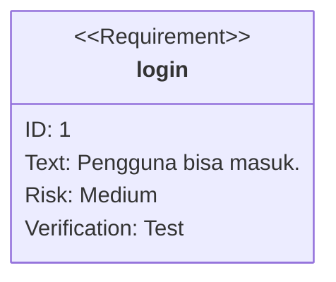
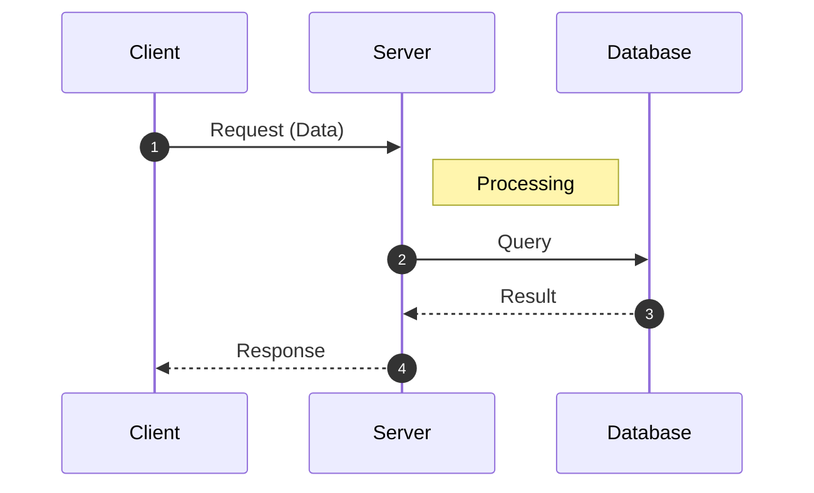
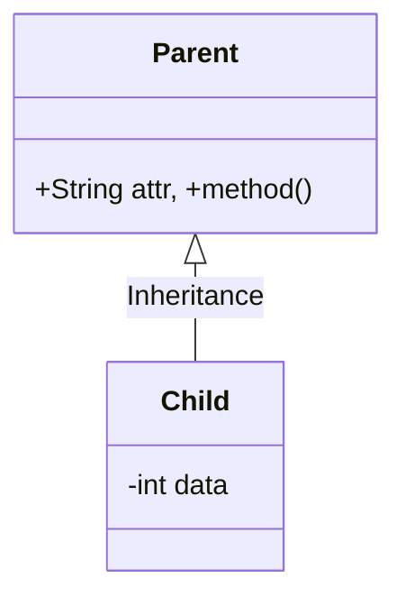
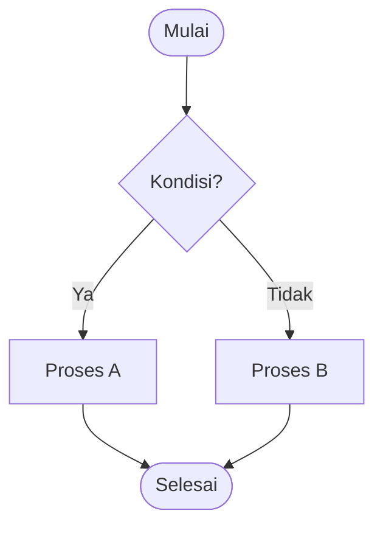
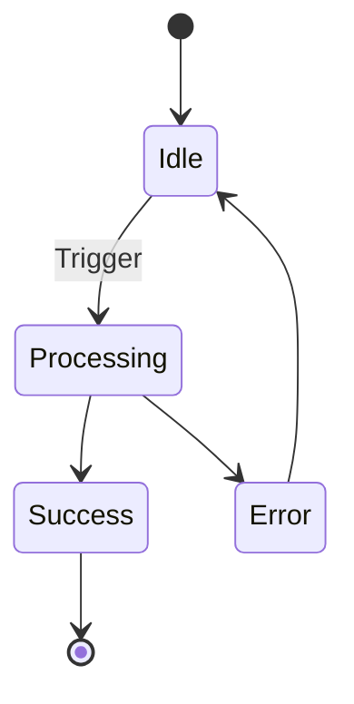

# [Mata Kuliah] | Sesi [N]: [Judul Sesi]

> **Mata Kuliah:** [Nama MK] | **Sesi:** [N] | **Status:** [Materi UTS/UAS/Tugas]

---

## 🔑 Cues
- [Keyword 1]
- [Keyword 2]
- [Keyword 3]

---

## 📖 Materi Utama

### 1. [Topik Utama 1]
- [Poin materi penting dari PPT/Foto]
- [⚠️ PENTING: Tuliskan informasi langsung dari gambar/slide seolah-olah teks narasi biasa.]

#### **[Visualisasi Konsep]**
[Pilih salah satu template diagram di bawah sesuai kebutuhan materi]

---

## Library Diagram & Arsitektur
> Aturan pipeline: hanya tipe mermaid **valid** yang bisa di-render jadi gambar
> (fallback = blok kode + warning). `useCaseDiagram` **tidak valid** di Mermaid.

### 1. Requirement Diagram (pengganti use case)


### 2. Sequence Diagram


### 3. Class Diagram


### 4. Flowchart / Alur Proses


### 5. State Diagram


### 6. ER Diagram (Database)
```mermaid
erDiagram
    USER ||--o{ ORDER : "places"
    USER { string id PK, string name }
    ORDER { int order_id PK, string status }
```

---

## 🛠️ Use Case / Implementasi Nyata
- **Skenario:** [Contoh nyata]
- **Masalah yang Diatasi:** [Problem]
- **Keuntungan:** [Benefit]

---

## 🗂️ Konsep Kunci

| Istilah | Definisi | Contoh / Catatan |
|---------|----------|-----------------|
| [Term] | [Definisi] | [Notes] |

---

## 📊 Tabel Ringkasan
[Gunakan untuk perbandingan atau ringkasan data teknis]

---

## ⚠️ Catatan Penting
> **[Insight Penting]** — Hal krusial yang sering muncul di ujian.

---

## 📝 Materi Tambahan (Visual Insights)
- [Detail tambahan hasil scan media visual]
#### [Sub-heading Detail]
- [Poin tambahan]

---

## ✅ Standar Visual & Orisinalitas (bar jual — wajib untuk semua catatan)

- **Sintesis orisinal**: struktur, diagram, dan contoh milik sendiri. Sumber (materi aslab/dosen) hanya referensi fakta. Jangan cerminkan urutan langkah, nama contoh, atau naskah sumber.
- **Satu diagram ter-render per catatan** (minimal): tulis diagram sebagai fence ` ```mermaid ` bertipe valid (`flowchart`/`graph`/`sequenceDiagram`/lainnya inti); pipeline import me-render jadi gambar + menyimpan sumber di toggle. Diagram gagal render = fallback blok kode + warning (perbaiki, jangan biarkan). Jebakan: tanda `-` di dalam nilai `text:` requirementDiagram merusak parser — tulis ulang tanpa hubung (`waktu nyata`, bukan `real-time`).
- **Konsistensi visual**: judul `# MK | Sesi N: Judul`, callout pembuka, cues ≤15 dalam toggle, tabel selalu ber-header, blok kode ≤2000 char (lebih = pecah), ikon + cover judul terisi otomatis saat import.
- **Jujur provenance**: bila sumber hanya kerangka/tanpa isi, tulis di Sumber bahwa isi disusun dari dokumentasi umum.
